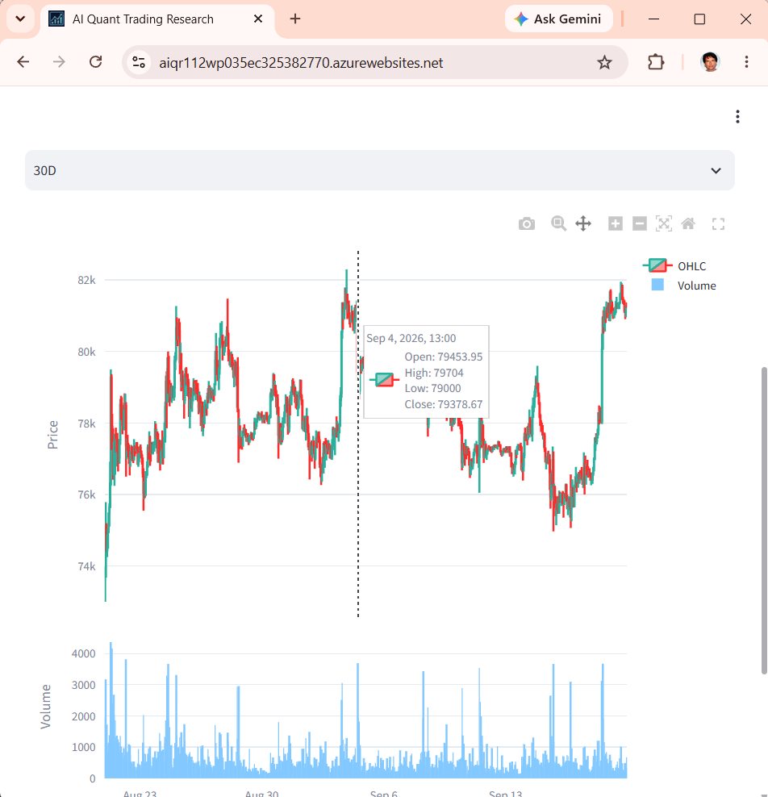
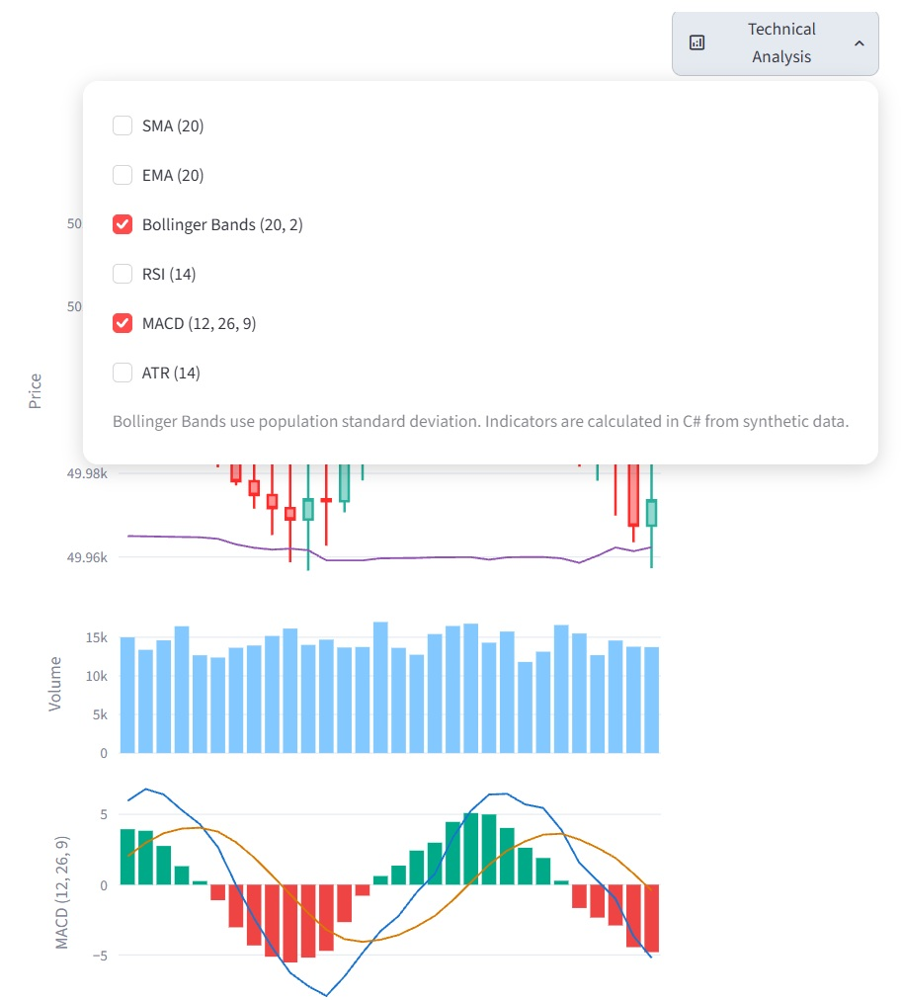
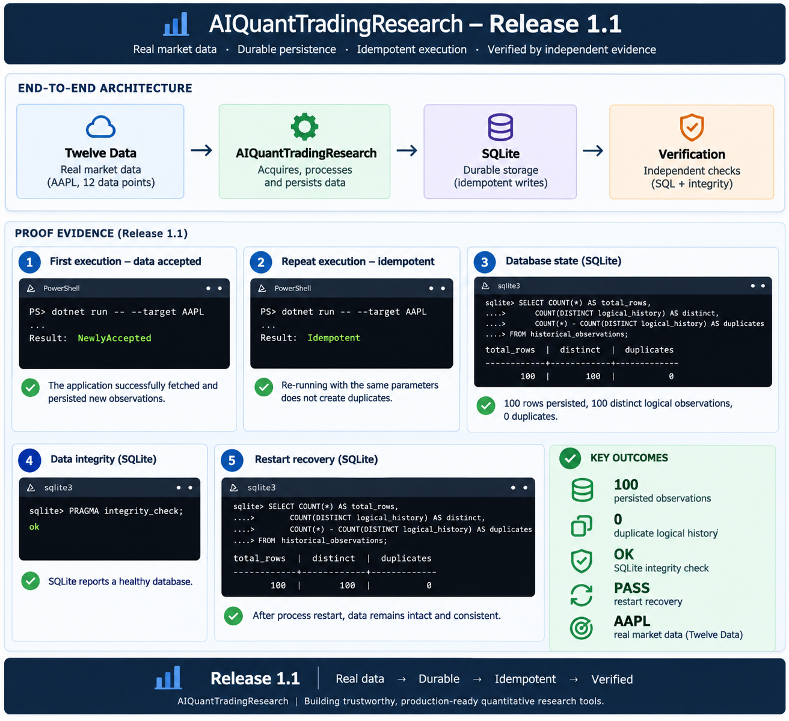

# AIQuantTradingResearch

> A production-oriented quantitative research and platform-engineering project built around deterministic market-data pipelines, durable evidence, governed .NET/Python interoperability, observability, and reproducible public-reference deployment.

[](https://github.com/samuel-santos-engineer/AIQuantTradingResearch/milestone/65)
[](https://github.com/samuel-santos-engineer/AIQuantTradingResearch/tree/main/tests)
[](https://github.com/samuel-santos-engineer/AIQuantTradingResearch/tree/main/tests/AIQuantTradingResearch.Architecture.Tests)
[](https://dotnet.microsoft.com/)
[](docs/guides/PYTHON_DEVELOPER_ENVIRONMENT.md)
[](Dockerfile)
[](LICENSE)

AIQuantTradingResearch demonstrates how quantitative research capability can evolve as a maintainable software platform. Architecture, executable quality gates, incremental delivery, transparent technical decisions, and disciplined AI-assisted engineering are treated as part of the product.

### Platform

At the accepted Release 1.14 publication, the synthetic showcase was deployed to two Azure App Service F1 regions using the same qualified immutable image. This records the accepted deployment baseline, not a promise that staging and production always run identical versions.

The **Production Environment** is the primary public endpoint. The **Staging Environment** is a separate-region validation target and may run a different candidate during future development. When it hosts the accepted showcase, it can also provide a manually selected alternate endpoint; there is no automatic failover or availability SLA.

- **Production Environment - West Central US:**
  https://aiqr112wp035ec325382770.azurewebsites.net/

- **Staging Environment - West US 2:**
  https://aiqr112wp05wus27f5eabb5.azurewebsites.net/

Any future promotion requires separate authorization and exact-image qualification. The accepted deployment is recorded in the [Release 1.14 publication evidence](docs/roadmap/release-1.14/prompters/release-1.14-c2b-37-production-publication-evidence.md).

The project is intentionally broader than a collection of trading algorithms or ML experiments. It demonstrates how market-data capabilities can be designed as a maintainable software platform while creating a foundation for later quantitative analytics, AI/ML research, observability, resilience, and cloud-native operation.

**Current closed milestone:** **[Phase 4 - Release 1.14: Technical Analysis & Quantitative Feature Foundation](https://github.com/samuel-santos-engineer/AIQuantTradingResearch/milestone/65)**

**Current accepted milestone:** **[Phase 4 - Release 1.15: Historical Crypto Chart and Research Interface  — IN PROGRESS](https://github.com/samuel-santos-engineer/AIQuantTradingResearch/milestone/66)**

[What Works Today](#what-works-today) · [Architecture](#architecture) · [Run &amp; Verify](#run--verify) · [Engineering Evidence](#engineering-evidence) · [Implemented Technology](#implemented-technology) · [Roadmap](#engineering-capability-journey) · [Engineering Handbook](#engineering-handbook)

---

## What Works Today

**Release 1.14 status:** The synthetic chart showcase is accepted and published to both Azure environments, and milestone #65 is closed. It delivers deterministic BTC-like simulated candlesticks and volume, all 12 interval/range combinations, UTC labeling, hover, zoom/pan, System Health, and six technical indicator families: SMA(20), EMA(20), Bollinger Bands(20,2), RSI(14), MACD(12,26,9), and ATR(14). Indicators are computed offline in C# and delivered through a checksummed immutable handoff; raw public data APIs remain disabled. Showcase acceptance does not certify legacy WP07 isolation. The Release 1.15 historical BTC/USD and ETH/USD interface and Release 2.0 machine-learning evaluation remain planned work.

The following release history describes capabilities delivered at each milestone; historical provider-backed paths are distinct from the current synthetic public runtime.

- **Acquisition & Persistence (v1.1):** High-fidelity Twelve Data ingestion to SQLite.
- **Dataset Snapshots (v1.2):** Bounded `[from, to)` datasets tied to deterministic SHA-256 identities.
- **Research Pipeline (v1.3):** Structured 5-stage orchestration from retrieval to registration.
- **Feature Generation (v1.4):** Pure mathematical extraction (`simple-return-lag-1-v1`) over immutable states.
- **Experiment Metrics (v1.5):** Descriptive aggregate computations (mean, min, max).
- **Durable Evidence (v1.6):** Schema v3 persistence mapping outcomes to `NewlyAccepted` or `IntegrityConflict` states.
- **Evidence Discovery (v1.7):** Mandatory bounded discovery (`MaximumResultCount`) returning ordered binary-sorted collections.
- **Python Engineering Foundation (v1.8):** Isolated CPython scientific-stack tooling with a governed and tested one-shot JSON-over-stdio interoperability boundary while .NET remains the canonical pipeline owner.
- **Governed Real-Time-Style Visualization (v1.9):** Canonical .NET visualization read model with atomic JSON handoff to Python/Streamlit, deterministic/replay/simulated provenance disclosure, and truthful `Ready` / `WarmUp` / `Empty` / `Failed` presentation states.
- **OpenTelemetry & Pipeline Observability (v1.10):** OpenTelemetry-based pipeline and boundary observability with truthful Streamlit System Health diagnostics while preserving existing .NET, Python, persistence, and visualization ownership boundaries.
- **Public Reference Deployment Feasibility (Initiative-1.11):** Azure App Service Linux F1 feasibility qualification completed as **FEASIBLE**, validating a public Docker/GHCR reference-deployment path with HTTPS, persistent `/home`, writable SQLite using DELETE journal mode, and a strict `$0.00` recurring-infrastructure-cost boundary.
- **Public Reference Deployment & Stabilization (v1.12):** The accepted West US 2 reference target uses Linux F1/Free, a public GHCR immutable image, persistent `/home`, SQLite schema v4 with DELETE journal mode, bounded Twelve Data configuration, and public Streamlit/System Health. Resilience and recovery follow the governed regional order West Central US (historical evidence) → West US 2 → Central US → South Central India, with fresh capacity proof and independently configured runtime secrets for any recovered target.
- **Historical Market Visualization & Provider Abstraction (v1.13):** Introduced provider-independent historical-read contracts, a Vike adapter, cache-first reads, canonical OHLCV provenance, and the earlier BTC/USD and ETH/USD research interface. These are historical Release 1.13 capabilities; Vike is not the current synthetic showcase's data source or the Release 1.15 target provider.
- **Technical Analysis & Quantitative Feature Foundation (v1.14):** Delivered the synthetic candlestick/volume showcase, all 12 selections, six offline C# indicator families, immutable handoff validation, System Health, and qualified Linux image publication. See the detailed milestone section below.

Earlier private/provider-backed research capabilities connect Twelve Data, SQLite, Application-owned datasets, features, experiments and durable evidence. The deployed Release 1.14 public showcase instead reads immutable synthetic assets generated offline in C#; it does not run provider ingestion, a live C# Worker or a private SQLite store for chart requests. Release 1.15's supervised private ingestion service is a planned runtime, not a description of that deployed image.

> Azure hosts a bounded public reference/demo deployment. F1 has shared capacity, cold starts, throttling, a 60 CPU-minute daily allowance, 1 GB storage, and no SLA. This is not production hosting or production trading architecture.

### [Release 1.1: Market Data Persistence Foundation](https://github.com/samuel-santos-engineer/AIQuantTradingResearch/milestone/52)

Establish durable, provider-independent historical market-data persistence so normalized observations can be stored, reconstructed, retrieved, and reused deterministically while storage technology remains confined to Infrastructure.

Release 1.1 completes the first provider-backed, durable historical market-data vertical slice.

```text
Twelve Data
    │
    ▼
Infrastructure provider adapter
    │
    ▼
Application use cases
    │
    ├──────────────► Domain model
    │
    ▼
Infrastructure persistence adapter
    │
    ▼
SQLite
```

The current implementation can:

- Acquire historical market observations through the Twelve Data provider integration.
- Keep provider and storage details outside the Domain and Application layers.
- Persist historical observations durably in local SQLite storage.
- Retrieve historical observations deterministically in ascending chronological order.
- Preserve exact target, timestamp/offset, and decimal-value fidelity across persistence.
- Distinguish newly accepted, idempotent, and conflicting persistence outcomes.
- Preserve immutable accepted history and atomic write behavior.
- Map controlled storage failures through Application-owned failure contracts.
- Compose acquisition and persistence through an externally configured Worker execution root.
- Validate architectural boundaries with executable architecture tests.

### [Release 1.2: Research Dataset Foundation](https://github.com/samuel-santos-engineer/AIQuantTradingResearch/milestone/53)

Establish deterministic, versioned, reproducible, and discoverable research datasets with bounded metadata,
provenance, lineage, and catalog capabilities by reusing Release 1.1 durable historical observations.

Release 1.2 builds on Release 1.1 historical observations. It materializes one
exact-target, `[from,to)` research dataset definition into immutable SQLite
snapshot/catalog evidence. Definitions are ordered by semantic instant; empty
selection is valid; original offsets and decimal values are preserved. The
`aiq-dataset-identity-v1` scheme uses deterministic SHA-256-backed identities
for the definition, research dataset, source state, and snapshot; the snapshot
identity is also the immutable dataset version. Re-running equivalent evidence
is recognized without overwrite, while conflicts remain explicit.

Release 1.2 established the externally configured bounded dataset execution using
`Persistence:DatabasePath`, `Dataset:Target`, `Dataset:From`, and `Dataset:To`.
It remains the persistence foundation composed by Release 1.3.

### [Release 1.3: Research Pipeline Foundation](https://github.com/samuel-santos-engineer/AIQuantTradingResearch/milestone/54)

Deliver a deterministic fixed one-shot research pipeline by reusing persisted Release 1.1 historical observations
and Release 1.2 dataset materialization, snapshot, and catalog capabilities.

Release 1.3 composes persisted historical observations and the Release 1.2
dataset foundation into one fixed, deterministic, five-stage pipeline:
historical observation retrieval, dataset materialization, immutable snapshot
persistence, catalog registration, and structured result/evidence. Application
owns pipeline contracts, identities, orchestration, validation, and semantic
evidence; Infrastructure owns provider and SQLite mechanics; Worker remains the
outer one-shot composition and trigger boundary.

The `aiq-pipeline-identity-v1` definition and semantic execution identities are
distinct from `aiq-dataset-identity-v1`. Equivalent reruns preserve semantic
execution identity while reporting `NewlyAccepted` or `EquivalentExisting` as
non-identity-bearing dispositions. Empty datasets are valid successes. Failures
stop at the first failing stage and expose only established upstream evidence.
Live acquisition is not a pipeline stage, and the release adds neither schema
evolution nor durable pipeline run history.

### [Release 1.4: Deterministic Feature Engineering Foundation](https://github.com/samuel-santos-engineer/AIQuantTradingResearch/milestone/45)

Deliver a deterministic, one-shot Feature Engineering Foundation over canonical Release 1.2 dataset snapshots.
The only built-in computation is simple-return-lag-1-v1. Application owns feature semantics and orchestration;
output is in-memory and SQLite remains schema version 2. Feature persistence/catalog/cache, plugins,
generalized DAGs, scheduling, retries, live acquisition, model training, and MLOps are excluded.

Release 1.4 adds one separate, deterministic feature-generation use case over
an exact accepted immutable snapshot. The sole built-in definition is
`simple-return-lag-1-v1`, with decimal result `r[i] = (p[i] / p[i-1]) - 1`.
Application owns feature identities, provenance, validation, exact snapshot
lookup, and computation; Infrastructure reuses snapshot storage without feature
persistence; Worker selects feature mode, executes once, presents bounded
evidence, and exits. `aiq-feature-identity-v1` keeps distinct deterministic
Feature Definition and Feature Set identities bound to the exact snapshot and
version. Empty and single-observation snapshots are successful empty feature
sets. This is not a sixth Release 1.3 pipeline stage, a provider acquisition
path, or a feature engine.

At the Release 1.4 boundary SQLite remains schema version 2. No feature table, catalog, cache, scheduler,
retry loop, or durable feature run history exists.

### [Release 1.5: Deterministic Research Experiment Foundation](https://github.com/samuel-santos-engineer/AIQuantTradingResearch/milestone/46)

Establish one deterministic offline research experiment over accepted simple-return feature evidence,
producing immutable count, arithmetic mean, minimum, and maximum evidence with canonical experiment identity and provenance.

Release 1.5 adds one separate deterministic experiment over an exact accepted
`simple-return-lag-1-v1` Feature Set: `simple-return-descriptive-summary-v1`.
Application owns immutable experiment contracts, validation, decimal summary
computation, Feature Set-to-Experiment provenance/lineage, and distinct
`aiq-experiment-identity-v1` definition/result identities. Empty Feature Sets
succeed with count zero and absent aggregates; non-empty evidence contains exact
count, arithmetic mean, minimum, and maximum. Results are in-memory only and
remain bound to the exact Feature Set/snapshot evidence.

Worker selects Experiment mode only when `Experiment:SnapshotIdentity` or
`Experiment:SnapshotVersion` is present; that explicit mode takes precedence
over Feature mode, which takes precedence over the existing five-stage pipeline.
Partial Experiment configuration fails without fallback. Experiment execution
does not acquire provider data, persist results, create experiment tables, or
alter SQLite schema v2.

### [Release 1.6: Durable Experiment Evidence Foundation](https://github.com/samuel-santos-engineer/AIQuantTradingResearch/milestone/47)

Make accepted deterministic Experiment Result evidence durably persistent and exactly retrievable while preserving Release 1.5 semantics through atomic SQLite schema v2→v3 evolution, with no Feature Set persistence, generalized registry/history.

Release 1.6 persists accepted `simple-return-descriptive-summary-v1` Experiment Result evidence in schema v3. `experiment_results` is the single immutable durable-result table. Its exact `aiq-experiment-identity-v1` result identity is the lookup key: first acceptance is `NewlyAccepted`, equivalent reacceptance is `EquivalentExisting`, and contradictory same-identity evidence is `IntegrityConflict`. Exact lookup is read-only and returns durable reduced evidence or `NotFound`; it neither regenerates Feature Values nor calls a provider.

The explicit Durable Experiment Worker mode uses `DurableExperiment:SnapshotIdentity` and `DurableExperiment:SnapshotVersion`, with precedence Durable Experiment → Experiment → Feature → five-stage pipeline. Partial durable intent fails without fallback. Feature Set persistence, experiment registry/history/search, update/delete, retry, and provider acquisition remain deferred.

### [Release 1.7: Durable Experiment Evidence Discovery](https://github.com/samuel-santos-engineer/AIQuantTradingResearch/milestone/55)

Bounded deterministic discovery of immutable durable Experiment Result evidence by exact Dataset Snapshot and Experiment Definition context from Release 1.6. Preserves SQLite schema v3.

Release 1.7 adds read-only bounded discovery of accepted durable Experiment
Results for one exact Snapshot Identity and Experiment Definition Identity.
`DurableExperimentDiscovery:MaximumResultCount` is mandatory and positive;
matches are ordered by binary Experiment Result Identity ascending, and no
matches return a successful immutable empty collection rather than `NotFound`.
Discovery reuses `aiq-experiment-identity-v1` and complete durable evidence
without generating, accepting, changing, or repairing Experiment Results.

The Worker selects Discovery before Durable Experiment, Experiment, Feature,
and the fixed pipeline. Partial or malformed discovery intent fails without
fallback. Discovery remains schema-v3 read-only over `experiment_results`, uses
no provider or network fallback, and adds no registry, history, search,
pagination, new index, or persistence mutation.

### [Release 1.8: Python & AI Engineering Foundation](https://github.com/samuel-santos-engineer/AIQuantTradingResearch/milestone/56)

Establish a governed Python 3.13 engineering foundation alongside the existing .NET research platform, enabling scientific-computing interoperability without transferring pipeline ownership, persistence responsibility, or application orchestration to Python.

Release 1.8 introduces an isolated CPython scientific-stack environment and a
tested one-shot JSON-over-stdio interoperability boundary. .NET remains the
canonical owner of application orchestration and invokes Python through an
Infrastructure-owned adapter using explicit request/response contracts. Python
executes only within that bounded invocation and does not become an alternative
research pipeline or application host.

The integration establishes deterministic serialization, process execution,
response parsing, validation, timeout and failure handling, and clean process
termination. Python dependencies are explicitly pinned and independently
validated, providing a reproducible foundation for later quantitative,
visualization, and machine-learning capabilities without coupling the Domain or
Application layers to the Python runtime.

Release 1.8 does not introduce model training, machine learning, backtesting,
live trading, Python-owned persistence, direct SQLite access from Python, a
parallel research pipeline, or long-running Python process supervision. The
JSON-over-stdio boundary remains a distinct interoperability mechanism owned and
controlled by .NET.

### [Release 1.9: Real-Time Financial Data Visualization](https://github.com/samuel-santos-engineer/AIQuantTradingResearch/milestone/58)

Deliver governed real-time-style financial-data visualization through a canonical .NET-owned visualization read model and atomic JSON handoff consumed by read-only Python 3.13 and Streamlit presentation code.

Release 1.9 adds a distinct visualization path while preserving the established
research architecture. .NET owns construction of the canonical visualization
read model and publishes it through an atomic JSON handoff. Python parses that
contract into presentation-oriented frames, while Streamlit remains a
read-only visualization surface rather than an application, persistence,
provider, or process-supervision boundary.

The visualization contract exposes truthful `Ready`, `WarmUp`, `Empty`, and
`Failed` states and preserves explicit provenance for deterministic, replay,
and simulated data. Simulated or replayed observations are never represented as
live market activity. The handoff is designed for safe concurrent publication
and consumption, including bounded atomic-replacement behavior on Windows.

Release 1.9 keeps the visualization JSON handoff separate from the Release 1.8
one-shot JSON-over-stdio interoperability boundary. Streamlit does not access
SQLite or market-data providers directly, supervise the .NET Worker, or create
an alternative research pipeline. The release establishes governed
real-time-style visualization, not live trading or an execution platform.

### [Release 1.10: OpenTelemetry & Pipeline Observability](https://github.com/samuel-santos-engineer/AIQuantTradingResearch/milestone/59)

Establish governed OpenTelemetry-based observability across the research pipeline and cross-language boundaries, with truthful System Health diagnostics exposed through the existing read-only Streamlit presentation surface.

Release 1.10 adds structured observability without changing ownership of the
research pipeline or creating a parallel execution path. .NET remains the
canonical pipeline owner and emits governed telemetry across application,
infrastructure, persistence, visualization, and Python interoperability
boundaries. OpenTelemetry provides the instrumentation foundation while
preserving deterministic execution semantics and existing architectural
separation.

The canonical visualization handoff is extended with truthful System Health
evidence consumed by Python 3.13 and Streamlit. Health presentation distinguishes
operational states without allowing Streamlit to supervise the Worker, access
SQLite directly, invoke providers, or become an execution authority. Existing
deterministic, replay, and simulated provenance remains explicitly disclosed and
is never represented as live trading.

Release 1.10 preserves SQLite schema v4, the one-shot JSON-over-stdio Python
interoperability boundary, and the independent canonical JSON visualization
handoff. It introduces no live trading, model training, backtesting, provider
ownership changes, direct SQLite UI access, or parallel research pipeline.

### [Initiative-1.11: Public Reference Deployment / Azure App Service F1 Feasibility Qualification](https://github.com/samuel-santos-engineer/AIQuantTradingResearch/milestone/62)

Qualify whether the existing governed application can operate as a publicly accessible reference deployment on Azure App Service Linux F1 while preserving its architecture, SQLite persistence model, provider boundaries, truthful provenance, and a strict zero-recurring-infrastructure-cost constraint.

Initiative-1.11 validated Azure App Service Linux F1 in West Central US with a
custom Docker container, public HTTPS/DNS, persistent `/home`, writable SQLite
using DELETE journal mode, public/free GHCR image distribution, and bounded
authenticated Twelve Data connectivity. Persistence, restart/redeployment
behavior, CRUD integrity, contention handling, provider-secret isolation,
failure behavior, and public deployment connectivity were exercised as part of
the feasibility qualification.

The initiative concluded:

`AZURE APP SERVICE F1 REFERENCE DEPLOYMENT: FEASIBLE`

with observed recurring infrastructure cost:

`ACTUAL RECURRING INFRASTRUCTURE COST: $0.00`

This qualification is explicitly a reference/demo deployment boundary rather
than a production hosting claim. Azure remains an external deployment target,
not an application dependency, and the result does not introduce a production
SLA, paid Azure services, Azure SQL, Azure Container Apps, Azure Files,
mandatory ACR, live trading, or architectural bypasses.

**Initiative-1.11 is not Product Release 1.11.** Product Release 1.11 remains
abandoned/nonexistent; the feasibility evidence from this initiative is consumed
by Release 1.12 Public Reference Deployment Implementation & Stabilization.

### [Release 1.12: Public Reference Deployment Implementation & Stabilization](https://github.com/samuel-santos-engineer/AIQuantTradingResearch/milestone/63)

Release 1.12 completes the reproducible, bounded public reference/demo deployment lifecycle. It preserves the .NET-owned pipeline, canonical JSON handoff, read-only Streamlit presentation boundary, SQLite persistence model, and runtime-only provider-secret handling established by earlier releases.

The accepted West US 2 Azure App Service Linux F1/Free reference target uses a public GHCR immutable image, public HTTPS/DNS, persistent `/home/data/aiquant.db`, SQLite schema v4 with DELETE journal mode, bounded Twelve Data configuration, and truthful Streamlit/System Health presentation. WP01-WP08 are accepted and lifecycle-complete; Release 1.12 is published as `v1.12.0`.

Release 1.12 also governs constrained-infrastructure resilience and recovery through the regional order West Central US (historical evidence) → West US 2 → Central US → South Central India. Each recovered target requires fresh capacity proof and independently configured runtime secrets; this is bounded recovery governance, not automatic failover, production HA, or an SLA claim.

### [Release 1.13: Historical Market Visualization & Provider Abstraction](https://github.com/samuel-santos-engineer/AIQuantTradingResearch/milestone/64)

Release 1.13 completed the earlier provider-independent historical market-data and public research-visualization lifecycle. It preserves the .NET-owned pipeline and bounded local Worker/stdio bridge while adding cache-first historical reads, safe canonical OHLCV handoff, and controlled public states.

The historical Release 1.13 public surface supported BTC/USD and ETH/USD historical research with 1h, 4h, and 1d intervals; 1D, 7D, 30D, and 90D ranges; candlesticks, distinct volume, hover inspection, and bounded zoom/pan. Vike was its server-side historical-data adapter, with Twelve Data retained for private research. Release 1.14 subsequently adopted the synthetic showcase and delivered technical indicators; Release 1.15 now plans private Twelve Data ingestion and transformed public snapshots. ML evaluation remains Release 2.0 scope.

### [Release 1.14: Technical Analysis & Quantitative Feature Foundation](https://github.com/samuel-santos-engineer/AIQuantTradingResearch/milestone/65)

Release 1.14 completes the technical-analysis foundation for the adopted synthetic chart showcase. It preserves C# ownership of deterministic calculations and the read-only Python presentation boundary, computing indicators offline over a full calculation window with 250 hidden warmup candles before projecting visible results into a checksummed immutable handoff.

The accepted interface presents clearly labeled BTC-like simulated candlesticks and volume across 1h/4h/1d intervals and 1D/7D/30D/90D ranges. SMA(20), EMA(20), and population Bollinger Bands(20,2) appear as price overlays; Wilder RSI(14), MACD(12,26,9) with signal/histogram, and Wilder ATR(14) use separate labeled panels. Technical Analysis toggles, UTC timestamps, hover, zoom/pan, the Plotly toolbar, and System Health remain available without Python indicator recalculation or real-market data claims.

The same qualified immutable Linux/amd64 image is published to staging and production on Azure App Service F1, and milestone #65 is closed. Final focused Linux evidence records 63 C# and 43 Python tests passing, together with browser checks for all 12 selections and the public API boundaries. Raw public data APIs remain disabled; the owner-accepted viewport reset on indicator toggles remains a known UX limitation. Showcase acceptance does not certify legacy WP07 isolation or Azure capacity, and `PUBLIC_RUNTIME_VERIFIED=False` remains unchanged. Historical BTC/USD and ETH/USD research and machine-learning evaluation remain separate Release 1.15 and Release 2.0 work.


| Evidence                          | Recorded baseline and Release 1.14 gates |
| ----------------------------------- | -------------------------------: |
| Recorded automated gate passes    |                **610 passing** |
| Domain tests                      |                 **11 passing** |
| Application tests                 |                **168 passing** |
| Architecture tests                |                 **27 passing** |
| Infrastructure tests              |                **238 passing** |
| Focused Vike tests                |                 **24 passing** |
| Python presentation tests         |                 **36 passing** |
| [Focused Linux tests (Release 1.14)](docs/roadmap/release-1.14/prompters/release-1.14-c2b-37-production-publication-evidence.md) | **106 passing** |
| Release 1.13 build warnings        |                          **0** |
| Release 1.13 build errors          |                          **0** |
| Release 1.13 canonical verification |                      **PASS** |

The 610 total combines the 504 established baseline gate checks with 106 focused Linux checks (63 C# and 43 Python). Test scopes may overlap; this is recorded gate evidence, not a new full-suite run or a count of unique test cases. The other baseline rows retain their Release 1.13 results; their zero-warning result is not a claim that Release 1.14 qualification was warning-free.

### Release 1.13 chart showcase

The public Market Research experience presents historical OHLCV data with candlestick price action, a separate volume panel, and hover inspection.



### Release 1.14 technical analysis showcase

The synthetic Market Research chart adds a native Technical Analysis popover for six C#-computed indicator families. This view shows Bollinger Bands over simulated candlesticks, a separate volume panel, and MACD line, signal, and histogram below the price chart.



### Release 1.1 showcase

Release 1.1 is a foundation, not a claim that the full quantitative trading vision is complete. Streaming/live feeds, provider failover, trading execution, AI/ML models, APIs, scheduling, advanced resilience, and production deployment remain future capabilities.

The completed vertical slice has also been exercised manually against real AAPL market data and independently inspected at the SQLite boundary. The evidence demonstrates durable persistence, idempotent repeat execution, zero duplicate logical history, database integrity, and restart recovery.



For reproducible steps behind this evidence, see the **[Platform Execution & Verification Guides](docs/guides/README.md)**.

---

## Architecture

The solution uses explicit dependency direction and layer ownership.

```text
Domain          → none
Application     → Domain
Infrastructure  → Application
Worker          → Application, Infrastructure
```

### Layer responsibilities


| Layer                | Responsibility                                                                                            |
| ---------------------- | ----------------------------------------------------------------------------------------------------------- |
| **Domain**           | Quantitative concepts and invariants without provider, storage, deployment, or presentation dependencies. |
| **Application**      | Use cases, contracts, identities, orchestration, and semantic evidence.                                   |
| **Infrastructure**   | Twelve Data, SQLite, telemetry adapters, and the governed local Python process boundary.                  |
| **Worker**           | Composition and bounded execution of the canonical .NET pipeline.                                         |
| **Python/Streamlit** | Read-only consumption and presentation of governed handoff evidence.                                      |

.NET remains the canonical pipeline owner. Streamlit does not directly own provider access, SQLite access, or Worker supervision. The Release 1.8 JSON-over-stdio interoperability boundary and Release 1.9 visualization handoff remain distinct governed contracts. Azure is deployment-only and introduces no Domain or Application dependency.

### Current solution structure

```text
AIQuantTradingResearch.slnx
├── src/
│   ├── AIQuantTradingResearch.Domain
│   ├── AIQuantTradingResearch.Application
│   ├── AIQuantTradingResearch.Infrastructure
│   └── AIQuantTradingResearch.Worker
└── tests/
    ├── AIQuantTradingResearch.Domain.Tests
    ├── AIQuantTradingResearch.Application.Tests
    ├── AIQuantTradingResearch.Infrastructure.Tests
    └── AIQuantTradingResearch.Architecture.Tests
```

The architecture test suite makes dependency direction, ownership, visibility, provider confinement, storage independence, and acyclicity executable rather than relying only on documentation.

---

## Run & Verify

### Start Here - Run the Synthetic Showcase in Linux Docker

The current public showcase uses bundled synthetic data and requires no provider API key or private database. From the repository root, with Docker configured for Linux containers:

```bash
docker build --platform linux/amd64 --target synthetic-candidate -t aiq-synthetic-preview .
docker run --rm --name aiq-synthetic-preview --publish 127.0.0.1:8501:8501 --read-only --tmpfs /tmp:rw,noexec,nosuid,size=32m --cap-drop ALL --cap-add SETUID --cap-add SETGID --security-opt no-new-privileges --cpus 1 --memory 512m --memory-swap 512m --pids-limit 64 --env AIQ_RUNTIME_MODE=public-synthetic aiq-synthetic-preview
```

Open **http://127.0.0.1:8501** after startup. Use an unused local port/container name if these are already occupied. Stop the foreground command with Ctrl+C; `--rm` removes that owned container. The fixed bootstrap drops to the non-root presentation identity before serving the application.

These commands are a local preview, not a new acceptance certificate or permission to publish/deploy the resulting image. Release qualification must exercise the exact Linux image, record its immutable digest, and satisfy the separately approved test/browser/resource gates.

For the separate private/provider-backed research path, see [Local Platform Execution](docs/guides/LOCAL_PLATFORM_EXECUTION.md) and the [Platform Execution & Verification Guides](docs/guides/README.md). Those historical guides cover acquisition, persistence and recovery; they are not the synthetic public quickstart or authorization to activate the planned Release 1.15 service.

### Prerequisites

The Dockerfile pins the Linux build/runtime bases and installs the existing Python dependencies under `requirements-linux.lock`. Docker builds the offline C# assets; a host .NET/Python installation is not required for the synthetic preview. For separate contributor and private-research tooling, use the .NET SDK pinned by `global.json`.

Release 1.8 also uses machine CPython **3.13.15** as the base runtime and an
ignored, disposable repository-local `.venv` for every project dependency.
The five direct pins are NumPy 2.5.1, pandas 3.0.5, scikit-learn 1.9.0,
Streamlit 1.61.1, and Plotly 7.1.0.
See the [Python developer environment guide](docs/guides/PYTHON_DEVELOPER_ENVIRONMENT.md)
and the [interoperability boundary](docs/architecture/design/DOTNET_PYTHON_INTEROPERABILITY.md).
The current Streamlit product application presents the synthetic chart and System Health. There is no delivered product ML model or training workflow; lightweight ML evaluation remains separately planned for Release 2.0.

For historical/private provider-backed execution only, configuration is supplied externally. None of these credentials is required for the synthetic preview; the Release 1.15 configuration contract remains separately governed:
- `Vike:ApiKey` - historical Release 1.13 adapter configuration only; not the current showcase or Release 1.15 target.
- `TwelveData:ApiKey` — Twelve Data API key.
- `Persistence:DatabasePath` — local SQLite database path.
- `Dataset:Target`, `Dataset:From`, and `Dataset:To` — explicit dataset input;
  timestamps use invariant round-trip `DateTimeOffset` values.
- `Experiment:SnapshotIdentity`, `Experiment:SnapshotVersion` — exact
  immutable snapshot/version input for the code-owned experiment definition.
- `DurableExperimentDiscovery:SnapshotIdentity`,
  `DurableExperimentDiscovery:ExperimentDefinitionIdentity`, and
  `DurableExperimentDiscovery:MaximumResultCount` — exact bounded
  read-only durable-evidence discovery input; all three are mandatory.

Secrets and environment-specific paths should not be committed to the repository.

### Contributor Tooling and Release Verification

The existing PowerShell scripts are contributor/legacy engineering utilities, not native-host release certification. From the repository root:

```powershell
./eng/restore.ps1
./eng/format.ps1
./eng/build.ps1
./eng/test.ps1
./eng/verify.ps1
```

Optional cleanup:

```powershell
./eng/clean.ps1
```

`format.ps1` verifies formatting without rewriting files. `verify.ps1` is the canonical quality gate and delegates the repository restore, formatting verification, build, and test workflow.

A shell build counterpart is available at `eng/build.sh`. Release qualification still requires tests and browser checks against the actual Linux/amd64 Docker image; neither helper alone certifies the public runtime.

The container is defined by [Dockerfile](Dockerfile). Release 1.12 deployment automation is under [`eng/azure-cli/r1.12-deployment/`](eng/azure-cli/r1.12-deployment/). Credentials, API keys, auth profiles, and machine-local paths must remain outside source control.

The repository validates Domain, Application, Infrastructure, Architecture, and Python behavior through automated suites and canonical engineering scripts. Recorded test counts are summarized in the Evidence table above with their scope. Fresh validation output is authoritative for any new change or release.

### Execution flow — Release 1.15 design

Release 1.15 replaces the former Vike-backed public historical-read path with **Twelve Data through a private C# ingestion and research service**. The following is the planned architecture, not a claim that this runtime is implemented or deployed. The published Release 1.14 synthetic showcase remains unchanged.

```text
One immutable Linux/amd64 Docker image on Azure App Service F1
        |
        v
Minimal PID1 supervisor
        |
        +-- Private C# ingestion/research service (research identity)
        |       |
        |       +-- Twelve Data -> validated completed BTC/USD and ETH/USD 1m candles
        |       +-- Private SQLite -> latest 1,000 retained candles per instrument
        |       +-- C# indicators, trend/regime classification, continuity and recovery
        |       +-- UTC-day HMAC transformation of prices and price-valued indicators
        |       `-- Loopback-only, read-only transformed-snapshot API
        |                                      |
        |                                      v
        `-- Public Streamlit/Plotly service (streamlit identity)
                |
                +-- Validated full/unchanged snapshots and independent status
                +-- 100 / 300 / 1,000 retained-candle presets, volume and indicators
                `-- Public HTTPS/DNS -> browser research interface
```

The private C# service owns provider credentials, bounded quota-aware ingestion, authoritative SQLite commits, private research calculations, checkpoints and recovery evidence. Streamlit receives only validated transformed snapshots through the localhost API; it cannot read private SQLite files, access provider/HMAC secrets, call Twelve Data directly, or recalculate authoritative indicators. Only Streamlit is exposed through public ingress. The supervisor manages both distinct non-root processes with bounded health checks and restart behavior.

Public prices are labeled **transformed educational values, not actual BTC/USD or ETH/USD quotes**. The shared UTC-day transformation applies to OHLC and price-valued indicators; RSI is unchanged. Generation/version/date-aware snapshot validation prevents mixed data, while disconnected sessions retain clearly labeled last-known history. Live follow and Historical Exploration preserve eligible absolute UTC viewports without provider requests from zoom/pan.

This is a separately authorized Release 1.15 implementation and Linux-container qualification target, not automatic provider activation, image promotion or Azure deployment. `PUBLIC_RUNTIME_VERIFIED=False` and the advanced WP07 hold remain unchanged. See the [Release 1.15 design](docs/governance/HISTORICAL_CRYPTO_CHART_AND_RESEARCH_INTERFACE.md) and [execution plan](docs/roadmap/release-1.15/RELEASE_1.15_EXECUTION_PLAN.md). The earlier bounded execution modes below are historical release capabilities, not the proposed dual-process runtime.

Release 1.4 adds a separate bounded feature mode selected by exact
`Feature:SnapshotIdentity` and `Feature:SnapshotVersion`. It resolves the
Application feature use case once over existing snapshot evidence and exits; it
does not invoke Twelve Data, add a pipeline stage, or persist feature output.

Release 1.5 adds an explicit one-shot Experiment mode selected by exact
`Experiment:SnapshotIdentity` and `Experiment:SnapshotVersion`. It invokes the Application experiment use case once over existing Feature Set evidence, emits
bounded semantic result/failure evidence, and terminates. It is not a sixth
pipeline stage, a provider fallback, an experiment registry, or durable history.

Release 1.7 adds an explicit one-shot Durable Experiment Evidence Discovery
mode. It requires exact Snapshot and Experiment Definition identities plus a
positive maximum, invokes the Application discovery use case once, presents
ordered bounded durable evidence (including successful empty results), and
exits. Its precedence is Discovery → Durable Experiment → Experiment →
Feature → pipeline; it does not write SQLite, regenerate evidence, or call a
provider.

Release 1.12 adds the bounded public-reference deployment composition while
preserving those ownership boundaries:

```text
Public HTTPS/DNS -> Azure App Service Linux F1 -> container entrypoint
                                               |- .NET Worker: provider, pipeline, SQLite, JSON handoff
                                               `- Streamlit: read-only presentation and System Health
```

The Worker owns provider access, the application pipeline, persistent
`/home/data/aiquant.db`, and the canonical JSON handoff. Streamlit does not
read SQLite, call providers, or supervise the Worker; after the Worker exits
successfully, the container retains the Streamlit presentation process. This
is a bounded public reference/demo flow, not a production HA or automatic
failover design.

Historically, Release 1.13 introduced provider-independent historical-read
contracts, cache-first behavior, canonical OHLCV provenance/freshness evidence,
and a Vike adapter. That adapter is not part of the Release 1.15 target flow,
which uses private Twelve Data ingestion and transformed snapshots instead.

---

## Engineering Evidence

The platform makes its engineering state inspectable through immutable accepted evidence, deterministic identities and provenance, explicit idempotent/conflict/failure semantics, executable architecture rules, governed process boundaries, OpenTelemetry telemetry, secret-safe deployment automation, and exact Git/lifecycle governance.

AI assists implementation and analysis inside explicit contracts, mutation boundaries, validation gates, and reviewable pull requests. It does not replace architecture, testing, or acceptance evidence.

### Persistence semantics

Release 1.1 establishes explicit behavior for durable historical observations:

- **NewlyAccepted** — a previously unseen observation is durably accepted.
- **Idempotent** — an equivalent observation already exists and does not create duplicate history.
- **Conflict** — the same observation identity exists with incompatible data and accepted history is not destructively replaced.
- **Unavailable** — an accepted infrastructure/storage availability failure.
- **InvalidData** — invalid input or persisted data that cannot satisfy the established contract.

Persistence is designed around immutable accepted history, deterministic retrieval, atomic writes, and explicit fidelity guarantees.

### Testing strategy

The current permanent test baseline covers:

- Domain invariants.
- Application persistence contracts.
- Persistence use-case behavior.
- Twelve Data provider behavior.
- Historical Vike adapter behavior.
- SQLite schema and bootstrap.
- Connection lifecycle.
- Persistence and retrieval semantics.
- Idempotency and conflict behavior.
- Atomic rollback.
- Timestamp/offset/decimal fidelity.
- Storage failure mapping.
- Dependency injection and configuration.
- Fixed pipeline identity, orchestration, validation, failure, and evidence semantics.
- Offline composition and separate one-shot Worker-process validation.
- Read-only bounded durable Experiment Evidence Discovery, including exact
  dual-identity filtering, binary identity ordering, empty success, DI, and
  offline Worker-process routing.
- Executable architecture rules.

SQLite persistence tests use isolated local databases and deterministic cleanup. Provider/network access is not required by the persistence test suite.

### Engineering automation

The `eng/` scripts provide repeatable repository operations for restore, formatting verification, build, tests, canonical verification, and cleanup.

The goal is a repository that can prove its expected engineering state instead of relying on manual inspection alone.

---

## AI-Assisted Engineering Approach

AIQuantTradingResearch is also an experiment in **AI-assisted software engineering as a disciplined engineering workflow**, rather than AI-generated code without governance.

Work is decomposed into bounded releases and work packages. Architecture, contracts, acceptance criteria, repository constraints, tests, and validation gates constrain implementation before a work package is considered complete.

The workflow emphasizes:

```text
Engineering intent
      ↓
Architecture & contracts
      ↓
Bounded work package
      ↓
AI-assisted implementation
      ↓
Automated tests & architecture rules
      ↓
Canonical validation
      ↓
Evidence & release acceptance
```

AI assists the engineering process; it does not replace architecture, testing, reviewability, or explicit technical decisions.

---

## What Makes This Project Different


| Typical prototype-oriented project         | AIQuantTradingResearch                                        |
| -------------------------------------------- | --------------------------------------------------------------- |
| Code first                                 | Architecture and contracts before implementation              |
| Documentation added later                  | Documentation treated as part of the deliverable              |
| Design decisions remain implicit           | Decisions and trade-offs are made visible                     |
| Tests focus only on functional behavior    | Functional and architecture rules are executable              |
| Infrastructure leaks into core logic       | Provider/storage concerns are kept behind boundaries          |
| Large feature drops                        | Incremental releases and bounded work packages                |
| AI used primarily for code generation      | AI used inside a governed engineering lifecycle               |
| Current code presented as the final vision | Implemented and planned capabilities are explicitly separated |

---

## Implemented Technology

The delivered Release 1.14 public showcase uses:

- C#/.NET offline deterministic synthetic OHLCV generation and six technical indicator families: SMA, EMA, Bollinger Bands, RSI, MACD, and ATR.
- A checksummed immutable JSON handoff with bounded validation and hidden calculation warmup.
- Python 3.13, Streamlit, and Plotly 7.1.0 for the synthetic candlestick/volume chart and technical-analysis controls.
- Public System Health diagnostics and controlled unavailable raw-data API responses.
- One immutable Linux/amd64 Docker image, public GHCR publication, and separately authorized Azure App Service F1 deployment.

The repository also retains historical/private research and engineering foundations:

- Twelve Data acquisition adapters, SQLite persistence and durable research evidence.
- The historical Vike adapter; it is not used by the current synthetic public chart or the Release 1.15 target flow.
- Governed JSON-over-stdio interoperability, canonical visualization handoff, and OpenTelemetry instrumentation; these are not all active processes in the synthetic image.
- PowerShell and shell engineering utilities, plus automated Domain, Application, Infrastructure, Architecture, and Python validation.
- GitHub issues, milestones, project workflow, and documented AI-assisted governance.

Implemented deployment capability does not include Azure SQL, Azure Files, Container Apps, ACR, paid monitoring, Kubernetes, ML, backtesting, live trading, or a production SLA.

---

## Planned Technology & Platform Direction

Release 1.14 is the delivered synthetic chart baseline: deterministic C# technical indicators, a checksummed immutable handoff, Streamlit/Plotly visualization, System Health, and an accepted Linux Docker image published to both Azure environments. Python interoperability, Docker packaging, SQLite research capabilities, and observability are existing foundations rather than future-only claims.

**Next milestone: [Release 1.15 - Historical Crypto Chart and Research Interface](https://github.com/samuel-santos-engineer/AIQuantTradingResearch/milestone/66).** The planned direction replaces Vike in the target execution flow with Twelve Data through a private C# ingestion and research service. Its eight work packages cover:

- One immutable Linux/amd64 Docker image with a minimal PID1 supervisor and distinct non-root private C# and public Streamlit processes.
- Bounded, quota-aware acquisition of completed BTC/USD and ETH/USD one-minute candles, retaining the latest 1,000 per instrument in private SQLite without fabricated observations.
- Private C# indicators, trend/regime classification, continuity tracking, correction handling, checkpoints, and recovery evidence.
- A loopback-only, read-only transformed-snapshot API with generation/version/date validation and no public access to raw private candles, SQLite, provider credentials, or HMAC secrets.
- Clearly labeled transformed educational prices, not actual market quotes, with validated full/unchanged snapshots and independent readiness, freshness, connectivity, and classification status.
- Streamlit/Plotly research charts with 100/300/1,000 retained-candle presets, Live follow and Historical Exploration, absolute UTC viewport retention, and truthful disconnected last-known history.
- Linux-container security, cross-language contracts, real-browser interaction, and measured Azure F1 resource/readiness qualification, followed by release acceptance and operational handoff.

These are planned Release 1.15 capabilities, not delivered behavior or authorization to activate providers, publish images, or deploy. The existing Release 1.14 synthetic artifacts and their qualification history remain preserved. See the [Release 1.15 architecture](docs/governance/HISTORICAL_CRYPTO_CHART_AND_RESEARCH_INTERFACE.md).

**[Release 2.0 - Lightweight Machine Learning Evaluation](https://github.com/samuel-santos-engineer/AIQuantTradingResearch/milestone/60)** remains a separate planning workstream: one bounded offline synthetic-data hypothesis, chronological training/evaluation splits, leakage prevention, reproducible metrics, and comparison with simple baselines. Logistic Regression is the milestone-preferred candidate, not an implemented or selected model. The current plan proposes an immutable educational results panel, not request-time training, a live inference service, trading advice, or backtesting. Model/features, evaluation contracts, resource budgets, implementation, and development-only promotion require separate approval. See the [Release 2.0 plan](docs/roadmap/release-2.0/planning/RELEASE_2_0_DEFINITION.md).

Later governed direction remains:

- Release 2.1 Machine Learning.
- Release 2.2 Explainable AI.
- Release 2.3 Backtesting.
- A separately scoped Azure SQL Database Free Offer investigation and architecture decision; no database migration or additional Azure service is part of the current release commitment.
- Further resilience, scheduling, and analytics only where separately defined, justified, and approved.

Future release qualification must exercise the actual immutable Linux Docker image locally before any separately authorized exact-digest promotion. Azure F1 capacity, security, and availability require measured evidence, not assumptions from local tests. `PUBLIC_RUNTIME_VERIFIED=False` and the advanced WP07 hold remain unchanged; roadmap planning does not enable raw public data APIs or authorize production changes.

---

## Engineering Capability Journey

Each release is intended to add a concrete platform capability while strengthening the engineering system around it.


| Release             | Engineering capability                                                         |
| --------------------- | -------------------------------------------------------------------------------- |
| **0.1–0.6**        | Architecture, governance, design, resilience, and implementation foundations   |
| **0.7**             | AI Engineering Toolkit                                                         |
| **0.8**             | Executable .NET solution skeleton                                              |
| **0.9**             | Build, CI, and platform bootstrap evolution                                    |
| **1.0**             | Provider-backed historical market-data acquisition                             |
| **1.1**             | Durable market-data persistence and deterministic retrieval                    |
| **1.2**             | Immutable datasets, snapshots, versions, and catalog evidence                  |
| **1.3**             | Fixed deterministic research pipeline                                          |
| **1.4**             | Deterministic feature generation                                               |
| **1.5**             | Deterministic research experiment evidence                                     |
| **1.6**             | Durable experiment evidence                                                    |
| **1.7**             | Bounded durable experiment evidence discovery                                  |
| **1.8**             | Python interoperability and governed JSON-over-stdio boundary                  |
| **1.9**             | Governed real-time-style visualization and canonical JSON handoff              |
| **1.10**            | OpenTelemetry pipeline/boundary observability and truthful System Health       |
| **Initiative-1.11** | Azure App Service F1 public-reference feasibility qualification —**FEASIBLE** |
| **1.12**            | Public Reference Deployment Implementation & Stabilization                     |
| **1.13**            | Historical Market Visualization & Provider Abstraction                        |
| **1.14**            | Technical Analysis & Quantitative Feature Foundation                          |
| **1.15**            | Historical Crypto Chart and Research Interface - planned                        |
| **2.0**             | Lightweight Machine Learning Evaluation — planned                             |
| **2.1**             | Machine Learning — planned                                                    |
| **2.2**             | Explainable AI — planned                                                      |
| **2.3**             | Backtesting — planned                                                         |

The roadmap evolves incrementally. Completed releases represent implemented evidence; future releases represent direction until formally defined and accepted. The completed path through Release 1.12 is 1.9 Visualization → 1.10 Observability → Initiative-1.11 feasibility qualification → 1.12 Public Reference Deployment Implementation & Stabilization. The next planned release is 1.15 Historical Crypto Chart and Research Interface, followed by 2.0 Lightweight ML Evaluation → 2.1 Machine Learning → 2.2 Explainable AI → 2.3 Backtesting.

### Public engineering roadmap

The project is planned transparently through GitHub milestones, issues, and the public **AIQuantTradingResearch Engineering Roadmap** project.

- [Engineering Roadmap Project](https://github.com/users/samuel-santos-engineer/projects/2)
- [Repository Issues](https://github.com/samuel-santos-engineer/AIQuantTradingResearch/issues)
- [Repository Milestones](https://github.com/samuel-santos-engineer/AIQuantTradingResearch/milestones)

This provides traceability from platform direction to release milestones, bounded work packages, implementation, tests, and acceptance evidence.

---

## Why This Project Exists

Many quantitative repositories emphasize strategies, notebooks, or prediction accuracy.

AIQuantTradingResearch explores a complementary question:

> How can a long-lived quantitative research platform evolve data sources, evidence models, analytics, and operations without sacrificing architecture, reproducibility, or maintainability?

The project therefore gives deliberate attention to:

- Architecture and dependency management.
- Engineering governance.
- Testability and deterministic validation.
- Documentation-driven development.
- Explicit trade-offs and technical decisions.
- DevOps and Site Reliability Engineering principles.
- Incremental platform evolution.
- AI-assisted engineering under explicit constraints.

The objective is not merely to produce working features, but to build a transparent reference implementation of the engineering practices required to evolve them responsibly.

---

## Engineering Principles

The project is guided by a small set of enduring principles:

- Architecture before implementation.
- Documentation is part of the deliverable.
- Incremental delivery.
- Automation by default.
- Simplicity over unnecessary complexity.
- Security and observability by design.
- Transparent engineering decisions.
- Functional correctness and architectural integrity.
- Continuous learning and improvement.

---

## Engineering Handbook

The repository contains a structured body of engineering documentation supporting the platform.

### Foundation

- Project Constitution
- Product Vision
- Engineering Guide
- Engineering Playbook
- Engineering Decision Log

### Architecture

- Architecture overview and solution architecture
- Data-platform architecture
- Dependency and boundary definitions
- Design and extensibility guidance
- Resilience and failure-handling guidance
- Implementation architecture and practices
- Architecture Decision Records (ADRs)

### Engineering practices

- Coding standards
- Testing strategy
- Logging and observability guidance
- Dependency-injection guidance
- Contributing guide
- Code of Conduct
- Changelog
- Roadmap
- Engineer growth guidance

Start with the [`docs/`](docs/) directory for the detailed engineering record.

---

## Repository Philosophy

AIQuantTradingResearch is built on the belief that engineering quality is part of functional quality.

The repository values clear architecture, thoughtful technical decisions, transparent trade-offs, high-quality documentation, sustainable design, executable validation, and incremental evolution.

The software should not only solve a problem. It should make the reasoning, constraints, and engineering practices behind the solution inspectable.

---

## Contributing

Whether improving documentation, reviewing architecture, fixing defects, strengthening tests, or implementing an accepted capability, contributions should preserve the project's architecture and engineering standards.

Contributions are welcome. Before contributing, review [CONTRIBUTING.md](docs/project/CONTRIBUTING.md) and the relevant architecture and release governance.

---

## Disclaimer

AIQuantTradingResearch is an engineering and quantitative research project. It is **not financial advice**, does not guarantee investment performance, and should not be interpreted as a recommendation to buy, sell, or trade any financial instrument.

---

## License

This project is released under the [MIT License](LICENSE).

---

> **AIQuantTradingResearch is a living demonstration of how modern .NET engineering, quantitative research, AI-assisted development, and transparent technical leadership can be combined to build a platform designed to evolve.**
