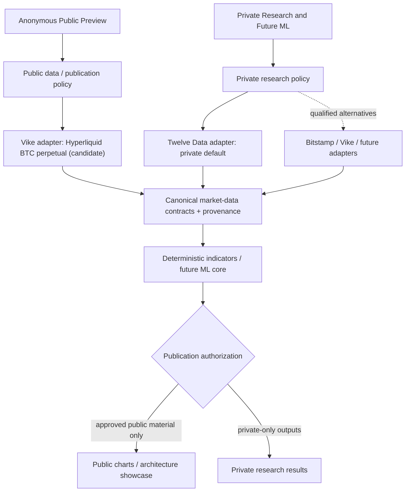
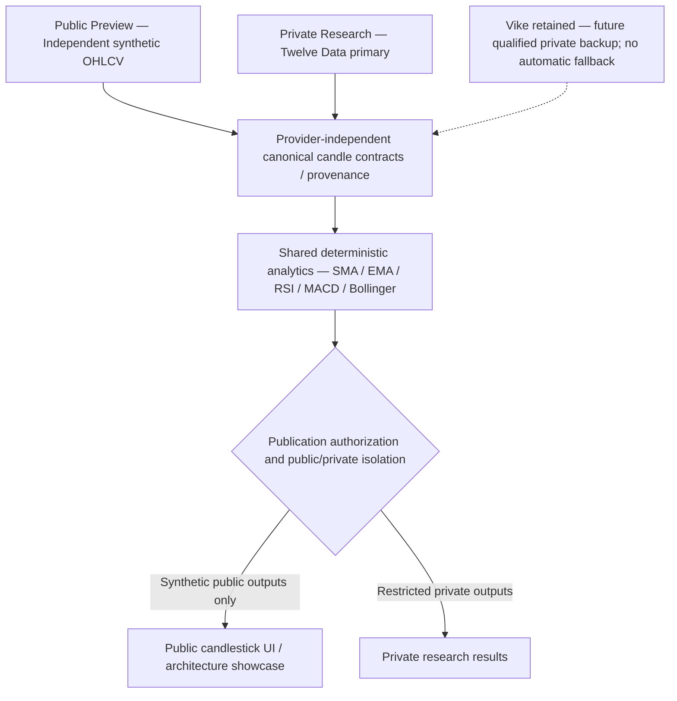

# Public Preview and Private Research Data Governance

**Project:** AIQuantTradingResearch
**Status:** Approved product direction; provider qualification pending
**Initial scope:** Release 1.14 and subsequent technical-analysis and ML milestones
**Implementation prerequisite:** This policy and its derived requirements must be accepted before Release 1.14 implementation authority.

## 1. Purpose and business context

AIQuantTradingResearch is a noncommercial engineering portfolio and private quantitative-research platform. The public website demonstrates architecture and analysis capabilities to hiring managers and other visitors without exposing privately licensed market datasets. The public preview must avoid third-party subscription costs.

Two execution contexts are mandatory:

- **Public Preview:** anonymous, publicly accessible demonstration using market data independently qualified for public display and reuse, with required attribution.
- **Private Research:** the owner's nonpublic technical-analysis studies and future machine-learning experimentation, initially using Twelve Data subject to its applicable terms.

The contexts share canonical contracts and analytical algorithms, **not** publication entitlements. Public API access, free API access, authentication, or transformation into indicators does not automatically authorize redistribution.

## 2. Market identity and proposed sources

**Public Release 1.14 candidate:** BTC perpetual futures on Hyperliquid, accessed through Vike. Public charts must say **“BTC — Hyperliquid Perpetual Futures”**, identify Vike as the data provider and Hyperliquid as the venue, and disclose the verified quote/settlement characteristics. Never label these candles BTC/USD spot or silently substitute spot, perpetual, USD, or USDT markets.

**Private research default:** Twelve Data for personal technical-analysis evaluation and future private ML research, subject to the applicable agreement, including any storage, ML-training, and derived-artifact restrictions. Private Twelve Data candles, cached datasets, derived features, models, forecasts and exports are not automatically publishable.

**Future private alternatives:** Bitstamp, Vike or other providers may replace Twelve Data once qualified for the intended market and research use. Algorithms must remain provider-independent.

Vike's public candidate is **not approved for live activation merely by this document**. First-party licensing and upstream provenance, attribution, actual instrument semantics, endpoint behavior, history, gaps, coverage, free quotas, and 1h/4h/1d support require recorded evidence.

## 3. Logical architecture

This diagram represents intended boundaries, not a claim that every component already exists.

Adapters own provider-specific requests, authentication, pagination, error handling, normalization, market identity and provenance. Shared research algorithms consume canonical data. Provider selection is constrained by execution-context policy; **no automatic cross-context fallback**.

## 4. Non-negotiable controls

1. Separate public/private configuration, credentials, provider authorization, cache namespaces, routes, logs, exports, research artifacts and deployment permissions. Hidden UI controls or login alone are not sufficient isolation.
2. Public access fails closed if publication rights, provider qualification, market identity, or provenance is missing or invalid. Never fall back to Twelve Data on a public request.
3. Preserve originating venue, provider, instrument type, base/quote/settlement characteristics, interval, UTC boundaries, acquisition timestamp, license evidence, calculation version, gap policy and dataset fingerprint as applicable.
4. Preserve deterministic historical contexts, bounded warm-up, explicit gaps, accurate freshness, and bounded cache/resource use. Never fabricate or fill candles without a separately documented methodology.
5. Provider replacement cannot require rewriting indicator or ML core algorithms; however, replacement still requires data-quality, market-equivalence and licensing review.
6. No public subscription costs are assumed. Zero cost does not imply publication permission.
7. Research-derived indicators, features, forecasts, trained weights, datasets and model artifacts require publication review; transformation does not erase upstream obligations.

## 5. Provider-selection and qualification policy

| Provider / feed                  | Context                                         | Decision                     | Activation prerequisites                                                                                                                                       |
| ---------------------------------- | ------------------------------------------------- | ------------------------------ | ---------------------------------------------------------------------------------------------------------------------------------------------------------------- |
| Vike / Hyperliquid BTC perpetual | Public                                          | **Candidate, not activated** | Confirm first-party reuse terms, upstream rights, attribution, exact market identity, 90 days plus warm-up, 1h/4h/1d, API behavior, quotas, costs and coverage |
| Twelve Data                      | Private research and proposed future private ML | **Preferred private source** | Confirm applicable personal-plan research, retention, ML-training and derived-artifact terms; prevent public redistribution                                    |
| Bitstamp spot                    | Optional private alternative                    | **Unqualified**              | Validate pair metadata, spot identity, intervals, history, quality and applicable rights                                                                       |
| Other providers                  | Either context                                  | **Unqualified**              | Independent legal/terms and technical assessment                                                                                                               |

A qualification record must capture: provider and first-party documentation URLs, license version/date, originating venue, instrument type and denomination, permitted audiences/outputs, upstream provenance, attribution, cache/retention limits, credentials, rate quotas, cost, technical coverage and test evidence, failure handling, reviewer and review date.

Requalify on material licensing, market or endpoint changes. Public activation requires both rights clearance and technical acceptance. When unavailable, display an honest unavailable or separately licensed illustrative state; do not leak private data.

## 6. Public-preview requirements derived from this policy

### Homepage keynote

Near the top of the main page, show a prominent section titled:

> **Quantitative Research Built with Responsible Data Governance**

Suggested copy:

> AIQuantTradingResearch separates its public engineering preview from private quantitative research. Provider-agnostic analytics, explicit market identity, and licensing-aware publication controls let us demonstrate capabilities without redistributing restricted market data.

Provide a real navigation link labeled **“Explore the Architecture & Data Governance”** to a dedicated page (proposed route: `/architecture/data-governance`).

### Dedicated public architecture page

Provide readable, responsive, accessible diagrams with text equivalents explaining:

- Public versus private data sources and execution-context boundaries.
- Provider adapters → canonical contracts → indicators and future ML → publication authorization.
- Why public/free API access differs from public-display or redistribution permission.
- Explicit Hyperliquid BTC perpetual futures versus BTC/USD spot market identity.
- Source provenance, reproducible historical context, deterministic calculations and gap treatment.
- Separate credentials, caches, endpoints and artifact access policies.
- Private Twelve Data research and qualified future Bitstamp/Vike substitutions.
- Future ML training data, features, model weights, predictions and publication review.
- Delivered functionality versus proposed capabilities, accurately labeled.

Show accurate attribution, venue, instrument type, and freshness alongside public charts. Never disclose credentials, restricted data, sensitive infrastructure details, or private research results. Avoid unsupported claims of legal certification or provider approval.

## 7. Derived Release 1.14 acceptance criteria

| ID    | Acceptance criterion                                                                                                                        |
| ------- | --------------------------------------------------------------------------------------------------------------------------------------------- |
| AC107 | Homepage displays a prominent architecture and data-governance keynote near the top.                                                        |
| AC108 | Keynote links to a working dedicated architecture/data-governance page.                                                                     |
| AC109 | Dedicated page includes accessible, responsive diagrams and equivalent text explaining public/private separation and provider independence. |
| AC110 | Page accurately identifies the Vike/Hyperliquid perpetual public candidate and private Twelve Data research role.                           |
| AC111 | Page distinguishes public API access, free usage, license rights and redistribution permission.                                             |
| AC112 | Page explains future ML training-data and derived-artifact publication governance.                                                          |
| AC113 | Public chart clearly labels BTC Hyperliquid perpetual futures; never BTC/USD spot.                                                          |
| AC114 | Public outputs expose no private credentials, restricted datasets, derived private artifacts or sensitive internals.                        |
| AC115 | Mobile/desktop responsiveness, keyboard access and diagram descriptions are verified.                                                       |
| AC116 | Public claims distinguish implemented functionality from future roadmap items and pending qualifications.                                   |
| AC117 | Public adapter activation is blocked until licensing, upstream provenance and technical qualification are documented.                       |
| AC118 | Negative tests verify fail-closed provider selection and no Twelve Data fallback from public requests.                                      |
| AC119 | Canonical data preserves instrument type, venue, quote/settlement identity and provenance.                                                  |
| AC120 | Qualified private provider substitution does not change research core indicator or ML algorithms.                                           |
| AC121 | Private derived ML features, models, forecasts and exports pass a separate publication review before public exposure.                       |
| AC122 | Public attribution, freshness, and unavailable-state explanations are accurate and visible.                                                 |

## 8. Mandatory Release 1.14 gates

**G-1 — Governance baseline:** Review and accept this policy as the controlling business/architecture requirement before implementation authorization.

**G-2 — Traceability:** Public UI, provider selection, isolation and analytical requirements trace to this policy and explicit acceptance criteria.

**G-3 — Provider evidence:** Record first-party licensing, upstream provenance, market identity, cost/quota, technical coverage and public-display rights before live public data activation.

**G-4 — Verification:** Before public deployment, pass tests for public/private isolation, no unauthorized fallback, truthful labels, attribution, accessibility and safe failure states.

## 9. Decision status and non-authority

**Accepted direction:** Two-context strategy, Twelve Data as preferred private research source, provider-agnostic analysis/ML, perpetual futures clearly labeled in public, homepage keynote and dedicated public architecture page.

**Pending qualification:** Vike/Hyperliquid BTC perpetual public use, including technical and rights evidence; private ML use rights and any derived-output publication.

**Not authorized by this document:** application code changes, new infrastructure, credentials, data ingestion, public feed activation, ML training, or deployment. Future milestones inherit these principles unless explicitly revised through architecture governance.

---

## 10. Release 1.14 amendment — synthetic public preview and retained secondary provider

**Decision date:** 2026-10-10
**Status:** Proposed governance amendment, effective upon owner review and merge.
**Supersedes:** Earlier Release 1.14 public-preview assumptions identifying Vike / Hyperliquid BTC perpetual candles as the intended public chart feed. Sections 1–9 remain governing where compatible; this amendment takes precedence where they conflict.

### Revised source-of-data decision

- **Anonymous Public Preview:** Use **independently generated deterministic synthetic OHLCV** exclusively. No public Vike or Twelve Data market-data calls, snapshots, perturbed real candles, or private derived data. Label prominently **“BTC-like Market Simulation — Synthetic Historical OHLCV”** with a visible statement that prices and volumes are illustrative, not exchange observations or investment advice.
- **Private Research:** Twelve Data is the **primary external market-data provider**, subject to its plan-specific access, retention, training and derived-output terms. Private data and results must never leak into public charts, caches, logs, artifacts or exports.
- **Retained Vike adapter:** Preserve existing Vike integration and the completed conditional qualification evidence for future provider-agnostic research and potential **private** resilience. No automatic fallback, public activation or equivalence assumption is authorized. A future fallback requires separately approved rights, instrument/venue/denomination equivalence, provenance, data-quality, operational and security controls.
- **Shared provider-independent architecture:** All sources must map through canonical candle contracts preserving source, market identity, UTC timestamps, interval, volume units, generation/version metadata and provenance. Shared indicator algorithms (SMA, EMA, RSI, MACD, Bollinger) must remain source-independent, while publication authorization remains context-specific.

### Revised architecture — normative diagram

The diagram below is the architecture reference for Release 1.14. The future public **Architecture & Data Governance** page **must display this architecture visually**, with an accessible text equivalent and accurate implemented-versus-planned labels. A standalone scalable SVG asset may be produced in a separately authorized UI work package; the Mermaid source here is the version-controlled diagram authority.

**Accessible text equivalent:** Independently generated public simulation candles and separately authorized private provider data enter a shared canonical representation and analytics core. Publication controls allow only synthetic outputs into the anonymous public chart. Twelve Data supplies private research. Vike remains a retained but inactive secondary provider candidate; it cannot automatically replace Twelve Data or feed the public chart.

### Traceability and acceptance amendments

Retain **AC107–AC122** and **G-1–G-4** identifiers; interpret them under the revised decision:

- **AC107–AC112, AC115–AC116:** Preserve the homepage governance keynote, real navigation to a dedicated accessible architecture page, public/private explanation, ML publication governance, and truthful implemented/planned distinctions. Replace any claim that Vike powers the public chart with the synthetic-preview decision.
- **AC113:** Public charts must clearly say **synthetic BTC-like simulation**, never BTC/USD spot, live BTC, or Hyperliquid BTC perpetual observations.
- **AC114, AC118, AC121:** Public/private isolation remains fail-closed; no Twelve Data or Vike fallback into public requests; no publication of private datasets, derived indicators, features, model artifacts or forecasts without separate authorization.
- **AC117:** External-provider public activation remains blocked pending explicit rights and technical qualification; Release 1.14 synthetic public charts do not depend on Vike qualification.
- **AC119–AC120:** Canonical market identity/provenance and provider-independent indicators remain required. Preserve Vike for future qualified private-provider substitution without promising market equivalence or automatic failover.
- **AC122:** Show synthetic provenance, generator version/seed or dataset fingerprint as appropriate, UTC context and honest freshness; do not attribute synthetic candles to Vike or Twelve Data.
- **G-1/G-2:** Governance acceptance and traceability must reflect this amendment before implementation authority.
- **G-3:** Independently generated synthetic public data must have auditable generation provenance and no provider-data derivation. Any future real public feed separately requires first-party licensing/upstream rights and technical acceptance.
- **G-4:** Before public deployment, test deterministic generation, OHLC invariants, UTC alignment, correct synthetic labels, accessibility, no private-data fallback, and absence of public provider secrets/calls.

### Implementation and governance boundaries

This amendment is **documentation-only**. It does not authorize application changes, new dependencies, provider activation, public deployment, automatic failover, paid services, ML training, changes to root README, or edits to existing adapter code. Preserve the zero-recurring-infrastructure-cost Azure F1 target. Reconcile older Release 1.13/1.14 public Vike assumptions through subsequent explicitly scoped governance and work packages; do not silently rewrite historical records.

### Option B documentation reconciliation - pending final owner policy review

**Documentation authority:** Owner explicitly approved the consolidated planning artifact's Section 9 four-path documentation packet on 2026-10-10. Recommended dispositions and numerical evaluation criteria are approved for this reconciliation. The resulting policy diff still requires separate owner review before this addendum becomes effective. Existing controlling policy remains in force until that review; G-B0 is not complete. No implementation, active tests, lifecycle action or public activation is authorized.

**Planning decision:** Retain external supervision, approved C# generator/shared `aiq-ta-v1` analytics and bounded Worker UTF-8 transport. Replace hard CPU-consumption claims with conservative admission-reservation policy and explicitly measured residual availability/resource risk only upon effectiveness of the amendment. Confidentiality, synthetic provenance, exclusive admission and independently verified cleanup are not relaxed. Guardian-only flock is rejected as sufficient fencing: Phase 1B observed admission reopening before registered process exit notifications.

**Admission domain and recovery:** One qualified public container instance, shared across its sessions/processes; other region remains disabled for this public path. Unexpected topology/identity or inaccessible shared state fails closed. Durable occupied state and reservation precede any Worker creation; registration and verified READY/START precede computation. No final-holder death, deadline, TTL, boot change or numeric PID alone clears occupation. Unknown cleanup/settlement denies generation indefinitely; operator recovery requires independent proof, authentication and audit. Storage and recovery implementation remain unqualified.

**Reservation arithmetic:** Charge 16 reserved CPU-seconds per admitted or uncertain-start job; at most three admissions in rolling 900 seconds and fifteen in rolling 86,400 seconds, subject also to 60/240 reservation caps. Three charges total 48; fifteen total 240. Persist atomic history across restart, use UTC event timestamps with rollback/high-water safeguards and monotonic in-lifetime deadlines; inconsistent/missing evidence denies generation. These are not actual consumption ceilings, midnight-reset quotas or Azure-metered usage. Session cooldown is 10 seconds, with three expensive attempts/client/rolling 60 seconds as supplementary defense; rotation never bypasses global limits.

**Hold:** `PUBLIC_RUNTIME_VERIFIED = False`; PR #330 remains draft/unmerged, issue #322 open and dependent WP05 activation blocked. Gate approval is not implementation acceptance or activation authority. Candidate numerical criteria are unmeasured. Separate architecture, mutation, verification, acceptance and lifecycle authorities remain necessary.

### Option B candidate normative requirements

### A — Execution and synthetic-only provenance

1. Anonymous historical-market requests **SHALL** use only the independently deterministic approved BTC-like synthetic OHLCV implementation and approved analytics. The C# generator, shared indicator calculator, canonical dataset/version/seed/fingerprints, 12 selections, 250 hidden warmup candles and visible-only projections **SHALL** remain authoritative.
2. The public execution path **SHALL NOT** construct or call private Twelve Data/Vike adapters, consume observed-data caches, perform provider fallback or access private handoffs.
3. The existing bounded Worker byte protocol **SHALL** be preserved unless separately amended. Public requests **SHALL** be strictly validated before costly work.

### B — Supervisor, admission and crash recovery

1. A trusted admission authority **SHALL** durably establish an **occupied** state and conservative reservation **before any Worker can exist**. All admission contenders in the explicitly defined admission domain **SHALL** use the same enforcement path.
2. At most **one** public synthetic generation job **SHALL** be admitted within that domain. An unregistered-Worker creation window is unacceptable; the startup protocol **SHALL** prevent Worker creation before auditable registration and verified START.
3. Guardian death, supervisor death, final flock-holder death, UI death, expired lease/deadline, numeric PID reuse or process-group kill **SHALL NOT** alone clear occupied state.
4. New admission **SHALL** require independently verified complete termination/cleanup of the prior registered execution boundary and durable settlement. Missing, corrupt, ambiguous, inconsistent or inaccessible evidence **SHALL** fail closed, including after restart.
5. Boot identity, process start identity and available pidfd evidence **SHALL** be treated according to their actual persistence limitations. PIDfds cannot simply be reconstructed as equivalent evidence after arbitrary owner death. Time passage alone **SHALL NOT** prove cleanup.
6. Recovery **MAY** require documented operator intervention, but **SHALL NOT** clear occupation without adequate independent evidence. A durable occupied record prevents overlap; by itself it does **not** kill processes or bound CPU.
7. The architecture **SHALL** define its admission domain (single container vs multiple instances/replicas), its shared-state durability, and the behavior when those assumptions are violated. A local lock **SHALL NOT** be called deployment-global without proof.

### C — Revised CPU and memory resource contract

1. The existing rolling **60 CPU-seconds/15 minutes** and **240 CPU-seconds/day** values are proposed as **provisional conservative admission-reservation budgets**, not hard actual CPU-consumption ceilings. The **16 CPU-second/job** reservation and proposed **3 admissions/15 minutes, 15/day** are also provisional pending arithmetic, policy and F1 capacity validation.
2. Admission accounting **SHALL** be atomic, durable and fail closed on inconsistent state, clock rollback, missing evidence or incomplete settlement. Conservative full-reservation charging **SHALL** apply when exact use is unknown, without claiming that reservation bounds actual CPU.
3. The architecture **SHALL** bound request/response sizes, concurrency, retries, in-flight allocations and operation deadlines; **SHALL** document and measure possible overshoot, supervisor overhead and cleanup latency; and **SHALL NOT** claim that `wait4`, `rusage`, cooperative cancellation, wall-clock deadlines, `DOTNET_PROCESSOR_COUNT=1` or a reservation ledger independently enforce hard CPU ceilings.
4. The approved residual risk **MAY** include CPU use beyond a reservation, temporary public-chart unavailability, manual recovery and measured Streamlit degradation. It **SHALL NOT** include private-data exposure, provider calls, unverified overlapping jobs or silent reopening after crash.
5. The public workload **SHALL** reserve measurable operating headroom for Streamlit health, ordinary chart viewing and platform quota. Exact CPU/memory/performance thresholds require a separate owner decision informed by measured F1 behavior; internal budget values are not Azure's platform-metered quota.

### D — Confidentiality and isolation (not relaxed)

1. Public Worker execution **SHALL** have no effective access to private provider credentials, market caches, research artifacts, private `/runtime` handoffs or other private observations through mounts, inherited descriptors, environment, symlinks, `/proc` or alternative paths.
2. Public execution **SHALL** be denied outbound provider access. Network-namespace or equivalent isolation is a candidate to be separately verified; no mechanism is presumed sufficient without target-runtime evidence.
3. Public/private startup separation **SHALL** prevent inherited private configuration or handles. A separate process with the same effective private permissions **SHALL NOT** count as an isolation boundary.
4. No private file contents or credentials **SHALL** be collected in verification artifacts.

### E — Availability, failure and operations

1. Unknown cleanup or admission state **SHALL** deny new public generation requests. Failure responses **SHALL** be bounded, non-retrying by default and free of sensitive details.
2. The application **MAY** prefer temporary generation unavailability over unsafe readmission. Operator recovery **SHALL** be documented, observable, auditable and evidence-based.
3. Public activation **SHALL** require separate authorization after every applicable gate passes. Draft/merged code or an accepted planning amendment **SHALL NOT** imply activation authority.

### F — Anonymous request abuse prevention and Azure F1 quota protection (**owner-approved inclusion in proposal**)

1. The public application **SHALL** reject invalid, oversized or disallowed requests using cheap bounded validation **before** expensive generation or cache work.
2. It **SHALL** enforce both (a) per-client/session throttling as defense in depth and (b) **durable global admission frequency and quota-reservation limits** that cannot be bypassed merely by changing tabs, sessions, IP addresses or query parameters.
3. Anonymous client identifiers **SHALL NOT** be treated as verified identities; IP-based controls **SHALL** account for shared addresses and proxy/header trust. Client identity rotation **SHALL NOT** bypass global controls.
4. At most one generation job **SHALL** be admitted in the approved domain. There **SHALL** be no unbounded waiting queue, automatic retry storm or speculative generation triggered by denial.
5. Validated cache hits **MAY** serve public requests without new generation **only within existing cold-generation, cache-publication, provenance and validation contracts**. Cache hits **SHALL** have independent bounded response/rate/concurrency protection. This amendment **DOES NOT** authorize startup pregeneration, exported fixtures, background generation or cache-rule changes. Section 12 separately proposes the owner-selected immutable B1 release exception; it requires explicit canonical acceptance and distinct production/export authority and cannot be inferred from this cache-hit allowance.
6. If durable admission/budget state, resource health or recovery evidence is unknown or unavailable, new expensive generation **SHALL** fail closed. Denials **SHALL NOT** launch a Worker.
7. Rate controls **SHALL** protect measured F1 headroom for Streamlit and health responses. Sustained request floods **SHALL** be tested under separately authorized, bounded conditions; no claim is made that application-level limits prevent all ingress CPU or Azure platform quota usage.
8. **Provisional evaluation values only:** one concurrent generation; 10-second session cooldown; three expensive requests/client/minute; three new generation admissions/15 minutes; 15/day; 60 reserved CPU-seconds/15 minutes; 240 reserved CPU-seconds/day; no waiting queue; explicit retries only; fail-closed uncertainty. Values require consistency checks, time-window definitions, multi-instance scope and separate threshold approval. The original 4096-byte input, 2 MiB stdout, 16 KiB stderr, 1-second admission, 10-second operation and 15-second admission-to-reap figures remain provisional pending contract reconciliation.

### Option B mandatory acceptance gates

| Gate                                              | Required evidence                                                                                                                                                                              | Blocking failure                                                     |
| --------------------------------------------------- | ------------------------------------------------------------------------------------------------------------------------------------------------------------------------------------------------ | ---------------------------------------------------------------------- |
| **G-B0 — Contract authority**                    | Owner approves exact policy changes, residual-risk acceptance, numerical limits, admission domain and conflicts reconciled across controlling documents                                        | No implementation authority                                          |
| **G-B1 — Crash-safe admission**                  | Durable occupied state before spawn; no overlapping Worker after guardian/supervisor/UI failure, final-holder death, interrupted handshake or restart; explicit Phase 1B regression            | Any reopening before independently verified cleanup                  |
| **G-B2 — Confidentiality**                       | Target-runtime negative tests of private cache,`/runtime`, credentials, mount/symlink/FD/`/proc`/environment and outbound-provider access                                                      | Any public path to private observations or credentials               |
| **G-B3 — Resource-risk qualification**           | Atomic reservations, rolling-window accounting, overshoot/CPU/memory measurements, deadlines, bounded capture, retry controls, supervisor overhead, no hard-ceiling misrepresentation          | Unknown risk or uncontrolled accounting/admission                    |
| **G-B4 — Lifecycle and recovery**                | Ordinary exit, parent/guardian/supervisor death, combined failures, PID namespace behavior, orphan/escape cases, ledger corruption, restart, operator recovery                                 | Unsafe automatic reopening or unverified cleanup                     |
| **G-B5 — Functional preservation**               | Exact synthetic fingerprints, 12 selections, warmup, analytics, Worker transport, private-provider negatives and public response provenance                                                    | Any observed-data leakage or contract regression                     |
| **G-B6 — Azure F1 operational qualification**    | Separately authorized target-runtime tests of cold/warm latency, memory, startup, availability, health, restoration, cost/plan preservation and documented failure impact                      | Unacceptable F1 impact or unverified target behavior                 |
| **G-B7 — Abuse and quota-starvation protection** | Bounded flood/identity-rotation/concurrent-tab/cache-hit/invalid-input tests; no Worker on denial; durable global budgets across restart; fail-closed corrupt ledger; verified health headroom | Saturation amplification, limit bypass or uncontrolled queue/retries |

**Ordering:** G-B0 precedes any implementation authority. G-B1 and G-B2 are non-negotiable prerequisites to public Worker activation. G-B3, G-B4, G-B5, G-B6 and **G-B7** must also pass before WP07 acceptance and any separately approved public activation. Active verification requires distinct authorization; a planning gate does not authorize probes.

### Option B residual-risk acceptance matrix

| Risk                                                           | Proposed owner treatment                                                                                                   |
| ---------------------------------------------------------------- | ---------------------------------------------------------------------------------------------------------------------------- |
| Actual CPU use exceeds a conservative reservation              | **Conditionally acceptable** with measurement, operating headroom and explicit threshold approval; not called a hard bound |
| Public charts unavailable while occupied state is uncertain    | **Acceptable** fail-closed outcome                                                                                         |
| Evidence-based manual recovery after crash                     | **Conditionally acceptable** with an approved runbook                                                                      |
| Measured degradation of Streamlit under F1 load                | **Conditionally acceptable** within separately approved thresholds                                                         |
| Anonymous floods exhausting planned generation admissions      | **Must be limited** by global budgets and cheap denials; residual HTTP ingress costs disclosed                             |
| Private observed-data or credential exposure                   | **Unacceptable**                                                                                                           |
| Public provider calls or observed-data fallback                | **Unacceptable**                                                                                                           |
| Overlapping generation after uncertain cleanup                 | **Unacceptable**                                                                                                           |
| Silent lock/lease/TTL-based reopening                          | **Unacceptable**                                                                                                           |
| Claiming reservation budgets are enforced Azure quota ceilings | **Unacceptable**                                                                                                           |

### Owner-approved numerical evaluation criteria, pending policy effectiveness

| Boundary                                                  | Proposed acceptance/evaluation value                                                                                                                                                              | Precise scope and failure treatment                                                                                                                                                                                                                                                                          |
| ----------------------------------------------------------- | --------------------------------------------------------------------------------------------------------------------------------------------------------------------------------------------------- | -------------------------------------------------------------------------------------------------------------------------------------------------------------------------------------------------------------------------------------------------------------------------------------------------------------- |
| Health latency                                            | Warm running-host healthp95<=1second; every sampled response<=3seconds; zero unexpected5xx/timeouts in each authorized qualification batch                                                        | Report startup/restoration separately, not hidden in warm figures. Baseline and loaded figures must both be disclosed with sample count. Fail qualification on breach; no claim of availability under arbitrary ingress                                                                                      |
| Health headroom                                           | Loaded healthp95 no more than2times the same-instance warm baseline, while also satisfying the absolute1second limit                                                                              | Protect an independent health path/class. Controlled monitoring at most1check/10seconds per test observer, finite predeclared count; this is a test sampling cap, not authorization to throttle Azure platform probes                                                                                        |
| Cached service reads, global                              | At most30 accepted cached-chart service reads in rolling60seconds; maximum2 in any rolling1second; one active cached read across the admitted instance                                            | No waiting queue; excess requests receive cheap bounded Busy/unavailable without Worker launch. Apply accounting before disk validation/projection/analytics/serialization; invalid/denied ingress costs remain outside this protection                                                                      |
| Cached service reads, session                             | At most6 accepted reads/rolling60seconds per session, additionally subject to all global controls                                                                                                 | Session rotation cannot bypass global limits. Hover/zoom/ordinary client rerender remains acquisition-free. These counters are separate from expensive attempts and generation reservations                                                                                                                  |
| Limiter state                                             | Maximum1024 live supplementary client/session limiter records, idle retention30minutes; no silent counter-reset eviction that grants admission                                                    | At capacity, reject new expensive/client-class admissions cheaply or apply the strict global-only denial policy; existing global history survives. Implementation must bound identifier lengths and bookkeeping bytes separately                                                                             |
| Generation and supervision daily CPU evaluation allowance | At most10% of applicable documented daily F1 CPU quota, provisionally360CPU-seconds if the target quota is verified as3600seconds/day                                                             | Include Worker descendants, request setup/guardian and attributed supervision/cleanup overhead. This is measured allocation/qualification, not kernel enforcement. Cache-hit/denial/UI/HTTP/background CPU must be measured separately and still fit total operating headroom                                |
| C2 quota-availability admission                           | Missing/stale/unverifiable Azure quota telemetry alone does not deny admission when every qualified mandatory local budget, isolation, journal, recovery, abuse and health condition is satisfied | Unknown observation time means unknown freshness/headroom; never assert >20% actual Azure headroom when unknown. Authenticated trustworthy exhaustion/unsafe-condition evidence may tighten denial. Global health breaker trip/recovery thresholds remain unresolved; no production qualification is claimed |
| CPU overshoot acceptance                                  | For each fully accounted qualification job, actual attributable request CPU must be<=20CPU-seconds, i.e. at most4seconds above the16second policy reservation                                     | Include descendants and per-job setup/cleanup/supervision. Incomplete accounting does not pass. Normal cold-work2CPU-second performance target remains. This is an observed acceptance criterion, not a crash-safe hard ceiling                                                                              |
| Timeout/cleanup                                           | Retain10second operation,15second admission-to-cleanup target and<=1second TERM grace                                                                                                             | Report every deadline breach and measured cleanup lag; any unfinished boundary retains durable occupation and denies readmission. No numerical overshoot allowance permits overlap or clearing unknown state                                                                                                 |
| Memory/latency                                            | RetainchildRSS<=160MiB,totalworking-set<=640MiB,coldp95<=5seconds,warmp95<=2seconds                                                                                                               | Include supervisor and parent/container overhead in total measurements. Report sample counts and method;12selections alone are not robustp95 evidence                                                                                                                                                        |

C2 supersedes the mandatory C1 <=60-second quota-freshness and >20% platform-headroom admission prerequisite. Unknown Azure telemetry alone need not deny under qualified C2 local predicates; it never establishes fresh observations or actual headroom. The 10% daily allocation requires an independently verified applicable allowance and complete attributable CPU evaluation, not reservation arithmetic. No 3,600-second/day quota is asserted as verified. Health protection remains mandatory; application controls cannot guarantee platform quota preservation or ingress resistance.

Planning/evidence source: [consolidated WP07 artifact](../../roadmap/release-1.14/prompters/WP07_OPTION_B_CONSOLIDATED_PLANNING_AND_QUALIFICATION.md).

### C2 approval and governance disposition - 2026-10-10

The owner approved the response-only C2 contract wording and its four-document reconciliation for documentation edits. This supersedes the earlier pending-review status only for the exact C2 amendment recorded here; it does not approve all uncommitted Option B proposals, select an architecture/backend or establish policy publication/merge. C2 residual availability risk is accepted; numerical limits remain candidate upper bounds pending qualification. G-B0 remains incomplete while admission topology, health-breaker thresholds and accounting dispositions are unresolved. No runtime gate is marked passed and no new implementation authority follows.

One authoritative admission domain must cover every enabled public entry point. The prior single-container/other-region-disabled topology remains the candidate, not verified deployment-wide enforcement; no region or replica is enabled by this amendment. Confidentiality, exclusive durable occupation and independently verified cleanup are mandatory. A2 distinct broker UID remains preferred for qualification, not selected; B2 remains conditional on actual resource, protected access, consistency and permanent zero incremental recurring cost. No role map or backend changes.

The offline policy implementation remains frozen and its source/test snapshot is preserved. Required holds remain `PUBLIC_RUNTIME_VERIFIED = False`, PR #330 draft/unmerged, issue #322 open and no public activation. Remote lifecycle status is not reverified by this documentation change. Acceptance, literal-path implementation authority, tests/diagnostics, identity/RBAC changes, PR lifecycle, deployment and activation require separate explicit owner authority.

### C2 - Conservative local-budget admission and accepted quota-availability risk

1. **Scope and priority.** C2 replaces only the prerequisite that every new public generation has authoritative Azure quota observations no older than 60 seconds and more than 20% remaining headroom in both applicable quota classes. It SHALL NOT relax confidentiality, synthetic-only publication, exclusive Worker admission, durable recovery, abuse protection, zero recurring infrastructure cost or activation authority. All unaffected Section 10 requirements remain.
2. **Authoritative domain.** Every enabled public entry point SHALL participate in one explicitly defined, qualified admission domain using the same authoritative durable occupation and budget state. At most one Worker tree SHALL be occupied. Reservation and occupation SHALL commit before any Worker creation; auditable registration and verified START remain required. Additional instances/regions/entry points SHALL remain disabled unless participation in the same enforcement domain is qualified.
3. **Recovery.** Supervisor/guardian/UI death, released flock, lost/expired lease, timeout, restart, clock rollback, missing/corrupt/inaccessible journal or unverifiable cleanup SHALL NOT reopen admission or replenish budgets. Independent complete termination verification of the registered boundary and descendants, followed by durable settlement, SHALL precede clearing occupation. No public recovery/reset command. Time passage or numeric PID alone SHALL NOT prove cleanup.
4. **Budgets.** Retain candidate upper bounds pending qualification: 16 reserved CPU-seconds per actual or uncertain Worker spawn; at most three admissions/rolling 900 seconds and fifteen/rolling 86,400 seconds; reservation caps 60/240 seconds respectively. Both count and reservation limits SHALL apply. An actual warm-cache Worker spawn SHALL be charged. Unknown launch outcomes retain full reservation; incomplete measurement SHALL NOT justify a refund. These are admission reservations, not hard CPU-consumption ceilings.
5. **Honest telemetry.** Measurements without verifiable observation timestamps SHALL be unknown, not fresh. Missing/stale/unverifiable Azure quota telemetry SHALL NOT alone prohibit C2 admission when every independently mandatory isolation, durable-state, local-budget, abuse and health condition is qualified and satisfied. Authenticated trustworthy exhaustion/unsafe-condition evidence MAY tighten denial. No >20% actual Azure headroom assertion when unknown; no owner credentials in the app. Mandatory local health/state/recovery evidence is not optional telemetry.
6. **Accepted risk.** F1 quota exhaustion, throttling and temporary chart unavailability may occur despite compliant budgets. Other app CPU, supervisor/broker/orphan CPU, anonymous ingress, telemetry lag and runaway CPU are not bounded by reservations. No writable cgroup delegation was demonstrated; no kernel hard process-tree CPU ceiling is claimed. Risk acceptance SHALL NOT permit private exposure, overlap, unsafe reopening, uncontrolled abuse, new recurring costs or privileged infrastructure.
7. **Accounting.** Fifteen times 16 is 240 reserved seconds; fifteen times the candidate measured 20-second envelope is 300 measured job seconds before additional non-attributed costs. Qualification SHALL evaluate Worker descendants, setup, guardian/broker, per-job supervision/cleanup and allocated idle/orphan costs without double counting. Other app/cache/denial/ingress costs require separate health assessment. The proposed <=10% daily allocation requires an independently verified applicable F1 allowance and total-attributable CPU with uncertainty; 240 reserved seconds proves neither allocation nor actual quota. No verified 3,600-second daily allowance is invented. Missing accounting cannot pass. If measured consumption and uncertainty exceed allocation, tighter budgets SHALL be proposed and approved before activation; do not increase limits to conceal the discrepancy.
8. **Abuse and health.** Global authoritative limits, supplementary client/session throttling, bounded validation, cached-read rate/concurrency controls and independent health remain mandatory. No unbounded queues/retries, work on denial or counter eviction granting admission. Candidate, unqualified values: 10-second session cooldown; three expensive attempts/client/60 seconds; 30 cached reads/global/60 seconds; two/global/second; six/session/60 seconds; one active cached read. A global health circuit breaker SHALL deny generation when required health evidence is unavailable or approved unsafe-health criteria are met. Trip/recovery thresholds, evidence freshness, hysteresis and observation-failure treatment remain unresolved. Breaker recovery SHALL NOT clear occupation or replenish budgets.
9. **Isolation.** Anonymous content SHALL remain synthetic-only with no public Twelve Data/Vike access, private cache/observations/credentials/research artifacts or outbound provider access. Broker/Worker isolation and journal durability remain unqualified. Same-UID peer credentials SHALL NOT prove broker isolation. This amendment selects no role map/backend and permits no public recovery command.
10. **Governance.** C2 policy acceptance is distinct from implementation/qualification. G-B0-G-B7 and existing release criteria SHALL be reconciled without claiming gate passage. Disabled public invocation and frozen implementation remain until separate owner decisions. Qualified security/recovery/abuse/resource/F1 operational evidence, owner acceptance and explicit activation authority remain prerequisites.

### C2 gate and acceptance reconciliation

| Gate | C2 evidence obligation                                                                                                                                                             |
| ------ | ------------------------------------------------------------------------------------------------------------------------------------------------------------------------------------ |
| G-B0 | Exact C2 wording/risk accepted; topology, numerical/accounting and health-breaker decisions and publication reconciliation remain open. No implementation or gate passage implied. |
| G-B1 | Unchanged durable occupation/no overlap and Phase 1B regression.                                                                                                                   |
| G-B2 | Unchanged confidentiality, including Worker-to-broker authority and any quota credentials.                                                                                         |
| G-B3 | Complete attributable CPU vs verified daily allowance, uncertainty, tighter budgets if needed; reservations are not CPU enforcement.                                               |
| G-B4 | Unchanged combined-failure recovery; health-breaker recovery never clears occupation.                                                                                              |
| G-B5 | Unchanged deterministic generator/analytics, 12 selections, hidden warmup, provenance and private preservation.                                                                    |
| G-B6 | Separately authorized F1 health, restoration, resources, permanent zero cost and accepted exhaustion/unavailability risk qualification.                                            |
| G-B7 | Durable global abuse/cached-read protection and health circuit breaker; C2 local predicates replace mandatory fresh Azure headroom, not protection against uncontrolled abuse.     |

AC114/118/121 retain confidentiality, negative isolation and publication boundaries; AC110/117/120 retain provider roles, external activation restrictions and provider-independent analytics. AC116/122 require truthful risk/status and safe unavailable states; quota freshness is not synthetic coverage/generated-at provenance. AC107-109/111-113/115/119 are unchanged. G-1/G-2 require governance/traceability reconciliation, G-3 preserves synthetic independence/private qualification and G-4 retains security/operational evidence before deployment. No new AC identifiers.

---

## 11. C2B amendment — frozen public-preview REST API contract

**Baseline consolidation clarification (2026-10-15):** This section records future product requirements, not implemented routes or current dataset coverage. The accepted generator remains fixed to `[2025-10-26T00:00:00Z, 2026-10-01T00:00:00Z)` with unchanged version, seed and qualified fingerprints. Rolling last-90-completed-day generation requires a separate contract/version decision and qualification; it is deferred. Historical statements above that PR #330 remained draft describe their original inspection dates: GitHub now reports PR #330 merged on 2026-10-13; issue #322 remains open. That lifecycle fact does not qualify public generation or authorize administrative activation. `PUBLIC_RUNTIME_VERIFIED=False`; advanced WP07 remains ON HOLD, and production deployment remains NO-GO.

**Decision date:** 2026-10-14
**Owner decision:** REST API requirements frozen for C2B planning.
**Authority:** Product and interface requirements only; no implementation, deployment, provider activation, administrative diagnostics activation, or Git lifecycle authority.
**Relationship to earlier sections:** This section adds a public, sanitized observability and read-only data-access contract. It does not supersede the synthetic-only public/private isolation rules or the WP07 hold. Exact implementation, hosting, quotas and operational qualification remain pending.

### 11.1 Purpose and scope

The anonymous, zero-incremental-recurring-cost Public Preview SHALL provide a versioned REST interface that supports independently verifiable deployment progress, readiness, synthetic dataset coverage, bounded chart retrieval, indicator results and safe failure diagnosis. Under the C2B-9 pending canonical reconciliation, the public contract preserves the fixed reference coverage `[2025-10-26T00:00:00Z, 2026-10-01T00:00:00Z)` and at most 90 visible completed UTC days ending at that fixed exclusive end, not a rolling/current window. Data remains **independently generated deterministic synthetic OHLCV**, labeled **“BTC-like Market Simulation — Synthetic Historical OHLCV.”** The 90-day limit is a strict research-laboratory boundary; expansion requires a subsequent owner decision. B1 immutable candles plus offline precomputed indicators is owner-selected; implementation, SQLite/storage/backend selection and daily generation are not authorized. Section 12 states effectiveness and retained gates.

No public API operation SHALL call Twelve Data or Vike, read private provider caches or credentials, publish private research results or derived artifacts, or automatically fall back to private providers. Private Twelve Data research remains a separate execution context. Shared indicators and canonical provenance contracts may be reused only under the existing publication and isolation controls.

### 11.2 Frozen endpoint surface

All paths below are proposed **HTTP GET** routes under `/api/v1`. Their presence in this contract does not assert that the deployed Streamlit application currently implements them.

| Route                     | Public purpose                                | Required boundary                                                                                                                                                          |
| --------------------------- | ----------------------------------------------- | ---------------------------------------------------------------------------------------------------------------------------------------------------------------------------- |
| `GET /api/v1/health`      | Lightweight service liveness                  | No generation, database scan, external provider call or privileged operation; preserve existing`/_stcore/health`                                                           |
| `GET /api/v1/status`      | Sanitized application and component readiness | Distinguish web readiness, synthetic dataset readiness and indicator readiness; truthful`ready`, `degraded` or `unavailable` state                                         |
| `GET /api/v1/dataset`     | Synthetic dataset metadata                    | Report source/type, version/fingerprint as appropriate, UTC coverage, available intervals, completed-day freshness and strict 90-day visible boundary; no private metadata |
| `GET /api/v1/candles`     | Bounded public synthetic OHLCV reads          | Validate interval, UTC range, record count and response size before expensive work; never imply observed BTC/USD spot prices                                               |
| `GET /api/v1/indicators`  | Bounded public indicator reads                | Explicit indicator, parameters, interval and UTC range; use approved deterministic algorithms and hidden warm-up without leaking private observations                      |
| `GET /api/v1/diagnostics` | Sanitized failure and validation summary      | Stable public-safe failure categories only; no stack traces, sensitive infrastructure, credentials, filesystem paths, process identifiers or administrative controls       |

**No public mutation or control endpoints** are authorized: no regeneration, job launch, cache reset, database repair, recovery, gate override, credentials, privileged debugging or worker administration. Diagnostics are deliberately separate from the frozen privileged administrative subsystem.

### 11.3 Response and failure semantics

1. API responses SHALL use a documented, versioned JSON schema and stable machine-readable status/error codes. Exact payload schema, query parameters and HTTP status mapping are C2B design deliverables, not assumed complete here.
2. A successful HTTP response SHALL NOT be treated as proof that the synthetic dataset or indicators are ready. Liveness and readiness SHALL be separately observable.
3. At minimum, the failure taxonomy SHALL distinguish `DATASET_NOT_READY`, `DATASET_STALE`, `DATASET_INTEGRITY_FAILURE`, `INVALID_INTERVAL`, `RATE_LIMITED` and `SERVICE_UNAVAILABLE`. Additional safe validation errors may be specified during design.
4. Denials and unavailable states SHALL be bounded, non-retrying by default and free of private implementation details. No endpoint SHALL trigger speculative generation, unbounded queueing or automatic provider fallback.
5. Dataset and chart metadata SHALL preserve synthetic identity, generator/version or fingerprint as applicable, UTC boundaries, interval, generation provenance and honest freshness. Responses and UI SHALL identify prices/volumes as illustrative, not exchange observations or investment advice.
6. The API SHALL support a repeatable post-deployment smoke-test sequence: **health → status → dataset → candles → indicators**. Each stage SHALL return either an explicitly validated result or a safe actionable error code. Diagnostics SHALL help classify failures without privileged access.

### 11.4 Security, resource and hosting qualification

- Public requests SHALL remain synthetic-only and fail closed under missing authorization, provenance, dataset integrity, durable-state or other mandatory safety evidence. No private Twelve Data/Vike execution path, secret, cache, artifact or network access may become reachable.
- All read endpoints SHALL have bounded input validation, response sizes, concurrency and abuse controls appropriate to Azure F1. The previously proposed global/session cached-read and generation limits remain **candidate values requiring qualification**, not automatically accepted REST quotas.
- `GET /api/v1/health` SHALL remain cheap and independent of costly generation or database work. Dataset readiness and diagnostics SHALL not compromise the Streamlit health path.
- The design SHALL evaluate whether versioned REST routes can coexist with Streamlit and the existing single-port Azure App Service deployment without incremental recurring infrastructure cost. No second publicly exposed service or additional paid resource is presumed authorized.
- Storage/publication integrity, corruption, retention, atomic promotion, restart and deterministic continuity SHALL be qualified before the owner-selected immutable B1 context can serve data. No rolling refresh, daily generation or scheduler is selected. A SQLite market store is not selected; any durable security-control backend remains unselected and needs separate consistency/ownership/recovery/cost evidence. Azure F1 Always On is not assumed.
- The REST design SHALL be checked against frozen WP07 confidentiality, synthetic provenance, admission, recovery and resource constraints. This amendment SHALL NOT bypass `PUBLIC_RUNTIME_VERIFIED=False` or activate the held supervisor/guardian/native-interface work.

### 11.5 C2B verification and acceptance requirements

| ID         | Required verification outcome                                                                                                              |
| ------------ | -------------------------------------------------------------------------------------------------------------------------------------------- |
| C2B-API-01 | Six documented GET routes have explicit contracts, authentication/access posture, bounds and public-safe JSON schemas.                     |
| C2B-API-02 | Liveness remains independent of dataset/indicator readiness and expensive work; existing Streamlit health remains functional.              |
| C2B-API-03 | Synthetic-only 90-day UTC boundary and truthful market identity are enforced across metadata, candles, indicators and UI.                  |
| C2B-API-04 | Negative tests prove no Twelve Data/Vike fallback, private-data exposure, privileged controls or provider credentials in public API paths. |
| C2B-API-05 | Safe status and failure taxonomy are deterministic, documented, non-sensitive and testable during deployment smoke checks.                 |
| C2B-API-06 | Bounds, rate/concurrency controls, storage/scheduler assumptions and Azure F1 hosting/cost are explicitly qualified before activation.     |
| C2B-API-07 | Existing WP07 holds and public runtime gate remain unchanged until separately authorized qualification and activation.                     |

**Decision disposition:** REST API scope **FROZEN as C2B product requirements**. The owner has selected B1 principles and the narrow security-state exception; concrete engineering mechanisms and the Section 12 canonical reconciliation remain pending review/qualification. No code changes, Azure configuration changes, privileged diagnostics activation, or public synthetic generation activation follow from this documentation decision.

## 12. C2B-9 immutable release governance proposal

**Effectiveness:** P1-P7, S, B1 and T are owner-approved selections recorded in the [C2B-8 register](../../roadmap/release-1.14/prompters/release-1.14-chart-mvp-c2b-8-owner-decision-register.md). The newly proposed canonical reconciliation wording here and in the definition, execution plan and manifest remains pending explicit owner review/acceptance of the C2B-9 PR. Earlier C2B-5/6/7 proposals and historical authority records are not retroactively rewritten. Neither this PR nor any planning merge grants runtime authorization. `PUBLIC_RUNTIME_VERIFIED=False`; dataset/candles/indicators remain unavailable; activation/deployment NO-GO and advanced WP07 ON HOLD. Unknown mandatory evidence stops the affected step.

### 12.1 C1 — Separate offline production context (P1)

Only a separately authorized owner-controlled offline C# immutable release operation may reuse the unchanged `aiq-synthetic-ohlcv-v1` generator, seed 114, fixed UTC coverage `[2025-10-26T00:00:00Z, 2026-10-01T00:00:00Z)` and accepted canonical bytes/dataset/window/visible fingerprints. This narrow proposed exception to cold-generation/export prohibitions does not change existing Worker behavior or authorize any producer/output path, generation, export or promotion now. No anonymous-request, deployment/startup/background, repair or recovery generation; no private/observed/provider inputs or fallback.

### 12.2 C2 — Artifact provenance, trust and ownership (P2)

Require immutable content-bound release identity, independently trusted external anchor, exact bounded schema/member/row/byte/date/fingerprint checks and auditable producer/reviewer/promotion provenance. Public code, assets, anchors and ancestor directories must not be public-principal-writable. Artifact self-reported hashes do not establish trust. Unknown/extra/duplicate members, traversal/links, tampering, mixed/partial versions or unknown required state fail closed. Serialization/schema, pins versus signatures, key management, principals, UID/mount and promotion paths are unselected; no engineering choice or private credential/data publication follows.

### 12.3 C3 — B1 analytics timing exception (P3 and B1)

B1 is selected: synthetic candles plus independently verified offline-precomputed shared C# analytics for all twelve qualified windows. Only a future separately accepted immutable context may use this exception to per-response/no-analytics-cache rules. Existing Worker per-response analytics and candle/cache `CalculationVersion == null` stay unchanged. Preserve exactly 250 calculation-only warmup rows, SMA20/EMA20/RSI14/MACD12-26-9/Bollinger20x2, exact frozen scale/rounding/null/seed/gap semantics and source/window identity; no hidden values or production Python port. Independent complete derived byte/numerical parity and fingerprints are still required; no invented floating tolerance or copied-output expectations. Indicators remain unavailable until proof and all applicable gates pass.

### 12.4 C4 — Fixed selections and six-route compatibility (P4)

Preserve 1h/4h/1d times 1/7/30/90-day fixed-end selections, current parameters/defaults/validation/errors and all six GET routes plus Streamlit health. Unqualified valid ranges remain null-data 503 `DATASET_NOT_READY`; no silent truncation/rebasing, rolling/live claims or pagination. Public identity is exactly **BTC-like Market Simulation — Synthetic Historical OHLCV**, with illustrative units/research/no-investment-advice context. Twelve Data stays private; Vike inactive. Ready schemas/bytes remain unqualified; current safe unavailable responses are unchanged.

### 12.5 C5 — Durable security-control state only (S)

Immutable public market-data assets and private research remain separate; mutable shared market-data/private state is prohibited. The approved narrow exception permits separately controlled persistent security/abuse-accounting state solely for authoritative durable admission/protection across an approved restart/instance domain. Require purpose-minimized data, bounded atomic concurrency-safe transitions, isolated ownership/authentication, accepted retention and auditable recovery. Unknown/corrupt/inaccessible/inconsistent/rollback-ambiguous state denies affected work. Restart/client/release rotation cannot reset counters or grant fresh budget; no expiry/eviction of unresolved protection to grant capacity. No public reset/recovery/admin endpoint. Backend, topology, identities, retention or paid resource is not selected; a process-local limiter is not durability evidence.

### 12.6 C6 — Isolation and complete-read admission (P5)

No public Worker/generator/provider/private fallback. Prove effective private path/mount/environment/FD/`/proc`/network/derived-data exclusion and bounded verification, load, projection, serialization, retained allocations, complete response send/cancellation and independent health. No unbounded queue or retry storm. Applicable G-B0-G-B7 predicates and no-spawn applicability require explicit qualified mapping, not a blanket WP07 waiver. Current ownership/in-flight/read-accounting gaps are not fixed by this policy proposal; no gate, manifest or request can claim verified runtime.

### 12.7 C7 — Separate release lifecycle (P6)

Immutable release lifetime/limits are separate from the unchanged 24-hour request-cache contract. Only an authorized release operator may promote/revoke/retire/roll back a whole eligible trusted release. Readers pin coherent verified version/bytes; reject validation-to-use replacement and mixed members. Startup/restart may only validate existing accepted bytes under separate authority, never generate/export/repair. Missing/untrusted/unqualified data gives safe null/503 `DATASET_NOT_READY` with cheap independent health. No public repair, automatic old-file/provider fallback or time-only trust restoration. Retention, versions/counts, disk/temp, active-read revocation and recovery budgets remain TBD.

### 12.8 C8 — Separate authorities and unmeasured limits (P7 and T)

Explicit policy effectiveness, literal-path finite implementation, offline production/export/promotion, local qualification, target Azure F1/browser qualification, deployment and public activation are distinct authorities. Response bytes, CPU/RSS, in-flight/send/cancellation, security-store durability/domain, disk/temp/retention/recovery/test ceilings remain **TBD — measurement required**; no affected activity proceeds until separately accepted. Existing candidate values are not measurements or hard CPU guarantees. Confidentiality, frozen semantics and safe failure are not waived. Implementation allowlists are not expanded by this reconciliation; engineering E1-E8 remains pending.
