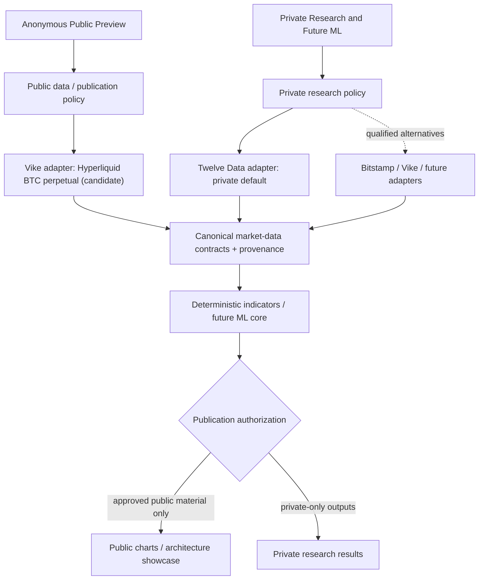
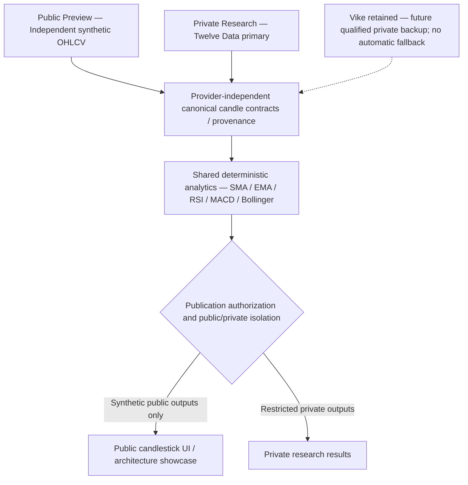

# Public Preview and Private Research Data Governance

**Project:** AIQuantTradingResearch  
**Status:** Approved product direction; provider qualification pending  
**Initial scope:** Release 1.14 and subsequent technical-analysis and ML milestones  
**Implementation prerequisite:** This policy and its derived requirements must be accepted before Release 1.14 implementation authority.

## 1. Purpose and business context

AIQuantTradingResearch is a noncommercial engineering portfolio and private quantitative-research platform. The public website demonstrates architecture and analysis capabilities to hiring managers and other visitors without exposing privately licensed market datasets. The public preview must avoid third-party subscription costs.

Two execution contexts are mandatory:

- **Public Preview:** anonymous, publicly accessible demonstration using market data independently qualified for public display and reuse, with required attribution.
- **Private Research:** the owner's nonpublic technical-analysis studies and future machine-learning experimentation, initially using Twelve Data subject to its applicable terms.

The contexts share canonical contracts and analytical algorithms, **not** publication entitlements. Public API access, free API access, authentication, or transformation into indicators does not automatically authorize redistribution.

## 2. Market identity and proposed sources

**Public Release 1.14 candidate:** BTC perpetual futures on Hyperliquid, accessed through Vike. Public charts must say **“BTC — Hyperliquid Perpetual Futures”**, identify Vike as the data provider and Hyperliquid as the venue, and disclose the verified quote/settlement characteristics. Never label these candles BTC/USD spot or silently substitute spot, perpetual, USD, or USDT markets.

**Private research default:** Twelve Data for personal technical-analysis evaluation and future private ML research, subject to the applicable agreement, including any storage, ML-training, and derived-artifact restrictions. Private Twelve Data candles, cached datasets, derived features, models, forecasts and exports are not automatically publishable.

**Future private alternatives:** Bitstamp, Vike or other providers may replace Twelve Data once qualified for the intended market and research use. Algorithms must remain provider-independent.

Vike's public candidate is **not approved for live activation merely by this document**. First-party licensing and upstream provenance, attribution, actual instrument semantics, endpoint behavior, history, gaps, coverage, free quotas, and 1h/4h/1d support require recorded evidence.

## 3. Logical architecture

This diagram represents intended boundaries, not a claim that every component already exists.

Adapters own provider-specific requests, authentication, pagination, error handling, normalization, market identity and provenance. Shared research algorithms consume canonical data. Provider selection is constrained by execution-context policy; **no automatic cross-context fallback**.

## 4. Non-negotiable controls

1. Separate public/private configuration, credentials, provider authorization, cache namespaces, routes, logs, exports, research artifacts and deployment permissions. Hidden UI controls or login alone are not sufficient isolation.
2. Public access fails closed if publication rights, provider qualification, market identity, or provenance is missing or invalid. Never fall back to Twelve Data on a public request.
3. Preserve originating venue, provider, instrument type, base/quote/settlement characteristics, interval, UTC boundaries, acquisition timestamp, license evidence, calculation version, gap policy and dataset fingerprint as applicable.
4. Preserve deterministic historical contexts, bounded warm-up, explicit gaps, accurate freshness, and bounded cache/resource use. Never fabricate or fill candles without a separately documented methodology.
5. Provider replacement cannot require rewriting indicator or ML core algorithms; however, replacement still requires data-quality, market-equivalence and licensing review.
6. No public subscription costs are assumed. Zero cost does not imply publication permission.
7. Research-derived indicators, features, forecasts, trained weights, datasets and model artifacts require publication review; transformation does not erase upstream obligations.

## 5. Provider-selection and qualification policy

| Provider / feed | Context | Decision | Activation prerequisites |
| --- | --- | --- | --- |
| Vike / Hyperliquid BTC perpetual | Public | **Candidate, not activated** | Confirm first-party reuse terms, upstream rights, attribution, exact market identity, 90 days plus warm-up, 1h/4h/1d, API behavior, quotas, costs and coverage |
| Twelve Data | Private research and proposed future private ML | **Preferred private source** | Confirm applicable personal-plan research, retention, ML-training and derived-artifact terms; prevent public redistribution |
| Bitstamp spot | Optional private alternative | **Unqualified** | Validate pair metadata, spot identity, intervals, history, quality and applicable rights |
| Other providers | Either context | **Unqualified** | Independent legal/terms and technical assessment |

A qualification record must capture: provider and first-party documentation URLs, license version/date, originating venue, instrument type and denomination, permitted audiences/outputs, upstream provenance, attribution, cache/retention limits, credentials, rate quotas, cost, technical coverage and test evidence, failure handling, reviewer and review date.

Requalify on material licensing, market or endpoint changes. Public activation requires both rights clearance and technical acceptance. When unavailable, display an honest unavailable or separately licensed illustrative state; do not leak private data.

## 6. Public-preview requirements derived from this policy

### Homepage keynote

Near the top of the main page, show a prominent section titled:

> **Quantitative Research Built with Responsible Data Governance**

Suggested copy:

> AIQuantTradingResearch separates its public engineering preview from private quantitative research. Provider-agnostic analytics, explicit market identity, and licensing-aware publication controls let us demonstrate capabilities without redistributing restricted market data.

Provide a real navigation link labeled **“Explore the Architecture & Data Governance”** to a dedicated page (proposed route: `/architecture/data-governance`).

### Dedicated public architecture page

Provide readable, responsive, accessible diagrams with text equivalents explaining:

- Public versus private data sources and execution-context boundaries.
- Provider adapters → canonical contracts → indicators and future ML → publication authorization.
- Why public/free API access differs from public-display or redistribution permission.
- Explicit Hyperliquid BTC perpetual futures versus BTC/USD spot market identity.
- Source provenance, reproducible historical context, deterministic calculations and gap treatment.
- Separate credentials, caches, endpoints and artifact access policies.
- Private Twelve Data research and qualified future Bitstamp/Vike substitutions.
- Future ML training data, features, model weights, predictions and publication review.
- Delivered functionality versus proposed capabilities, accurately labeled.

Show accurate attribution, venue, instrument type, and freshness alongside public charts. Never disclose credentials, restricted data, sensitive infrastructure details, or private research results. Avoid unsupported claims of legal certification or provider approval.

## 7. Derived Release 1.14 acceptance criteria

| ID | Acceptance criterion |
| --- | --- |
| AC107 | Homepage displays a prominent architecture and data-governance keynote near the top. |
| AC108 | Keynote links to a working dedicated architecture/data-governance page. |
| AC109 | Dedicated page includes accessible, responsive diagrams and equivalent text explaining public/private separation and provider independence. |
| AC110 | Page accurately identifies the Vike/Hyperliquid perpetual public candidate and private Twelve Data research role. |
| AC111 | Page distinguishes public API access, free usage, license rights and redistribution permission. |
| AC112 | Page explains future ML training-data and derived-artifact publication governance. |
| AC113 | Public chart clearly labels BTC Hyperliquid perpetual futures; never BTC/USD spot. |
| AC114 | Public outputs expose no private credentials, restricted datasets, derived private artifacts or sensitive internals. |
| AC115 | Mobile/desktop responsiveness, keyboard access and diagram descriptions are verified. |
| AC116 | Public claims distinguish implemented functionality from future roadmap items and pending qualifications. |
| AC117 | Public adapter activation is blocked until licensing, upstream provenance and technical qualification are documented. |
| AC118 | Negative tests verify fail-closed provider selection and no Twelve Data fallback from public requests. |
| AC119 | Canonical data preserves instrument type, venue, quote/settlement identity and provenance. |
| AC120 | Qualified private provider substitution does not change research core indicator or ML algorithms. |
| AC121 | Private derived ML features, models, forecasts and exports pass a separate publication review before public exposure. |
| AC122 | Public attribution, freshness, and unavailable-state explanations are accurate and visible. |

## 8. Mandatory Release 1.14 gates

**G-1 — Governance baseline:** Review and accept this policy as the controlling business/architecture requirement before implementation authorization.

**G-2 — Traceability:** Public UI, provider selection, isolation and analytical requirements trace to this policy and explicit acceptance criteria.

**G-3 — Provider evidence:** Record first-party licensing, upstream provenance, market identity, cost/quota, technical coverage and public-display rights before live public data activation.

**G-4 — Verification:** Before public deployment, pass tests for public/private isolation, no unauthorized fallback, truthful labels, attribution, accessibility and safe failure states.

## 9. Decision status and non-authority

**Accepted direction:** Two-context strategy, Twelve Data as preferred private research source, provider-agnostic analysis/ML, perpetual futures clearly labeled in public, homepage keynote and dedicated public architecture page.

**Pending qualification:** Vike/Hyperliquid BTC perpetual public use, including technical and rights evidence; private ML use rights and any derived-output publication.

**Not authorized by this document:** application code changes, new infrastructure, credentials, data ingestion, public feed activation, ML training, or deployment. Future milestones inherit these principles unless explicitly revised through architecture governance.

---

## 10. Release 1.14 amendment — synthetic public preview and retained secondary provider

**Decision date:** 2026-10-10  
**Status:** Proposed governance amendment, effective upon owner review and merge.  
**Supersedes:** Earlier Release 1.14 public-preview assumptions identifying Vike / Hyperliquid BTC perpetual candles as the intended public chart feed. Sections 1–9 remain governing where compatible; this amendment takes precedence where they conflict.

### Revised source-of-data decision

- **Anonymous Public Preview:** Use **independently generated deterministic synthetic OHLCV** exclusively. No public Vike or Twelve Data market-data calls, snapshots, perturbed real candles, or private derived data. Label prominently **“BTC-like Market Simulation — Synthetic Historical OHLCV”** with a visible statement that prices and volumes are illustrative, not exchange observations or investment advice.
- **Private Research:** Twelve Data is the **primary external market-data provider**, subject to its plan-specific access, retention, training and derived-output terms. Private data and results must never leak into public charts, caches, logs, artifacts or exports.
- **Retained Vike adapter:** Preserve existing Vike integration and the completed conditional qualification evidence for future provider-agnostic research and potential **private** resilience. No automatic fallback, public activation or equivalence assumption is authorized. A future fallback requires separately approved rights, instrument/venue/denomination equivalence, provenance, data-quality, operational and security controls.
- **Shared provider-independent architecture:** All sources must map through canonical candle contracts preserving source, market identity, UTC timestamps, interval, volume units, generation/version metadata and provenance. Shared indicator algorithms (SMA, EMA, RSI, MACD, Bollinger) must remain source-independent, while publication authorization remains context-specific.

### Revised architecture — normative diagram

The diagram below is the architecture reference for Release 1.14. The future public **Architecture & Data Governance** page **must display this architecture visually**, with an accessible text equivalent and accurate implemented-versus-planned labels. A standalone scalable SVG asset may be produced in a separately authorized UI work package; the Mermaid source here is the version-controlled diagram authority.

**Accessible text equivalent:** Independently generated public simulation candles and separately authorized private provider data enter a shared canonical representation and analytics core. Publication controls allow only synthetic outputs into the anonymous public chart. Twelve Data supplies private research. Vike remains a retained but inactive secondary provider candidate; it cannot automatically replace Twelve Data or feed the public chart.

### Traceability and acceptance amendments

Retain **AC107–AC122** and **G-1–G-4** identifiers; interpret them under the revised decision:

- **AC107–AC112, AC115–AC116:** Preserve the homepage governance keynote, real navigation to a dedicated accessible architecture page, public/private explanation, ML publication governance, and truthful implemented/planned distinctions. Replace any claim that Vike powers the public chart with the synthetic-preview decision.
- **AC113:** Public charts must clearly say **synthetic BTC-like simulation**, never BTC/USD spot, live BTC, or Hyperliquid BTC perpetual observations.
- **AC114, AC118, AC121:** Public/private isolation remains fail-closed; no Twelve Data or Vike fallback into public requests; no publication of private datasets, derived indicators, features, model artifacts or forecasts without separate authorization.
- **AC117:** External-provider public activation remains blocked pending explicit rights and technical qualification; Release 1.14 synthetic public charts do not depend on Vike qualification.
- **AC119–AC120:** Canonical market identity/provenance and provider-independent indicators remain required. Preserve Vike for future qualified private-provider substitution without promising market equivalence or automatic failover.
- **AC122:** Show synthetic provenance, generator version/seed or dataset fingerprint as appropriate, UTC context and honest freshness; do not attribute synthetic candles to Vike or Twelve Data.
- **G-1/G-2:** Governance acceptance and traceability must reflect this amendment before implementation authority.
- **G-3:** Independently generated synthetic public data must have auditable generation provenance and no provider-data derivation. Any future real public feed separately requires first-party licensing/upstream rights and technical acceptance.
- **G-4:** Before public deployment, test deterministic generation, OHLC invariants, UTC alignment, correct synthetic labels, accessibility, no private-data fallback, and absence of public provider secrets/calls.

### Implementation and governance boundaries

This amendment is **documentation-only**. It does not authorize application changes, new dependencies, provider activation, public deployment, automatic failover, paid services, ML training, changes to root README, or edits to existing adapter code. Preserve the zero-recurring-infrastructure-cost Azure F1 target. Reconcile older Release 1.13/1.14 public Vike assumptions through subsequent explicitly scoped governance and work packages; do not silently rewrite historical records.
