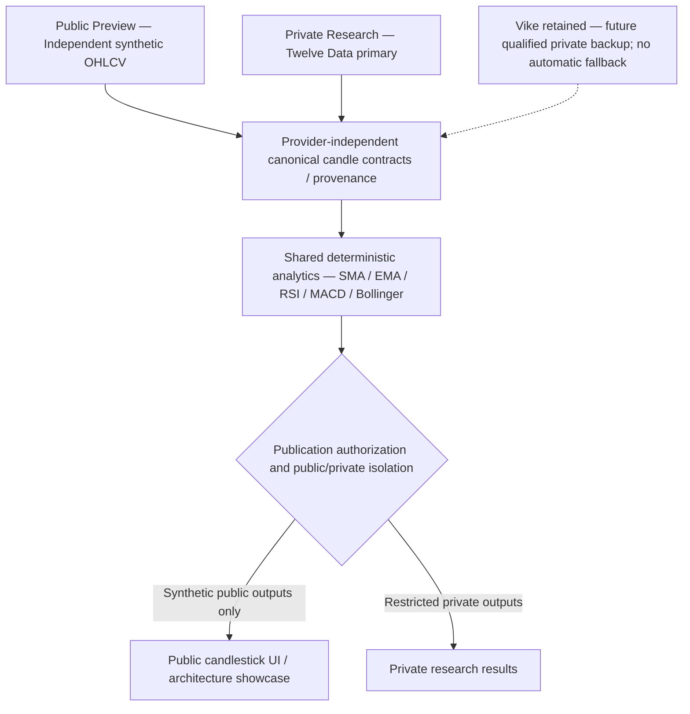

# Release 1.14 Definition — Synthetic Public Preview and Quantitative Foundation

## Status, authority and repository baseline

Status: WP01 engineering contract owner-approved and incorporated into local documentation on 2026-10-10. The approved selections below include the corrected dataset, generator, serialization, analytics, navigation, versions and isolation design. Resource limits are approved as provisional engineering targets. Independent golden verification, implementation tests, browser/accessibility, isolation and F1 profiling remain evidence gates. This does not authorize implementation or assert release acceptance.

Inspected on 2026-10-10: branch `main`, fetched `origin/main`, both at `893e54c058136a027bd9f8d2ad69019a2901aafc`. PR #316 merged at `b78bd8d8c0442633f6fd20286423245858899012`; PR #317 merged at the current baseline and adds the planning authority. These are inspection evidence, not fixed future predecessor requirements.

The controlling authority is [Public Preview and Private Research Data Governance, Section 10](../../architecture/business/PUBLIC_PREVIEW_AND_PRIVATE_RESEARCH_DATA_STRATEGY.md#10-release-114-amendment--synthetic-public-preview-and-retained-secondary-provider). Section 10 supersedes conflicting Sections 1–9 and older public-feed requirements. Compatible governance remains effective. Its lingering “Proposed” status is an editorial inconsistency following owner acceptance and PR #316, not permission to restore the old policy. A future separately authorized correction should state accepted status and merge evidence. This WP does not edit that document.

Read this definition with the [execution plan](RELEASE_1.14_EXECUTION_PLAN.md) and [file manifest](RELEASE_1.14_FILE_MANIFEST.md). The prior Codex inspection response is supporting planning context; this record is self-contained. Historical Release 1.13 contracts and evidence remain preserved.

## Purpose and non-goals

Deliver a future candlestick-first public engineering preview using independent synthetic OHLCV, a reusable canonical technical-analysis core, and visible data-governance architecture. Keep private research isolated while preserving Twelve Data and Vike integrations. Release 1.14 follows Release 1.13 and precedes Release 2.0.

Exclude trade/order execution, recommendations, buy/sell signals, brokerage, backtesting, ML training/inference, paid services, new packages, microservices, automatic provider failover and production HA/SLA claims. Preserve Azure Linux F1 and the $0 recurring infrastructure target. Planning evidence establishes no current Azure state or deployment readiness.

## Source roles and current implementation truth

| Context/source | Release 1.14 decision | Current versus planned |
| --- | --- | --- |
| Anonymous public | Independently authored deterministic synthetic OHLCV only | Generator, synthetic publication policy and UI are planned |
| Private Twelve Data | Primary external source, subject to applicable access, retention, derived-data and ML terms | Existing implementation normalizes daily close observations through `IObservationSource`; canonical historical OHLCV support is not delivered |
| Retained Vike | Preserve adapter and conditional qualification evidence for future separately qualified private backup | Adapter exists; no public activation, automatic failover or spot/perpetual equivalence is approved |
| Shared analytics | Canonical candles and source-independent SMA/EMA/RSI/MACD/Bollinger | Existing historical abstraction/cache/stdio/chart exist; requested indicator implementation is planned |

Public generation must not copy, sample, fit, perturb or train on licensed real market data, including Vike and Twelve Data. No anonymous provider requests, provider-derived fixtures or private derived outputs are allowed. A free/public API is not publication permission. Future real public feeds require separate rights, upstream provenance, identity, technical and owner approval; the synthetic baseline does not depend on Vike qualification. Private entitlements are not presumed from historical provider assessments. Private features, weights, forecasts and exports require separate publication review.

## Approved simulation planning baseline

| Dimension | Contract |
| --- | --- |
| Identity | `btc-like-simulation`; market type simulation, never BTC/USD spot or a perpetual |
| Coverage | Hourly UTC base grid from inclusive start `2025-10-26T00:00:00Z` through exclusive end `2026-10-01T00:00:00Z`; exactly 340 complete UTC daily buckets |
| Generator | Approved version `aiq-synthetic-ohlcv-v1`, public seed `114`, SHA-256 counter-based generation specified below |
| Aggregation | UTC-aligned 4h/1d buckets: first open, maximum high, minimum low, last close, summed simulated volume |
| Intervals/ranges | `1h`, `4h`, `1d` × `1D`, `7D`, `30D`, `90D`; all twelve combinations |
| Default | BTC-like simulation, `1h`, `30D` |
| Warmup | Exactly 250 prior candles at selected interval, excluded from visible display |
| Numbers | Decimal OHLCV, finite, positive prices, nonnegative illustrative activity units; decimal-safe deterministic serialization |
| Completeness | No gaps, duplicates or partial aggregate buckets; invalid data fails closed |
| Fingerprint | SHA-256 over versioned manifest and ordered canonical rows; excludes wall-clock generated-at |
| Request bound | At most 2,160 visible candles plus 250 warmup candles |

Each visible window ends at the fixed exclusive dataset end. Its start is that end minus the selected duration; include open boundaries in `[start, end)`. Hourly candles open on UTC hours, 4h candles at UTC hours 00/04/08/12/16/20, daily candles at UTC midnight. Generate from the fixed origin so overlapping selections cannot change candle values. Aggregate complete hourly buckets before selecting warmup and visible output.

**Dataset-coverage blocker resolved by owner approval on 2026-10-10:** the corrected inclusive start is `2025-10-26T00:00:00Z`, retaining exclusive end `2026-10-01T00:00:00Z`. UTC calendar subtraction gives 340 days, exactly sufficient for 90 visible daily candles plus 250 preceding daily warmup candles. No pre-origin candles, reduced warmup or narrowed matrix are needed. This is a planning-level arithmetic reconciliation, not generation, numerical validation or implementation authorization.

| Interval | Complete dataset candles | Visible 90D | Preceding warmup | Total 90D request |
| --- | ---: | ---: | ---: | ---: |
| 1h | 8,160 | 2,160 | 250 | 2,410 |
| 4h | 2,040 | 540 | 250 | 790 |
| 1d | 340 | 90 | 250 | 340 |

The complete hourly grid contains `340 × 24 = 8,160` candles; UTC-aligned four-hour aggregation gives `8,160 / 4 = 2,040`, and daily aggregation gives `8,160 / 24 = 340`. All twelve requests fit within this coverage with exactly 250 preceding candles at their selected interval. The request bound remains 2,160 visible plus 250 warmup candles, distinct from the complete dataset length.

| Interval | 1D | 7D | 30D | 90D |
| --- | ---: | ---: | ---: | ---: |
| 1h | 24 | 168 | 720 | 2,160 |
| 4h | 6 | 42 | 180 | 540 |
| 1d | 1 | 7 | 30 | 90 |

`1d × 1D` has exactly one visible candle. Indicators may use valid hidden warmup, never invented visible history. Simulation volume means illustrative activity units, not BTC, exchange turnover or observed market volume. Price units are illustrative; no actual quote currency, venue or settlement is implied.

Enforce `0 < Low <= min(Open, Close) <= max(Open, Close) <= High` and `Volume >= 0`, UTC offsets zero, aligned boundaries, ascending unique rows and complete expected counts. Overflow and malformed/nonfinite bridge values fail closed. Binary floats may be used only in the chart projection, never as canonical calculation or fingerprint inputs.

### Approved deterministic generator contract

All constants are independently authored for illustration, not estimates fitted or sampled from real feeds. Hash lanes separate boundary jitter (0), upper wick (1), lower wick (2) and activity volume (3). For boundary/candle index `i` and lane `l`:

```text
input = ASCII("aiq-synthetic-ohlcv-v1")
        || 0x00
        || UInt64BE(114)
        || UInt64BE(i)
        || UInt8(l)
digest = SHA256(input)
U(i,l) = UInt32BE(digest[0:4])
Z(i,l,m) = floor(U(i,l) * m / 4294967296)
```

BE means unsigned big-endian bytes; `digest[0:4]` is the first four bytes. Use unsigned integer arithmetic. The mapping is deterministic and does not claim perfect statistical uniformity. No runtime-default randomness or locale-dependent conversion.

Prices are integer ticks of 0.0001 illustrative price units:

```text
r = i mod 480
triangle(i) = r - 120       when r <= 240
              360 - r      otherwise
P(i) = 500000000 + 2500 * triangle(i) + Z(i,0,200001) - 100000

Open(i)   = P(i)
Close(i)  = P(i+1)
High(i)   = max(Open,Close) + 1 + Z(i,1,50000)
Low(i)    = min(Open,Close) - 1 - Z(i,2,50000)
Volume(i) = 100000 + Z(i,3,1000000)
```

Evaluate price boundary indices 0 through 8160; hourly candle indices are 0 through 8159. Divide OHLC ticks by 10000 and activity integers by 1000. Timestamp `i` is `2025-10-26T00:00:00Z + i hours`. There is no candle at the exclusive end; its price boundary closes the final candle.

Boundary prices lie within 49,960–50,040 illustrative units. Triangle slope is ±0.25 units/hour; boundary jitter is bounded by ±10; adjacent boundary movement is bounded by 20.25. Wicks are 0.0001–5.0000 units. Hourly activity volume is 100.000–1,099.999 arbitrary units. Open-to-previous-close continuity is exact. Integer construction needs no floating-point arithmetic or rounding. Checked arithmetic rejects invalid indices, overflow and invariant failure; never clamp or repair silently.

Aggregate complete groups of 4 or 24 hourly candles using first open, maximum high, minimum low, last close and summed activity volume, aligned from the UTC-midnight origin. The model is a bounded oscillating demonstration, not a calibrated market process. Generator/version/constants are immutable within the version; any change requires a new version and owner authority.

Generate the complete base dataset once per cold Worker request, aggregate/select and cache bounded accepted request results. No deployment/startup generation, background generator or persistent generation service. Lazy generation is not selected; a future optimization requires a separately accepted equivalence proof.

For interval length `h` hours and selected duration `d` days:

```text
totalIntervalCandles = 8160 / h
visibleCount = 24 * d / h
visibleStartIndex = totalIntervalCandles - visibleCount
calculationStartIndex = visibleStartIndex - 250
```

The earliest visible range begins `2026-07-03T00:00:00Z` (90D). Daily 90D warmup starts exactly at the approved dataset origin. All indices are interval-candle indices; multiply by `h` to obtain base-hour indices. No pre-origin generation is needed. Overlapping selections must yield identical candle values irrespective of clock, locale, execution order or range; recursive indicator equality is a separate matter below.

### Approved canonical serialization and fingerprint contract

Canonical dataset bytes are UTF-8 without BOM, LF (`0x0A`) only, with a final newline. Emit this fixed header order, replacing `<1h|4h|1d>` with the selected interval literal:

```text
aiq-synthetic-dataset-v1
canonical=aiq-candles-v2
source=independent-synthetic
status=simulated
instrument=btc-like-simulation
marketType=simulation
venue=none
base=none
quote=none
settlement=none
priceUnit=illustrative-price-unit
volumeUnit=illustrative-activity-unit
generator=aiq-synthetic-ohlcv-v1
seed=114
start=2025-10-26T00:00:00Z
endExclusive=2026-10-01T00:00:00Z
interval=<1h|4h|1d>
priceScale=4
volumeScale=3
columns=openTimeUtc,open,high,low,close,volume
```

Append ascending rows `YYYY-MM-DDTHH:mm:ssZ,open,high,low,close,volume` followed by LF. OHLC has exactly four fractional digits; volume exactly three. No exponents, grouping, spaces, alternate timestamp spellings or CRLF. `datasetFingerprint = lowercaseHex(SHA256(all bytes))`. Exclude generated-at, validation/cache times and indicators. Constants are fixed by the generator version specification.

Window serialization uses the same format, with first line `aiq-synthetic-window-v1`; immediately before `columns`, insert these lines in order: `range=<range literal>`, `visibleStart=<UTC timestamp>`, `calculationStart=<UTC timestamp>`, `warmup=250`. Timestamps use the same UTC-second spelling. Serialize the entire calculation window including hidden warmup and hash separately as `windowFingerprint`. Complete-dataset coverage in the header stays fixed. Analytics identity includes window fingerprint, calculation version and the fixed parameter set. Dataset/window identity is independent of operational generated-at and presentation.

### Reference vectors and pending independent evidence

The owner-approved engineering proposal reported independent Python and PowerShell/.NET reproduction of these three row vectors and hashes. They are transcribed here; this documentation update does not independently re-run generation. Each row has exactly one final LF, excluded from visual rendering below but included in the hash.

First hourly candle:

```text
2025-10-26T00:00:00Z,49969.1046,49973.6524,49961.7725,49962.8831,366.310
```

SHA-256: `987c0eb293692c988474f3e29c2e2324aef42ffcbbc8d448dc7f7a48a3d5f744`.

First aligned 4h aggregate:

```text
2025-10-26T00:00:00Z,49969.1046,49978.4032,49959.6323,49963.6863,1769.191
```

SHA-256: `75a3ee54c5c4f12ac3c1a39d732899cc977747cfa146605f7f2a4357812da79a`.

Final hourly candle (the final visible-range candle for every hourly selection):

```text
2026-09-30T23:00:00Z,49977.1349,49979.5310,49968.9920,49973.5849,115.148
```

SHA-256: `6b18c0a41339ec6e754d70475b9b6d52c1e18c567b6f8cfdeb3323caa5e9b708`.

Candidate full-dataset fingerprints from the proposal's Python reference only:

| Interval | Canonical bytes | Candidate SHA-256 |
| --- | ---: | --- |
| 1h | 596,926 | `5b187d5bea1fd202077c33713855f9c0518446ce6a8864a5249daa0e7e45dc29` |
| 4h | 151,407 | `d713767c7afeb5d3f535e8276e1cecb905b3f2d6c096aac5a62214f62ccc22ec` |
| 1d | 25,957 | `0fc878f11193073aa88f71b026825c9f7cbb4cb18d5c87fec2d66a9e44291c81` |

These are not independently verified complete-dataset fixtures. WP02 must independently reproduce complete bytes/counts/hashes before accepting them as release goldens. Do not infer implementation from accepted formulas or reference results. Future tests must cover cross-runtime equality, overlap, changed clock/locale/request order, aggregation boundaries, invariants and all twelve warmup/visible windows. New fixture files require separate literal authority.

## Canonical, analytics and publication contracts

Extend the existing Application-owned historical contracts minimally; preserve decimal candles and `IHistoricalMarketDataProvider`. Reuse the existing read service, atomic file cache/lock and bounded Worker stdio chain. No Python generator, direct browser feed, SQL access or parallel analytics pipeline.

Approved versions: `aiq-candles-v2`, `aiq-historical-query-v2`, `aiq-historical-market-data-cache-v2` and `aiq-ta-v1`. Public v2 requests contain only contract version, synthetic instrument, interval, range and bounded deadline; execution context/source authorization is server-owned. Reject public v1 observed-market requests, source overrides, private identities, unknown/duplicate/malformed fields, invalid grid and fingerprint mismatches. Legacy observed functionality is preserved only in its isolated private context. Responses carry validated provenance, fingerprints, ordered visible candles, aligned indicator values and typed public-safe state/failure; raw provider payloads remain outside canonical contracts.

Provenance must preserve source, simulated/observed status, market type, instrument, venue, base/quote/settlement where applicable, price/activity units, UTC interval and bounds, generated/acquired/validated timestamps as applicable, generator version/seed/configuration, dataset fingerprint, contract version and calculation version. Simulation venue/quote/settlement are explicitly inapplicable, not fabricated market metadata. Observed inputs require actual identity and relevant rights evidence. Legacy `BtcUsd`/`EthUsd` enums must not represent the simulation.

Public publication requires valid synthetic identity, independent generation provenance, complete validated grid and matching fingerprint/context. Missing/unknown metadata, mixed sources, private data, legacy observed payloads or invalid derived outputs fail closed. Source display strings are not authorization. Validate cache retrieval and final serialization; derived indicators retain the source/context/fingerprint of their inputs. No Twelve Data or Vike fallback on any public error.

Approved cache namespaces: `public-synthetic` and `private-research`, with distinct roots `/home/aiq-public-synthetic-cache` and `/home/aiq-private-research-cache` and separate access permissions. Public runtime cannot mount/read the private root or legacy Vike entries. Include context, instrument, source, generator/version/seed, fixed bounds, interval/range and contract in keys; analytics caching also includes parameters/calculation identity. Preserve atomic replacement and bounded coordination/cancellation. Resource/retention limits below are approved provisional targets, not measurements. No schema migration is proposed.

## Approved analytical contract and pending validation

Calculation version: `aiq-ta-v1`. Shared Application-owned algorithms take chronological canonical close prices and emit timestamp-aligned nullable decimal values plus input/parameter/calculation identity. Scale `S=10^12`; an integer represents decimal units divided by `S`. Accept finite positive closes exactly representable at this scale; reject excess precision instead of silently rounding. Input close bound is `10^9`, calculation count at most 2,410. Use built-in arbitrary-precision integers for intermediate products, without a new package.

`R(n/d)` means nearest-integer rounding, midpoint ties to even, symmetric for negative values; denominators are positive. Every explicitly divided seed/recurrence expression below is rounded once by R. No implicit binary float arithmetic. Canonical indicator outputs have exactly twelve fractional digits. Display price/price indicators to four places, RSI to two and activity volume to three; hover/table retains canonical precision. Chart float conversion follows validated decimal computation only. Zero/negative analytical outputs, including lower bands, are valid and must not be constrained by positive candle-price rules.

Positions below are one-based within the full calculation input, including warmup; zero-based implementation positions are one less. Let X be scaled closes.

| Indicator | Exact operation | First valid sample |
| --- | --- | ---: |
| SMA20 | `R(sum(last20 X)/20)` | 20 |
| EMA N | Seed `R(sum(first N X)/N)`; recurrence `R((2X+(N-1)*previous)/(N+1))`; EMA20 uses N=20 | N |
| Wilder RSI14 | Seed rounded average gains/losses over first 14 close changes; recurrence `R((13*previous+current)/14)` | 15 |
| MACD12/26/9 | EMA12 minus EMA26; SMA-seeded EMA9 over valid MACD; histogram MACD minus signal | MACD 26; signal/histogram 34 |
| Bollinger20 | Rounded SMA20 ± twice rounded population standard deviation | 20 |

For RSI, scaled gains/losses are positive/negative parts of consecutive close differences. Return `R(100S*averageGain/(averageGain+averageLoss))`. Both averages zero gives `50S`; zero loss with gain gives `100S`; zero gain with loss gives zero. EMA recurrence is the specified integer form of alpha `2/(N+1)`, not a separately rounded alpha.

### Exact population standard deviation

For 20 scaled closes:

```text
A = 20 * sum(X^2) - sum(X)^2
sigma = sqrt(A) / 20
k = floor(sqrt(A) / 20)
```

Compute integer floor square root using integer binary search. Compare `4A` against `20^2 * (2k+1)^2`; choose k or k+1 by nearest rounding, and on equality choose the even integer. Sigma is therefore an integer at scale S. Form bands from rounded SMA and twice rounded sigma. No floating-point square root, convergence tolerance, iterative decimal rounding or lower-band clamp.

### Reference analytical cases

These cases were evaluated in memory in the owner-approved engineering proposal, not application tests run under this documentation authority. Independent implementation tests remain WP04 evidence.

| Closes | SMA20 at 20 | EMA20 at 21 | RSI14 at 15 | MACD at 26 / signal at 34 |
| --- | ---: | ---: | ---: | --- |
| Constant 100 for 40 samples | 100 | 100 | 50 | 0 / 0 |
| 1 through 40 | 10.5 | 11.5 | 100 | 7 / 7 |
| 40 through 1 | 30.5 | 29.5 | 0 | -7 / -7 |

For constant 100, valid Bollinger bands coincide at 100 and MACD histogram is zero. For the increasing/decreasing cases, histogram at sample 34 is zero. For closes 1 through 20, population variance is exactly 33.25: sigma `5.766281297335`, lower `-1.032562594670`, middle `10.500000000000`, upper `22.032562594670`.

For `100,101,100,101,...`, RSI at sample 15 is 50. At sample 16, rounded average gain/loss are `0.535714285714` / `0.464285714286`; RSI is `53.571428571400`. Rounding checks: `R(1/2)=0`, `R(3/2)=2`, `R(-1/2)=0`, `R(-3/2)=-2`.

Null before each first-valid position; never substitute zero or forward-fill. Reject gaps, duplicates, malformed values and misalignment before calculating; no lookahead. Calculate over exactly 250 preceding candles plus visible input, then return only visible outputs. EMA/RSI/MACD depend on each calculation-window seed; overlapping ranges may produce different recursive outputs. Preserve calculation start/window fingerprint and do not promise range-independent recursive equality. Future independent tests cover mixed series, square-root midpoints, overflow and no-lookahead, in addition to these references.

## Anonymous startup and information isolation

Current public historical DI and cache-lock identity hard-code Vike. Python child invocation inherits the environment; container startup requires Twelve Data credentials and starts a legacy Worker. Anonymous System Health reads its handoff. These are future design/validation scope, not edits authorized here.

Approved public startup must succeed without provider credentials and cannot construct an external provider client or start a private acquisition/replay Worker. Construct the child environment from scratch using fixed server-owned Linux runtime variables: PATH, DOTNET_ROOT, HOME, TMPDIR, LANG/LC_ALL/TZ, telemetry-disable settings, public Worker mode and public cache path; set `DOTNET_PROCESSOR_COUNT=1`. Never inherit API keys, provider settings, connection strings, private paths or exporter endpoints. Public deployment cannot mount private caches, datasets, models, features, exports or logs. Hidden controls/login alone do not isolate contexts. This is an approved design for future implementation, not a claim that current startup is isolated.

System Health may publish only independently sanitized public operational evidence, with no private observation values or private handoff access. If safe evidence is unavailable, show a truthful controlled unavailable state. Private Worker behavior remains preserved in its separately authorized context. Test logs, stdout/stderr, failures, exports, cached responses and all anonymous navigation paths, not only the default chart.

Preserve existing Twelve Data daily-close observation integration and Vike adapter/qualification evidence. New private canonical historical OHLCV and automatic failover are deferred to separately authorized future work, not Release 1.14 prerequisites. Private retention/ML/publication entitlements remain conditional and unverified; preservation does not establish rights or market equivalence.

## Public UX and architecture page

Display prominently **“BTC-like Market Simulation — Synthetic Historical OHLCV”** and: **“Prices and activity units are illustrative, not observed market prices or investment advice.”** No BTC/USD/ETH/USD observed-market selector or provider attribution remains on the synthetic chart. The candlestick chart dominates the research surface with interval/range controls, UTC OHLCV hover, activity-volume panel, SMA/EMA/Bollinger overlays and separate RSI/MACD panels. Provide bounded zoom/pan, keyboard-operable controls, readable responsive layouts and an accessible table alternative.

Initial load, accepted selection changes and explicit bounded retry may invoke the governed service. Hover, zoom, pan, overlay toggles and ordinary reruns do not trigger acquisition/generation processes. Loading/empty/invalid/unavailable states are controlled and expose no paths, URLs, secrets, raw exceptions or provider errors. A complete fixed dataset does not become market-stale with wall-clock age; stale cache-version/integrity states cannot masquerade as valid data.

Show generated-at separately from fixed simulation coverage through the exclusive end, generator version/seed, fingerprint and UTC context. Never label simulation timestamps market-as-of or live/latest exchange updates. Distinguish dataset boundaries from last candle open/close. Retain the research/demo/no-trade-execution boundary.

Near the homepage top display **“Quantitative Research Built with Responsible Data Governance”** with real navigation labeled **“Explore the Architecture & Data Governance”** to a dedicated page. Approved navigation uses the existing Streamlit 1.61.1 application and these query values: `?page=market-research`, `?page=ml-studies`, `?page=system-health`, `?page=data-governance`. Missing page defaults to Market Research; accept only one recognized page value. Unknown/repeated values produce a safe navigation explanation and home link. Resolve URL selection before rendering and synchronize the radio control, including Architecture & Data Governance, without rerun loops.

Use a static same-tab anchor `<a href="?page=data-governance" target="_self">Explore the Architecture &amp; Data Governance</a>` and a return link to `?page=market-research`. JavaScript is disabled; no query-derived/untrusted HTML, remote renderer, proxy rewrite or multipage migration. No new `/architecture/data-governance` deep-path route is selected. The installed pinned source includes query-parameter/HTML APIs; its link button opens a new tab and is not the same-tab mechanism. Ordinary anchors create browser history entries; Back/Forward, reload and direct links in a fresh session require WP06/WP08 tests. Chart defaults may reset in a fresh session; radio-only history is not assumed verified. Architecture navigation makes no provider calls and reads no private handoffs. A dead link or Markdown-only architecture display fails acceptance.

The dedicated page must visually render the normative Section 10 topology using an accessible responsive SVG plus complete adjacent text equivalent. Proposed exact asset/page paths are in the manifest; this WP creates neither. Include scalable viewBox, readable layout at 320/768/1280px, contrast, accessible name/title/description, keyboard access/visible focus where interactive and no color-only distinctions. Solid synthetic/Twelve Data connections and dashed inactive future Vike connections preserve canonical core, analytics, gate and separated outputs. No JavaScript, external images/fonts or remote Mermaid renderer. Test mobile/desktop, screen-reader and keyboard behavior and preserve implemented/planned labels plus synthetic disclosure.



Text equivalent: independently generated public simulation candles and separately authorized private provider data enter a shared canonical representation and analytics core. Publication controls allow only synthetic outputs into the anonymous chart. Twelve Data supplies private research. Vike remains retained and inactive as a future qualified private candidate; it cannot automatically replace Twelve Data or feed the public chart. The diagram describes logical shared contracts, not private datasets co-hosted in an anonymous process.

Explain access versus publication rights, provenance, separate credentials/caches/artifacts, future ML publication review and accurate delivered/planned labels. Existing adapters/bridge/chart are delivered code; new synthetic generator, enriched isolation, indicators and page remain planned until accepted. Prior infographic is illustrative, not normative authority.

## Conflict register and documentary reconciliation

All replacement decisions below derive from Section 10 accepted through PR #316 and the owner-approved WP01 planning baseline. Proposed resolutions are recorded here; referenced files are not changed by this WP.

| File / section | Obsolete assertion or gap | Replacement / proposed resolution | Authority |
| --- | --- | --- | --- |
| `docs/architecture/business/PUBLIC_PREVIEW_AND_PRIVATE_RESEARCH_DATA_STRATEGY.md` §§1–3, 5, 9 | Public Vike/Hyperliquid candidate and old diagram | Synthetic baseline; future real-feed rights remain separately gated; propose dated consolidation under new authority | Section 10 / PR #316 |
| Same file §10 status | “Proposed” despite accepted merge | Future targeted accepted-status/merge correction; do not reopen policy | Owner authority / PR #316 |
| Same file §§6–7 AC110/113 | Public page/chart identifies Hyperliquid perpetual | Synthetic chart and Twelve Data private/Vike retained roles; retain IDs | Section 10 |
| Same file §8 G-3 | Provider qualification prerequisite for public baseline | Independent synthetic provenance now; separately licensed future real feeds later | Section 10 |
| `docs/roadmap/release-1.13/RELEASE_1.13_DEFINITION.md`, Product and first-screen contract | BTC/USD/ETH/USD public instruments and BTC/USD default | Single `btc-like-simulation`, same interval/range default; preserve historical record | Section 10 / approved baseline |
| Same definition, Provider and data boundary | Vike public source/attribution | No anonymous external source or provider attribution; cross-reference supersession here | Section 10 |
| Same definition, Cache-first/public-state contract | Provider freshness/outage language | Fixed simulation coverage, generated-at and integrity/version state; preserve historical text | Section 10 |
| `docs/roadmap/release-1.13/RELEASE_1.13_WP01_CONTRACT.md`, Product contract | Two symbols × twelve combinations | One simulation × twelve approved combinations; one daily candle case explicit | Approved WP01 baseline |
| Same WP01 contract, Provider abstraction | BTC/USD mapping to Vike BTC; public attribution assumptions | No simulation/spot/perpetual equivalence; retain as historical provider evidence | Section 10 |
| Same WP01 contract, UI acceptance/cache sections | Vike “Last updated” and observed volume | Generator identity, fingerprint, UTC coverage/generated-at and illustrative activity units | Section 10 |
| `docs/roadmap/release-1.13/RELEASE_1.13_EXECUTION_PLAN.md`, WP03–WP06/frozen UI topics | Public Vike activation/attribution sequence | Release 1.14 graph and synthetic acceptance replace prospective policy, without rewriting 1.13 history | Section 10 |
| `docs/project/ROADMAP.md`, Releases 1.13/1.14 | 1.13 PLANNED/public Vike; 1.14 RESERVED/candidate indicators | Future authorized status reconciliation using current lifecycle evidence and accepted new direction | Section 10 / owner review |
| `src/AIQuantTradingResearch.Application/MarketData/HistoricalMarketDataContracts.cs` | Only observed symbol enums and limited provenance | Future distinct simulation identity, units/context/provenance; retain adapter compatibility | Section 10 |
| `src/AIQuantTradingResearch.Infrastructure/DependencyInjection.cs`, `src/AIQuantTradingResearch.Worker/Program.cs`, `src/AIQuantTradingResearch.Worker/HistoricalMarketDataQueryExecution.cs` | Hard-coded Vike composition and lock identity | Future synthetic-only public binding and context-aware lock/key | Section 10 |
| `python/presentation/historical_market_bridge.py` | Observed selectors, strict v1 payload, inherited environment | Future versioned synthetic protocol, bounded capture and runtime allowlist | Section 10 / isolation contract |
| `python/presentation/realtime_financial_visualization.py`, market rendering/caption | Vike public claim, BTC/USD/ETH/USD controls, market freshness | Future exact synthetic disclosure and timestamp/units semantics | Section 10 |
| `container/entrypoint.sh` and anonymous System Health rendering | Provider credential requirement/legacy handoff | Future public startup independence and sanitized evidence | Section 10 |
| `imgs/showcase/Release 1.14 Governance Amendment.png` | Potential architectural illustration | Preserve untouched; Section 10 Mermaid is authoritative | Section 10 |

Historical provider assessments, qualifications and Release 1.13 acceptance remain dated evidence, not current rights/market-equivalence certification. No standalone qualification report was located during the prior inspection; retain available records and do not invent clearance.

## Acceptance and gate traceability

| ID | Release 1.14 interpretation | Evidence owner |
| --- | --- | --- |
| AC107 | Prominent exact homepage keynote | WP06 |
| AC108 | Working dedicated-page navigation | WP06 |
| AC109 | Visually rendered responsive architecture and complete text equivalent | WP06 |
| AC110 | Synthetic public / Twelve Data private / inactive retained Vike roles | WP06/WP07 |
| AC111 | API/free access distinguished from license/publication rights | WP06 |
| AC112 | Future ML training/derived-artifact publication governance explained | WP06 |
| AC113 | Exact synthetic label; no observed spot/perpetual identity claims | WP02/WP05 |
| AC114 | No private credentials, restricted data/artifacts or sensitive internals on any public surface | WP03/WP07/WP08 |
| AC115 | Keyboard, diagram descriptions and mobile/desktop accessibility | WP05/WP06/WP08 |
| AC116 | Truthful implemented/planned/pending distinctions | WP05/WP06 |
| AC117 | External public activation blocked; synthetic baseline independent of Vike qualification | WP03/WP07 |
| AC118 | Negative fail-closed tests; no public Twelve Data/Vike fallback | WP03/WP07/WP08 |
| AC119 | Canonical market identity, units and source/generation provenance | WP02/WP03/WP04 |
| AC120 | Shared analytics independent of source; future substitution requires separate qualification | WP04/WP07 |
| AC121 | Private ML/features/models/forecasts/exports require separate publication review | WP03/WP06/WP07 |
| AC122 | Visible synthetic provenance/fingerprint, honest UTC coverage/generated-at and safe states | WP02/WP05 |

| Gate | Revised requirement / state |
| --- | --- |
| G-1 | Section 10 accepted through PR #316; engineering contract owner-approved and incorporated; each implementation WP still requires separate authority |
| G-2 | All UI, source, isolation and analytical requirements trace to this definition, WPs and literal paths |
| G-3 | Auditable independent synthetic generation; future real public feed requires separate first-party rights/upstream/technical qualification; private entitlements remain conditional |
| G-4 | Before separately authorized deployment, prove deterministic generation/invariants/grid, isolation/no provider calls, truthful labels/states, accessibility and resource safety |

## Approved provisional F1 resource and process targets

These limits are owner-approved provisional engineering targets, not measured capacity, Azure quotas or deployment readiness. Enforcement belongs to separately authorized implementation; profiling/F1 acceptance remains a gate.

| Boundary | Provisional engineering limit |
| --- | --- |
| Cold generation | 8,160 hourly candles; at most 10,540 retained candles if all aggregates coexist |
| Calculation input | At most 2,410 candles |
| Public serialization | At most 2,160 visible candles and aligned indicator rows; warmup stays server-side |
| Request | 4,096 bytes enforced while reading |
| Response/stdout | 2,097,152 bytes enforced during capture |
| Stderr | 16,384 bytes, never displayed |
| Capture read chunk | At most 8,192 bytes |
| Public child concurrency | One globally admitted child across sessions/processes per app instance |
| Admission wait | At most 1 second, otherwise controlled Busy/unavailable |
| Worker operation deadline | 10 seconds |
| Admission-to-cleanup deadline | 15 seconds including reap |
| Cancellation | TERM, at most 1-second grace, then kill/reap within the total bound |
| Retry | No automatic retry; explicit retry at most once per session per 10 seconds |
| Public cache | At most 12 selection entries, at most 2 MiB each |
| Public cache disk | At most 32 MiB including bounded temporary files |
| Cache retention | 24 hours since write; opportunistic cleanup, no background poller |
| Session response retention | One current response, expires after 30 idle minutes on next interaction |
| Public health handoff | At most 64 KiB, public operational metadata only |
| Child peak RSS | At most 160 MiB |
| Total container working set | At most 640 MiB |
| Cold request CPU | Performance evaluation target: at most 2 CPU-seconds; not hard enforcement |
| Latency targets | Cold p95 at most 5 seconds; warm p95 at most 2 seconds |
| Aggregate child CPU admission | C2 candidate reservation caps: 60 CPU-seconds/rolling 900 seconds and 240/rolling 86,400 seconds; not actual consumption ceilings; qualification pending |

CPU admission fails closed when its budget is exhausted; parent Streamlit CPU is additional and requires profiling. Disk/session TTL is retention policy, not market freshness. Entry/byte limits include bounded temporary artifacts and cannot be bypassed by concurrent requests.

Observed existing constants are 4,096 request bytes, 2,000,000 response bytes checked after capture, 15-second bridge timeout, cache count 32 and 35-second lock lease. They are historical code facts, not measured safety. Current Python `capture_output` and Worker `ReadToEndAsync` check size after buffering; future implementation must enforce real bounds.

Drain stdout/stderr concurrently, count raw bytes before appending and terminate/reap on overflow, timeout or cancellation. Enforce request bounds before deserialization. Reject invalid UTF-8, duplicate keys, extra fields, endless streams and stderr floods. Suppress raw stderr. Retain bounded filesystem coordination and the existing 35-second lease pending race/abandoned-lock tests; add a global public admission slot instead of relying only on per-key locks. Lease expiry alone must never allow overlap of live children; owner-token checks and process cleanup require proof.

WP03 owns request/protocol/cache/lock enforcement; WP07 owns global admission, capture, environment, startup and health enforcement; WP08 owns integrated resource acceptance. Independent profiling requires separate authority: cold/warm requests, all twelve selections, at least five concurrent sessions, timeout/flood/cancellation, parent-plus-child memory/CPU, cache cleanup/restart and current applicable F1 limits. If the pinned stack exceeds targets, stop for scoped owner reconciliation; never assume paid upgrades or wider authority.

## Residual evidence gates, risks and non-authorities

The coverage blocker and engineering design selections are resolved by owner approval. Remaining gates are independent full-dataset golden verification (WP02), independent indicator tests (WP04), browser/history/accessibility (WP06/WP08), public/private isolation and hard capture/admission (WP03/WP07/WP08), and resource profiling/current F1 acceptance (WP08 under separate authority). These include evidence gates and the pending Option B effective-policy review; numerical planning approval does not establish runtime qualification. No implementation acceptance is claimed.

Private canonical OHLCV and automatic fallback are deferred to a future release, not prerequisites here. Rights remain unresolved for applicable private retention/ML/derived publication. Historical Azure evidence is resource-specific and cannot establish current health, region, quotas or readiness. Dependency pins remain unchanged; existing Plotly/Streamlit are reused. Missing fixture/test/script paths, scope conflicts, golden mismatches or failed budgets require scoped owner review; do not expand this authority or narrow the approved matrix/warmup silently.

This WP authorizes exactly the three planning documents. No edits to policy, roadmap, historical records, source, tests, UI assets, packages, schema, credentials, Docker/Azure or README; no live provider calls, GitHub issues/Projects, branches, commits, PRs, merges, tags/releases or deployment. Owner retains substantive acceptance and merge authority. Required out-of-scope changes stop for separate authority.

**NO IMPLEMENTATION OR DEPLOYMENT AUTHORIZED.**

## WP01 planning publication authority

On 2026-10-10 the owner explicitly authorized closing WP01 planning through a documentation-only GitHub PR containing all eight existing untracked planning/authority/image files, followed by merge. This subsequent instruction supersedes earlier local-only branch/commit/PR/merge restrictions solely for that publication lifecycle. It does not authorize implementation, provider calls, evidence-gate bypass or deployment. The file manifest records the exhaustive publication set.

The included governance amendment PNG is a historical illustration, not the normative architecture or verified licensing-compliance evidence. Its stronger compliance wording and simplified output diagram do not establish rights, bypass the Section 10 publication gate or authorize Vike fallback. Section 10 and this approved contract govern. The image is preserved as supplied, not activated as the planned public architecture page.


## Option B documentation reconciliation - pending final owner policy review

**Documentation authority:** Owner explicitly approved the consolidated planning artifact's Section 9 four-path documentation packet on 2026-10-10. Recommended dispositions and numerical evaluation criteria are approved for this reconciliation. The resulting policy diff still requires separate owner review before this addendum becomes effective. Existing controlling policy remains in force until that review; G-B0 is not complete. No implementation, active tests, lifecycle action or public activation is authorized.

**Planning decision:** Retain external supervision, approved C# generator/shared `aiq-ta-v1` analytics and bounded Worker UTF-8 transport. Replace hard CPU-consumption claims with conservative admission-reservation policy and explicitly measured residual availability/resource risk only upon effectiveness of the amendment. Confidentiality, synthetic provenance, exclusive admission and independently verified cleanup are not relaxed. Guardian-only flock is rejected as sufficient fencing: Phase 1B observed admission reopening before registered process exit notifications.

**Admission domain and recovery:** One qualified public container instance, shared across its sessions/processes; other region remains disabled for this public path. Unexpected topology/identity or inaccessible shared state fails closed. Durable occupied state and reservation precede any Worker creation; registration and verified READY/START precede computation. No final-holder death, deadline, TTL, boot change or numeric PID alone clears occupation. Unknown cleanup/settlement denies generation indefinitely; operator recovery requires independent proof, authentication and audit. Storage and recovery implementation remain unqualified.

**Reservation arithmetic:** Charge 16 reserved CPU-seconds per admitted or uncertain-start job; at most three admissions in rolling 900 seconds and fifteen in rolling 86,400 seconds, subject also to 60/240 reservation caps. Three charges total 48; fifteen total 240. Persist atomic history across restart, use UTC event timestamps with rollback/high-water safeguards and monotonic in-lifetime deadlines; inconsistent/missing evidence denies generation. These are not actual consumption ceilings, midnight-reset quotas or Azure-metered usage. Session cooldown is 10 seconds, with three expensive attempts/client/rolling 60 seconds as supplementary defense; rotation never bypasses global limits.

**Hold:** `PUBLIC_RUNTIME_VERIFIED = False`; PR #330 remains draft/unmerged, issue #322 open and dependent WP05 activation blocked. Gate approval is not implementation acceptance or activation authority. Candidate numerical criteria are unmeasured. Separate architecture, mutation, verification, acceptance and lifecycle authorities remain necessary.

### Resource and abuse qualification criteria

| Boundary | Proposed acceptance/evaluation value | Precise scope and failure treatment |
|---|---|---|
| Health latency |Warm running-host healthp95<=1second; every sampled response<=3seconds; zero unexpected5xx/timeouts in each authorized qualification batch |Report startup/restoration separately, not hidden in warm figures. Baseline and loaded figures must both be disclosed with sample count. Fail qualification on breach; no claim of availability under arbitrary ingress |
| Health headroom |Loaded healthp95 no more than2times the same-instance warm baseline, while also satisfying the absolute1second limit |Protect an independent health path/class. Controlled monitoring at most1check/10seconds per test observer, finite predeclared count; this is a test sampling cap, not authorization to throttle Azure platform probes |
| Cached service reads, global |At most30 accepted cached-chart service reads in rolling60seconds; maximum2 in any rolling1second; one active cached read across the admitted instance |No waiting queue; excess requests receive cheap bounded Busy/unavailable without Worker launch. Apply accounting before disk validation/projection/analytics/serialization; invalid/denied ingress costs remain outside this protection |
| Cached service reads, session |At most6 accepted reads/rolling60seconds per session, additionally subject to all global controls |Session rotation cannot bypass global limits. Hover/zoom/ordinary client rerender remains acquisition-free. These counters are separate from expensive attempts and generation reservations |
| Limiter state |Maximum1024 live supplementary client/session limiter records, idle retention30minutes; no silent counter-reset eviction that grants admission |At capacity, reject new expensive/client-class admissions cheaply or apply the strict global-only denial policy; existing global history survives. Implementation must bound identifier lengths and bookkeeping bytes separately |
| Generation and supervision daily CPU evaluation allowance |At most10% of applicable documented daily F1 CPU quota, provisionally360CPU-seconds if the target quota is verified as3600seconds/day |Include Worker descendants, request setup/guardian and attributed supervision/cleanup overhead. This is measured allocation/qualification, not kernel enforcement. Cache-hit/denial/UI/HTTP/background CPU must be measured separately and still fit total operating headroom |
| C2 quota-availability admission |Missing/stale/unverifiable Azure quota telemetry alone does not deny admission when every qualified mandatory local budget, isolation, journal, recovery, abuse and health condition is satisfied |Unknown observation time means unknown freshness/headroom; never assert >20% actual Azure headroom when unknown. Authenticated trustworthy exhaustion/unsafe-condition evidence may tighten denial. Global health breaker trip/recovery thresholds remain unresolved; no production qualification is claimed |
| CPU overshoot acceptance |For each fully accounted qualification job, actual attributable request CPU must be<=20CPU-seconds, i.e. at most4seconds above the16second policy reservation |Include descendants and per-job setup/cleanup/supervision. Incomplete accounting does not pass. Normal cold-work2CPU-second performance target remains. This is an observed acceptance criterion, not a crash-safe hard ceiling |
| Timeout/cleanup |Retain10second operation,15second admission-to-cleanup target and<=1second TERM grace |Report every deadline breach and measured cleanup lag; any unfinished boundary retains durable occupation and denies readmission. No numerical overshoot allowance permits overlap or clearing unknown state |
| Memory/latency |RetainchildRSS<=160MiB,totalworking-set<=640MiB,coldp95<=5seconds,warmp95<=2seconds |Include supervisor and parent/container overhead in total measurements. Report sample counts and method;12selections alone are not robustp95 evidence |

These criteria supplement, rather than replace, existing byte/cache/publication bounds. Cached reads have independent pre-work admission; they may still compute analytics. No startup/background pregeneration, exported fixture, Python production port or cache-rule bypass is authorized. At limiter capacity do not evict counters to grant new admission. Health protection must not block platform probes. Report warm baseline and loaded measurements, startup/restoration separately, accounting uncertainty and credible sample counts; twelve selections are not robust p95 evidence. All G-B0-G-B7 gates in the candidate controlling amendment apply before acceptance/activation.

### C2 approval and governance disposition - 2026-10-10

The owner approved the response-only C2 contract wording and its four-document reconciliation for documentation edits. This supersedes the earlier pending-review status only for the exact C2 amendment recorded here; it does not approve all uncommitted Option B proposals, select an architecture/backend or establish policy publication/merge. C2 residual availability risk is accepted; numerical limits remain candidate upper bounds pending qualification. G-B0 remains incomplete while admission topology, health-breaker thresholds and accounting dispositions are unresolved. No runtime gate is marked passed and no new implementation authority follows.

One authoritative admission domain must cover every enabled public entry point. The prior single-container/other-region-disabled topology remains the candidate, not verified deployment-wide enforcement; no region or replica is enabled by this amendment. Confidentiality, exclusive durable occupation and independently verified cleanup are mandatory. A2 distinct broker UID remains preferred for qualification, not selected; B2 remains conditional on actual resource, protected access, consistency and permanent zero incremental recurring cost. No role map or backend changes.

The offline policy implementation remains frozen and its source/test snapshot is preserved. Required holds remain `PUBLIC_RUNTIME_VERIFIED = False`, PR #330 draft/unmerged, issue #322 open and no public activation. Remote lifecycle status is not reverified by this documentation change. Acceptance, literal-path implementation authority, tests/diagnostics, identity/RBAC changes, PR lifecycle, deployment and activation require separate explicit owner authority.

### C2 resource and acceptance reconciliation

Section 10's C2 normative requirements govern conflicting C1 quota/headroom wording. Missing Azure quota telemetry alone is no longer a mandatory denial, but unavailable mandatory health/state/isolation/recovery evidence still denies. Candidate 16-second spawn reservations, 3/15 rolling admission counts and 60/240 caps apply together, including warm-cache spawns. They are not hard CPU ceilings. Preserve byte/cache/publication, deadline, RSS/latency and two-second cold-work performance targets.

Fifteen 16-second reservations total 240; fifteen fully attributed 20-second jobs total 300 before other non-attributed overhead. Evaluate all descendants/setup/broker/guardian/supervision/cleanup plus allocated idle/orphan CPU without double counting against <=10% of the verified applicable daily F1 allowance. Assess cache/denial/UI/ingress separately for health. No assumed verified daily quota or missing accounting can pass; tighten candidate budgets if needed before activation. Existing conditional 360/3600 figures are examples, not measurements.

The global health circuit breaker must deny on missing required health evidence or approved unsafe conditions; thresholds, recovery/hysteresis/freshness remain unresolved. Recovery cannot clear occupation or replenish budgets. Cache/session/global limiter values remain unqualified candidates, not throughput promises. The qualification plan's once/second health sampling conflicts with this definition's once/ten-seconds observer cap and omits the absolute loaded one-second p95 requirement; that profile cannot be used unchanged. Its correction needs separate documentation authority.

AC114/118/121 and AC110/117/120 boundaries remain unchanged; AC116/122 require truthful availability risk and safe synthetic states. Other existing ACs retain their mappings. All G-B0-G-B7 obligations remain: C2 accepts quota-availability risk, not isolation/recovery/abuse/resource/F1 gate passage.
