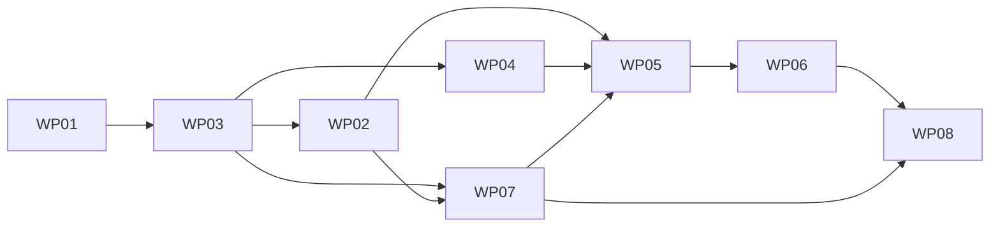

# Release 1.14 Execution Plan — Documentation-Only WP01

## Authority and dependency graph

**C2B-9 pending canonical reconciliation:** The [owner register](prompters/release-1.14-chart-mvp-c2b-8-owner-decision-register.md) approves P1-P7/S/B1/T selections. [Governance Section 12](../../architecture/business/PUBLIC_PREVIEW_AND_PRIVATE_RESEARCH_DATA_STRATEGY.md#12-c2b-9-immutable-release-governance-proposal) proposes their exact separate-context reconciliation, pending explicit owner review/acceptance of the C2B-9 PR. This documentation authority does not enact runtime permission, expand the source allowlist or accept a gate. Earlier WP01/current-authority wording below is historical. `PUBLIC_RUNTIME_VERIFIED=False`, public data unavailable, deployment/activation NO-GO and advanced WP07 ON HOLD.

This plan accompanies the [definition](RELEASE_1.14_DEFINITION.md) and [literal file manifest](RELEASE_1.14_FILE_MANIFEST.md). Section 10 of the controlling governance document takes precedence. Status: WP01 engineering contract owner-approved and incorporated into local documentation on 2026-10-10. Current authority covers in-place edits of the three existing documents only. Approved design is distinct from pending independent evidence and provisional unmeasured resource targets. Proposed source/test ownership is not execution authority. Owner substantive acceptance is required for every implementation WP; no acceptance automatically authorizes the next WP or a lifecycle action.

Preserve WP01–WP08 identifiers. WP03 precedes WP02 because generation consumes the revised canonical identity/provenance contract. WP07 precedes WP05 because anonymous startup/private isolation is a prerequisite to public UI acceptance.

Topological order: WP01, WP03, WP02/WP04, WP07, WP05, WP06, WP08. WP07 design/preservation work can start after WP03, but its runtime acceptance also requires WP02 for synthetic composition. This inspection-derived extra edge is documented rather than implying a missing generator can be activated. Sibling WPs may proceed independently only with accepted dependencies, individual authorities and sequenced shared files; this plan does not authorize agent delegation or concurrent edits. The graph is acyclic.

## Common execution and no-bypass rules

Each later authority must name accepted predecessor evidence, role, purpose, exact literal mutation paths (including tests/assets), validations, owner acceptance marker, exclusions and stop conditions. Copy complete paths from the manifest; never interpret directory references as permissions. Recheck current branch/main/worktree and preserve unrelated work before mutation. Do not silently expand allowlists when a dependency or defect requires another file.

No public provider calls, credentials or private fallback. No source-specific analytics, Python generation, direct provider/browser paths, SQL presentation access, new services/packages, schema migration, trading or ML. Preserve Twelve Data/Vike source files and private behavior. Public rights for future real feeds require a separate authority; synthetic acceptance does not clear those rights.

Negative tests must exercise every anonymous path, including retry, architecture navigation and System Health. Failures remain public-safe; no secrets/URLs/paths/raw payloads/stack traces in response, UI, logs or exports. Publication validation cannot be skipped on cache hits or derived outputs. Owner rejection or incomplete evidence blocks dependent work. Commits/PRs/merge/deployment are separate lifecycle authorities, never WP exit side effects.

## WP01 — Governance reconciliation and implementation contract freeze

- Prerequisites: fetched repository baseline, verified PR #316/#317 and Section 10, preserved worktree; owner-approved three-document authority.
- Ownership: exactly the three current paths in the manifest. No policy/roadmap/prompter/source mutation.
- Scope: incorporate owner-approved dataset/matrix/warmup, exact generator/hash serialization and reference vectors, scaled-integer analytics, query navigation/SVG, v2 canonical/protocol/cache isolation and provisional F1 targets; preserve conflict register, literal future paths and acceptance/gates.
- Checks: documentation-local cross-links/path existence, AC107–AC122/G-1–G-4 coverage, twelve counts/one-candle case, graph acyclicity, allowlist/status proof, whitespace and protected-file preservation. No application build/tests or provider calls.
- Negative review: reject public Vike/Twelve Data claims, observed BTC/USD simulation identity, fabricated fingerprint/test results or implicit implementation permissions.
- Completion evidence: owner-approved engineering contract incorporated in the three local artifacts, documentary consistency/allowlist checks and explicit residual evidence gates. Corrected coverage `[2025-10-26T00:00:00Z,2026-10-01T00:00:00Z)` supplies 340 days, including daily 90D plus 250 warmup. Row hashes are documentary transcriptions; complete-dataset goldens remain independently unverified. No implementation/test/profiling acceptance follows from this documentation completion.
- Traceability: all acceptance definitions; G-1/G-2 approved design, G-3/G-4 pending implementation/evidence requirements.
- Acceptance owner: repository owner; stop if a fourth path, implementation, commit/PR or external operation is required.

## WP03 — Canonical contracts, provenance and publication isolation

- Prerequisites: incorporated owner-approved WP01 numerical/identity/isolation contract and a subsequent individual literal-path implementation authority. WP01 approval does not grant WP03 execution.
- Ownership: manifest WP03 contracts, read-service/cache/lock, Worker query serialization and Python bridge plus focused tests. Composition remains WP07-owned; no generator or adapter edits.
- Scope: `aiq-candles-v2`, `aiq-historical-query-v2`, `aiq-historical-market-data-cache-v2`; synthetic identity/source/context/units, complete grid and fingerprint validation, fail-closed publication, distinct approved public/private roots and cache keys. Enforce 4,096-byte request reads before buffering/deserialization, maximum 2,410 calculation candles, 2,160 public-visible candles, 12 cache entries/2 MiB each, 32 MiB disk including temps and 24h retention. Bounded lock/atomic replacement and safe states preserve publication policy.
- Tests: UTC alignment, all window indices, streamed request bounds, ordering/uniqueness, identity/source/context matching, v2 versions, cache collisions/atomic replacement, cancellation/lock lease and exact serialization. Reject public v1 observed queries, source overrides, unknown/duplicate/malformed fields, mixed/private/legacy data, missing provenance, fingerprint mismatch, gaps, private-root traversal and nonfinite decimals. Cache hits/TTL cleanup cannot bypass policy or permit live-child overlap; no wall-clock market-staleness inference.
- Completion evidence: canonical/protocol fixtures, negative policy results, exact changed paths and unchanged preserved adapters. Interim composition remains unactivated; do not claim safe public runtime before WP07.
- Traceability: AC114/117/118/119/120/122; G-2/G-4.
- Acceptance owner: owner reviews contract compatibility and security evidence. Stop on schema, adapter, package, deployment or unlisted test needs.

## WP02 — Independent deterministic synthetic generator

- Prerequisites: accepted WP03, incorporated owner-approved 340-day generator/serialization contract and individual authority. Complete-dataset independent golden verification is WP02 exit evidence, not an already passed WP01 gate.
- Ownership: manifest proposed-new Infrastructure synthetic provider and dedicated tests. No composition, Python generator or licensed fixture changes.
- Scope: implement `IHistoricalMarketDataProvider` using the definition's exact SHA-256 counter bytes/lanes, integer equations/constants/scales and immutable version; generate complete base once per cold request, aggregate/select and cache bounded results. Exactly 250 calculation-only warmup candles, dataset/window fingerprints and operational timestamp exclusions are mandatory. No startup/background generation.
- C2B-9 forward-looking exception proposal: a separately authorized owner-controlled offline immutable B1 release operation may reuse the unchanged C# generator under governance Section 12. It does not change this existing cold-request implementation, frozen bytes/version/seed/coverage or cache contracts. No anonymous-request/startup/background/recovery generation, producer/export/promotion authority or implementation paths follow from this proposal.
- Tests: independent golden vectors; reproducibility across locale/clock/request order; hash/serialization; all twelve counts; one visible daily candle; aggregation and overlapping candle consistency; complete grids; invariants; changed seed/version effects; bounded cancellation. Verify the corrected complete dataset contains 8,160 hourly, 2,040 four-hour and 340 daily candles; 90D requests contain respectively 2,160/540/90 visible plus exactly 250 preceding warmup candles, totaling 2,410/790/340. Reject invalid requests, incomplete coverage, duplicate/gap/partial buckets, overflow and contaminated provenance. Test authors must not obtain fixtures from real feeds.
- Completion evidence: independent algorithm/constant origin record, independent cross-runtime reproduction of complete bytes/counts/hashes and row/window vectors, plus G-3 independence proof. The three candidate dataset hashes/byte counts in the definition remain candidate references until this evidence passes; do not silently promote Python-only full-dataset values to verified fixtures.
- Traceability: AC113/119/122; G-3/G-4.
- Acceptance owner: owner reviews reproducibility and independence. Stop on accepted-algorithm/golden mismatch, coverage failure, unauthorised constants/version changes, provider calls or unlisted fixture/test paths. Design acceptance does not bypass independent golden evidence.

## WP04 — Shared deterministic technical indicators

- Prerequisites: accepted WP03, accepted WP01 numerical indicator contract and individual authority. WP02 is not an algorithm prerequisite: use independently authored analytical fixtures.
- Ownership: manifest proposed-new Application contracts/calculator/tests; Worker and Python response integration/test paths sequenced after WP03.
- Scope: `aiq-ta-v1`, scale `10^12`, exact scaled-integer/rational ties-to-even seeds/recurrences, precision rejection and bounded inputs; SMA20, SMA-seeded EMA20, Wilder RSI14, MACD12/26/9 and population Bollinger20×2 using integer binary-search square root and exact midpoint comparison. Timestamp-aligned nullable outputs, canonical/display precision distinction and calculation-window identity are required.
- C2B-9 B1 timing exception proposal: only a future separately accepted immutable context may use offline precomputed C# analytics after independent exact complete-output verification for all twelve frozen calculation windows. Exactly 250 warmup candles remain calculation-only; no hidden rows, new tolerance, changed rounding/null/seed semantics or production Python port. This is a forward-looking cross-reference, not an edit to historical WP04 authority: existing Worker per-response calculation and candle/cache `CalculationVersion == null` remain unchanged. Indicator readiness stays unavailable until complete parity, integrity and all applicable gates pass.
- Tests: independently hand-computed constant/rising/falling and mixed fixtures; first-valid positions 20/20/15/26/34/20; RSI zero-gain/loss edges; no lookahead; Bollinger population variance/square root; accepted rounding/overflow behavior. Reject gaps, malformed or out-of-order candles and mismatched source identities; ensure null is not zero/forward-fill. Same canonical input yields same results independent of adapter type.
- Completion evidence: independently verified constant/up/down/alternating/mixed vectors, signed rounding and square-root midpoint/overflow tests, calculation version/parameter identity and safe protocol projections. The accepted reference cases are not substitute implementation evidence. Do not promise overlapping-range EMA/RSI/MACD equality with different 250-candle seed windows.
- Traceability: AC119/120; G-2/G-4.
- Acceptance owner: owner reviews conformity to approved numerical semantics and independent expected results. Stop on arithmetic/reference mismatch, proposed changes to accepted precision/square-root rules or source/provider/package expansion.

## WP07 — Private preservation, Vike retention and anonymous startup isolation

- Prerequisites: accepted WP03, completed Option B G-B0 policy review, frozen public composition/environment/resource design and individual authority. Preserve private provider files; no private OHLCV adapter is implied.
- Ownership: manifest existing Infrastructure DI, Worker Program, entrypoint, Python bridge/UI and existing composition/bridge/UI tests. Generator registration is an integration dependency on accepted WP02 before final WP07 runtime acceptance; WP07 design/preservation tests may begin after WP03, but its synthetic-runtime exit additionally requires WP02. This additional dependency does not change identifiers or create a cycle.
- Scope: synthetic-only anonymous composition; secret-free startup without private acquisition Worker; child environment built from scratch and `DOTNET_PROCESSOR_COUNT=1`; public/private handoff/cache/log/export isolation; public-safe System Health ≤64 KiB; retained private daily-close modes and Vike evidence. New private OHLCV/failover is deferred, not a release prerequisite. Enforce one globally admitted child, 1s admission, 10s operation/15s admission-to-reap deadlines, TERM then ≤1s grace/kill/reap, no automatic retry and explicit retry ≤once/session/10s. Enforce concurrent stdout/stderr draining, ≤2,097,152/16,384 bytes during capture and ≤8,192-byte chunks, plus existing CPU admission targets; the pending Option B addendum specifies reservation policy rather than hard CPU consumption enforcement. One current session response expires after 30 idle minutes on next interaction.
- Tests: existing offline Twelve Data configuration/client/normalizer/observation tests and Vike adapter regressions; missing credentials in public startup; malicious source/context selection; private environment injection; private cache/handoff/artifact access; System Health leaks; all anonymous navigation paths; no HTTP client/provider invocation. Prove private startup modes retain intended behavior without granting private use rights.
- Completion evidence: startup/environment allowlist matrix, zero provider-call assertions, preserved adapters, sanitized health, offline regressions and hard capture/global admission/cancellation proofs including cross-session/process overload and no lease-expiry overlap. If existing paths cannot host meaningful tests, request an explicit literal amendment before creating one. Profiling is separately authorized WP08 evidence, not inferred from control tests.
- Traceability: AC110/114/117/118/120/121; G-3/G-4.
- Acceptance owner: owner reviews all anonymous surfaces and preservation evidence. Stop for Docker, credentials, real provider calls, cloud settings, private OHLCV integration or unlisted files.

## WP05 — Synthetic candlestick-first research UI

- Prerequisites: accepted WP02, WP04 and WP07; individual authority.
- Ownership: manifest existing UI and market research tests; no packages, acquisition code or adapter changes.
- Scope: exact simulation title/disclosure; default 1h/30D; all twelve combinations; OHLCV/UTC hover; activity-volume panel; price overlays and RSI/MACD panels; accessible table; controlled states and provenance.
- Tests: exact labels/units, default and all counts, one daily candle, warmup excluded from public responses/chart, nullable output handling, canonical twelve-place values versus four-place price/two-place RSI/three-place activity display, accessible table/hover and safe states. Verify generated-at distinct from coverage and no market-as-of/provider attribution. Hover/pan/zoom/overlay/rerun do not invoke a child; retry follows accepted cooldown and cannot invoke providers. Inject private/legacy responses and secrets/errors; UI rejects rather than displays them.
- Completion evidence: focused UI tests plus representative desktop/mobile/keyboard captures and interaction counts. Structural chart assertions alone do not establish browser accessibility.
- Traceability: AC113/114/115/116/118/122; G-4.
- Acceptance owner: owner reviews public behavior and truthful timestamps. Stop for routing, bridge/package changes or missing prerequisite evidence.

## WP06 — Homepage keynote and dedicated architecture page

- Prerequisites: accepted WP05, incorporated approved Streamlit query-navigation/SVG contract and individual authority including proposed asset/page/test paths.
- Ownership: manifest existing UI/test and proposed-new governance page/test/SVG; no untracked infographic mutation.
- Scope: exact keynote/link; `?page=market-research|ml-studies|system-health|data-governance` in the existing 1.61.1 app, missing-page default, safe unknown/repeated values, static same-tab links and loop-free radio synchronization. No new deep-path route or JavaScript. Render Section 10 SVG plus complete text equivalent, accessible name/title/description, responsive 320/768/1280px layouts, implemented/planned and rights/ML explanations.
- Tests: direct link/fresh session, reload, browser Back/Forward, radio synchronization and safe malformed/duplicate page values; zero provider calls/private handoff access; normative nodes/edges including dashed inactive Vike; contrast/readability/focus, keyboard and screen-reader review, full text equivalence. Reject old Vike-public diagram, dead link, Markdown-only architecture, remote Mermaid/images/fonts, untrusted HTML, private details and unsupported certification claims.
- Completion evidence: accessible rendered page, text/topology comparison, manual browser evidence and truthful delivered/planned inventory.
- Traceability: AC107–112/115/116/121; G-2/G-4.
- Acceptance owner: owner reviews architecture fidelity and accessibility. Stop if selected routing requires additional files/Docker/configuration or UI assets outside the accepted authority.

## WP08 — End-to-end verification and release acceptance

- Prerequisites: accepted WP06 and WP07, transitively all prior WPs; individual verification authority and accepted numerical F1 resource/capture limits.
- Ownership: run existing accepted tests without mutation; proposed-new acceptance record in manifest only if separately allowlisted. Additional scripts/tests need explicit paths.
- Tests/evidence: integrated generation/analytics/protocol/cache/UI/public startup; all ACs; zero anonymous HTTP/provider calls; environment/hand-off/log/export isolation; malformed/oversized stdout/stderr and child exit/timeout/cancellation; concurrency and same-key serialization; browser accessibility; safe error states; exact changed paths and README/provider preservation.
- Resource assessment: test every provisional limit in the definition's full resource table; especially child RSS ≤160 MiB, container working set ≤640 MiB, cold CPU ≤2 CPU-seconds, p95 ≤5s cold/2s warm, capture/admission/CPU budgets and all retention/disk bounds. Profile cold/warm requests, all twelve selections, at least five concurrent sessions, floods/timeouts/cancellation, parent-plus-child memory/CPU and cleanup/restart under separate authority. Verify current applicable F1 limits independently; no numeric target is an observed Azure quota. No unbounded polling or persistent new listener.
- Completion evidence: per-AC/gate result with commands, environment, observed counts, measurements, limitations and owner review; historical test counts are not current validation. F1/$0 evidence must remain resource-specific and require separately authorized runtime/cloud validation when necessary. No current deployment readiness claim from this plan.
- Traceability: AC107–AC122; G-4 and final G-1/G-2/G-3 reconciliation.
- Acceptance owner: owner alone gives substantive release acceptance. Stop rather than deploy, commit, publish, modify Azure, obtain credentials or add a paid service. An offline-only result must clearly identify pending live/F1 evidence.

## Decision and validation ledger

Owner-approved and incorporated: corrected UTC boundaries, 340-day coverage, seed 114/version, twelve combinations/default, 250 warmup, exact generator/serialization/window identities, numerical rules, v2 canonical/protocol/cache, query navigation/SVG, isolation design and provisional resource targets. Coverage remains 8,160 hourly/2,040 four-hour/340 daily candles. Verify calendar/window arithmetic documentarily; no data generation under the current authority.

Pending independent evidence: full-dataset golden bytes/hashes (WP02), analytical implementation vectors (WP04), public-private isolation/capture/global admission (WP03/WP07/WP08), browser/history/accessibility (WP06/WP08) and resource profiling/current F1 acceptance (WP08 under separate authority). Private retention/ML/publication rights remain unresolved; new private OHLCV/failover is deferred, not a release prerequisite. Design approval is not evidence acceptance or implementation authorization.

| Resource validation ownership | Required evidence |
| --- | --- |
| WP03 | Input/grid/public-count bounds, cache entries/bytes/disk/retention, atomic replacement and bounded locks |
| WP02 | Cold/base/aggregate generation bounds, immutable constants and exact serialization |
| WP04 | Calculation-count/precision/null limits and independent arithmetic vectors |
| WP07 | Global child admission/deadlines/cancellation, hard stdout/stderr capture/chunks, retry/session/health/CPU controls, safe environment/startup |
| WP05 | Visible-only serialized/chart values and display precision |
| WP06 | Browser/query navigation and accessible SVG/text, no provider/private access |
| WP08 | Independent integrated evidence, CPU/RSS/container/latency/concurrency profiling and current F1/$0 acceptance |

Failure of an independent gate blocks relevant WP acceptance/dependents. Required extra files, golden mismatches or budget failures stop for scoped authority/reconciliation. No profiling, deployment or lifecycle operation is permitted by the current documentation update.

The graph above includes the WP02 → WP07 runtime-exit edge; it is the complete dependency graph for acceptance.

## Current WP01 review checks

Run documentation-local path/link/count/AC/gate/graph checks, `git diff --check`, final status and changed-path proof; include untracked document content in whitespace review because ordinary Git diff omits it. Verify pre-existing untracked file hashes and unchanged tracked/protected files. No application build/test execution, package installation or live provider request is required or authorized now.

**NO IMPLEMENTATION, COMMIT, PR OR DEPLOYMENT AUTHORIZED.**

## Subsequent WP01 planning publication authority

The preceding no-commit/PR statement records the documentation-update authority. On 2026-10-10 the owner subsequently authorized a documentation-only PR containing all eight existing untracked planning/authority/image files and its merge. Branch creation, staging, commit, push, PR creation and merge are authorized solely to publish and close WP01 planning. The current publication set is enumerated in the manifest. No implementation WP, provider call, profiling, release tag or deployment is authorized. Independent evidence gates remain pending; merging the planning PR is not release implementation acceptance.

## Option B documentation reconciliation - pending final owner policy review

**Documentation authority:** Owner explicitly approved the consolidated planning artifact's Section 9 four-path documentation packet on 2026-10-10. Recommended dispositions and numerical evaluation criteria are approved for this reconciliation. The resulting policy diff still requires separate owner review before this addendum becomes effective. Existing controlling policy remains in force until that review; G-B0 is not complete. No implementation, active tests, lifecycle action or public activation is authorized.

**Planning decision:** Retain external supervision, approved C# generator/shared `aiq-ta-v1` analytics and bounded Worker UTF-8 transport. Replace hard CPU-consumption claims with conservative admission-reservation policy and explicitly measured residual availability/resource risk only upon effectiveness of the amendment. Confidentiality, synthetic provenance, exclusive admission and independently verified cleanup are not relaxed. Guardian-only flock is rejected as sufficient fencing: Phase 1B observed admission reopening before registered process exit notifications.

**Admission domain and recovery:** One qualified public container instance, shared across its sessions/processes; other region remains disabled for this public path. Unexpected topology/identity or inaccessible shared state fails closed. Durable occupied state and reservation precede any Worker creation; registration and verified READY/START precede computation. No final-holder death, deadline, TTL, boot change or numeric PID alone clears occupation. Unknown cleanup/settlement denies generation indefinitely; operator recovery requires independent proof, authentication and audit. Storage and recovery implementation remain unqualified.

**Reservation arithmetic:** Charge 16 reserved CPU-seconds per admitted or uncertain-start job; at most three admissions in rolling 900 seconds and fifteen in rolling 86,400 seconds, subject also to 60/240 reservation caps. Three charges total 48; fifteen total 240. Persist atomic history across restart, use UTC event timestamps with rollback/high-water safeguards and monotonic in-lifetime deadlines; inconsistent/missing evidence denies generation. These are not actual consumption ceilings, midnight-reset quotas or Azure-metered usage. Session cooldown is 10 seconds, with three expensive attempts/client/rolling 60 seconds as supplementary defense; rotation never bypasses global limits.

**Hold:** `PUBLIC_RUNTIME_VERIFIED = False`; PR #330 remains draft/unmerged, issue #322 open and dependent WP05 activation blocked. Gate approval is not implementation acceptance or activation authority. Candidate numerical criteria are unmeasured. Separate architecture, mutation, verification, acceptance and lifecycle authorities remain necessary.

### WP07/WP08 gate and evidence allocation

G-B0: owner review of the reconciled policy diff precedes separate supervisor preflight and implementation authority. WP07 owns G-B1 crash-safe admission, G-B2 confidentiality, G-B4 lifecycle/recovery and G-B5 functional preservation, and implementation seams for G-B3 resource accounting and G-B7 abuse protection. WP08 owns separately authorized integrated G-B3/G-B6/G-B7 resource/operational/abuse qualification; neither WP ownership implies test permission. All seven runtime gates must pass before WP07 substantive acceptance and separately authorized activation. WP07 remains a prerequisite to WP05 acceptance; WP08 integrated evidence remains distinct.

Required negatives include Phase 1B regression, parent/guardian/supervisor and combined failure, interrupted registration/handshake, restart/corrupt history, nested/escaped/orphan boundaries, synthetic-only mount/FD/proc/environment/network isolation, denied requests launching no Worker, cache-hit/identity-rotation/concurrent-tab limits and protected health. Measurements include all twelve selections under actual rolling admission counts, supervisor/parent/container costs and uncertainty. Tests that exceed allocations need explicit authority; do not bypass budgets for profiling. No new paid services, privileges or private-data reads.

### C2 approval and governance disposition - 2026-10-10

The owner approved the response-only C2 contract wording and its four-document reconciliation for documentation edits. This supersedes the earlier pending-review status only for the exact C2 amendment recorded here; it does not approve all uncommitted Option B proposals, select an architecture/backend or establish policy publication/merge. C2 residual availability risk is accepted; numerical limits remain candidate upper bounds pending qualification. G-B0 remains incomplete while admission topology, health-breaker thresholds and accounting dispositions are unresolved. No runtime gate is marked passed and no new implementation authority follows.

One authoritative admission domain must cover every enabled public entry point. The prior single-container/other-region-disabled topology remains the candidate, not verified deployment-wide enforcement; no region or replica is enabled by this amendment. Confidentiality, exclusive durable occupation and independently verified cleanup are mandatory. A2 distinct broker UID remains preferred for qualification, not selected; B2 remains conditional on actual resource, protected access, consistency and permanent zero incremental recurring cost. No role map or backend changes.

The offline policy implementation remains frozen and its source/test snapshot is preserved. Required holds remain `PUBLIC_RUNTIME_VERIFIED = False`, PR #330 draft/unmerged, issue #322 open and no public activation. Remote lifecycle status is not reverified by this documentation change. Acceptance, literal-path implementation authority, tests/diagnostics, identity/RBAC changes, PR lifecycle, deployment and activation require separate explicit owner authority.

### C2 WP07/WP08 execution reconciliation

WP07 future implementation obligations include authoritative occupation across every enabled entry point, reservation for all actual/uncertain Worker spawns including warm reads, independent cleanup, bounded abuse/cached-read ingress and a global health circuit breaker. No implementation or test is authorized by this allocation. Candidate topology, backend and broker/Worker launch boundary remain unqualified.

WP07 retains G-B1/B2/B4/B5 ownership and G-B3/B7 implementation seams; WP08 retains separately authorized integrated G-B3/B6/B7 resource/operational/abuse evidence. Replace mandatory <=60-second Azure observation and >20% quota-headroom prerequisites with qualified C2 local predicates. Do not weaken mandatory health/isolation/journal/recovery evidence. Treat uncertain telemetry honestly and assess accepted exhaustion/throttling/unavailability risk. G-B0 remains incomplete pending remaining decisions; all runtime gates must pass before acceptance/activation.

WP08 must reconcile 240 reserved vs 300 measured job seconds and total attributable CPU/uncertainty against <=10% of the independently verified daily allowance, tighten budgets if necessary, preserve all existing resource/capture/cache/deadline targets, and verify health-breaker/abuse/restoration/cost behavior under separate authority. No owner credentials, paid services or privileged infrastructure. The qualification-plan sampling conflict requires separate reconciliation before its profile can run.

Existing AC107-AC122 identifiers/owners remain; AC116/122 include honest safe unavailability and AC114/118/121 retain non-negotiable confidentiality. Policy approval is not qualified evidence, PR merge, deployment or activation authority.
