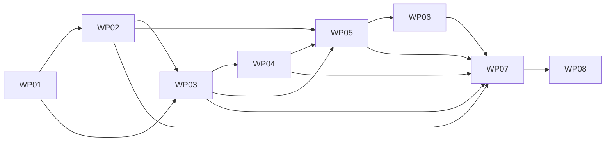

# Release 1.15 Execution Plan — WP01–WP08

## Status and controls
Planning-only execution map. The merged Release 1.15 architecture governance is controlling. This document authorizes creating and reviewing planning artifacts and issues, **not** application mutation, live provider calls, Azure deployment, image promotion or automatic acceptance of later WPs. Engineering may proceed under separately scoped implementation authority without a licensing-review milestone.

## Dependency graph

## Work packages and exit criteria
| WP | Issue | Dependencies | Exit evidence |
| --- | --- | --- | --- |
| WP01 — Baseline, architecture contract and feasibility | #367 | None | Repository baseline, contract/acceptance matrix, separately authorized UI/Docker feasibility spikes |
| WP02 — Docker dual-process runtime and isolation | #368 | WP01 | Linux image, PID1 restart, identity/secret/API isolation, bounded resources |
| WP03 — Ingestion, SQLite and recovery | #369 | WP01, WP02 runtime contracts | Completed OHLCV fixtures, quota fairness, atomicity, corrections, watermark and recovery |
| WP04 — Private indicators and regimes | #370 | WP03 | Independent numerical vectors, warmup/readiness, replay and transition events |
| WP05 — Transformed API and contract | #371 | WP02–WP04 | Cross-language full/unchanged fixtures, validation, HMAC date rollover, no raw leaks |
| WP06 — Streamlit historical chart | #372 | WP05 | Browser viewport/preset/session/reconnect/UTC gap and labeling evidence |
| WP07 — Integration and Linux/F1 qualification | #373 | WP02–WP06 | Image digest, security and browser evidence, resource measurements, deployment readiness assessment |
| WP08 — Acceptance, runbook and handoff | #374 | WP07 | Acceptance ledger, operations/recovery runbook, owner disposition; deployment remains separate |

## Sequencing rules
1. Before each WP, verify current `main`, merged governance, accepted predecessors, existing paths, tests and branch state. No assumptions from Release 1.14 file ownership.
2. Create a separate narrowly scoped implementation PR with literal file mutation paths and run-only regression paths. A directory name in the file manifest is **not** a wildcard write grant.
3. WP01 feasibility checks should first validate Plotly/Streamlit absolute-UTC viewport retention under reruns and refresh, and combined Linux process memory/startup on representative F1-like limits. Results are evidence, not a reason to silently change architecture.
4. WP03 ingestion tests use deterministic offline provider fixtures; live capability measurements require configured credentials and explicit operational authority. No live provider in CI.
5. WP04 numerical correctness precedes WP05 presentation transformations; private calculations always use real private observations.
6. WP05 freezes schema and negative fixture handling before WP06 UI acceptance; reject mixed snapshot identities and partial data.
7. WP07 records real measurements, failed cases and limitations. Local F1-like tests do not prove Azure F1 capacity. Azure activation is a separate decision.
8. Shared source files must have one active owner/PR at a time. Re-run downstream regressions whenever contracts change. Never invent acceptance evidence.
9. Every Codex prompt and change requires UTF-8 LF for all changed text, independent CRLF verification and `git diff --check`. Avoid unrelated mass normalization.

## Common stop conditions
Stop for missing predecessor evidence, unauthorized paths, schema incompatibility, secrets exposed to the public identity, external ingress to private API, invalid market candles, mixed generation/version/date, unverifiable recovery lineage, unexpected paid dependencies, or failure to satisfy resource/security limits. Escalate decisions in the owning WP rather than creating silent gates or fallback behavior.

## Milestone lifecycle
Each issue records plan → scoped implementation PR → deterministic tests → evidence → owner acceptance. GitHub PR merge, provider activation, image promotion, Azure deployment and release closure remain distinct lifecycle decisions.

## Release 1.15 dual-container execution-plan amendment — 2026-10-23

The owner selected two Linux Docker images and two Azure Linux F1 Web Apps **per environment** after the empty research shells were created (pending infrastructure evidence PR #381). This supersedes the earlier WP02 “Docker dual-process runtime” wording, single-image launch/supervisor assumption and local-only WP05 transport assumption in this plan. Dependency order WP01–WP08 remains intact; WP02 #368 now owns **two single-process images, per-container least privilege/lifecycle, environment separation and F1-compatible service-to-service security design**. No C PID1 supervisor, host Bash multiprocess supervisor, role-child restart protocol or same-container role-UID census is required.

WP03 #369 owns single-writer SQLite/recovery across any research-app replacement overlap; WP04 #370 research calculations unchanged; WP05 #371 authenticated HTTPS research snapshot client/server transport under the unchanged bounded D4 schema; WP06 #372 UI/viewport unchanged apart from transport; WP07 #373 qualifies two compatible digests, two concurrently running apps per F1 plan, per-environment actual Azure access control, denial cases, cold starts and resource pressure; WP08 #374 documents pairing/rollback of both images. Existing apps and infrastructure remain unchanged until separately authorized deployment.

**Security boundary:** A research Web App DNS name does not mean it has private ingress. External unauthorized requests to research endpoints must be rejected; no raw candles/keys/storage or admin operations in public API; HTTPS service authentication is required. Do not assume free-plan private endpoints, VNet features or dedicated compute. Fail closed on unsupported F1 security rather than invent paid resources or anonymously expose the research service.

**Qualification and gates:** The exact paired image digests, cross-app conformance and per-site browser tests replace one-image qualification. Existing source/contract/fixture approvals, G-B0–G-B7 and `PUBLIC_RUNTIME_VERIFIED=False` remain. No new licensing prerequisite, provider call, deployment, PR merge or WP02 source-path approval follows from this amendment.

## WP38 - local Docker implementation progress

Owner-authorized WP38 continues implementation and local qualification independently of Azure F1 availability. The existing two-container architecture, authenticated TLS snapshot contract, private C# research and Streamlit components remain effective. Local Docker delivery is valid milestone progress; Azure public qualification is not a prerequisite to local implementation. Azure activation and full release acceptance remain separate decisions.

Track evidence in three distinct states: **implemented**, **locally qualified**, **publicly qualified**. WP38 provides a fixture-only end-to-end chart; it does not qualify authentic observations or complete all Release 1.15 acceptance requirements. Azure F1 deployment/stop-request attribution remains **deferred and unresolved**, neither passed nor waived. See [WP38 local runbook](prompters/release-1.15-wp38-local-docker-chart.md). `liveAttemptReady=false`, `AUTHENTIC_DATA_NOT_IMPORTED=True`, `PUBLIC_RUNTIME_VERIFIED=False`.

## WP39 - offline local observation workflow

WP39 connects the existing Twelve Data minute adapter, validated private import and local dual-container chart. Implementation/offline fixture qualification are valid progress; actual provider acquisition, authentic import, local authentic snapshot/browser acceptance and public Azure qualification remain distinct. Current status: **ONE_APPROVED_ACQUISITION_ATTEMPT_FAILED_NO_BUNDLE**. The single approved attempt was consumed and failed exit 1; its HTTP status, request count and credit consumption remain unknown. Offline-only sanitized acquisition diagnostics are implemented for review; no additional provider request is authorized or performed. No authentic rows imported. No new licensing prerequisite was introduced. See [WP39 owner runbook](prompters/release-1.15-wp39-local-authentic-history.md) for the two-request proposal, private runtime channel, commands, test evidence and limitations. `AUTHENTIC_DATA_NOT_IMPORTED=True`; `PUBLIC_RUNTIME_VERIFIED=False`; `liveAttemptReady=false`. Azure deployment remains deferred/unresolved.

## WP40 - fresh offline preparation and approval checkpoint

Merged #427 baseline `c69832585a44c6253063b60d26d48b8ae487db26` was freshly published and packaged using cached inputs only. Status: **AWAITING_NEW_OWNER_PROVIDER_APPROVAL**. All 167 focused fake-only tests passed (84 C#, 22 workflow, 61 chart/client). A fresh compiled Worker negative probe through the Python diagnostic parser reported MISSING_APPROVAL with zero sends/responses. No provider request, Azure operation, authentic bundle/import, chart startup or browser verification occurred. The previous attempt remains consumed; actual credits/availability are unknown. See [WP40 evidence and bounded attempt proposal](prompters/release-1.15-wp40-controlled-acquisition.md). This documentation PR remains open for review; no new licensing gate or Azure dependency is introduced. `AUTHENTIC_DATA_NOT_IMPORTED=True`; `PUBLIC_RUNTIME_VERIFIED=False`; `liveAttemptReady=false`.

## WP41 - controlled verification Phase A

Verified merged #428 at `7c92eb98b8e9fe7d204375cf43c3e11f3f68a5e7`. Fresh offline runtime/images and valid TLS prepared, fresh assembly identity and missing-approval zero-send diagnostic confirmed. All 167 focused tests passed (84 C#, 22 workflow, 61 chart/client). Status **AWAITING_NEW_OWNER_PROVIDER_APPROVAL**; Phases B/C NOT RUN. Zero provider/Azure requests; no authentic bundle/import, session startup or browser acceptance. See [WP41 runbook and exact single-attempt approval checkpoint](prompters/release-1.15-wp41-controlled-verification.md). No new architecture/licensing gate. `AUTHENTIC_DATA_NOT_IMPORTED=True`; `PUBLIC_RUNTIME_VERIFIED=False`; `liveAttemptReady=false`.

### WP41 - separately approved attempt stopped

Following separate explicit owner approval and successful immediate prechecks, exactly one Acquire invocation failed exit 1: response_parse, BTC/USD, HTTP 200, requestsStarted=1, responsesReceived=1, outcomeUnknown=false, INVALID_PROVIDER_PAYLOAD, bundlePublished=false. ETH/USD was not requested. Bundle/receipt/private SQLite/qualification remain absent; no import/start/verify/browser or retry. Actual payload defect and consumed credits are not established. Status **ONE_APPROVED_ATTEMPT_FAILED_NO_BUNDLE**; approval consumed, stop for owner review. PR #429 evidence updated; no source change or Azure operation. `AUTHENTIC_DATA_NOT_IMPORTED=True`; `PUBLIC_RUNTIME_VERIFIED=False`; `liveAttemptReady=false`.

## WP42 - offline parser diagnostic precision

Existing open PR #429 now adds eleven fixed parser boundary codes, atomically updating C# producer/Python allowlist without changing version-1 envelope or acquisition contract. Final fake-only tests: 101 C#, 23 workflow, 61 chart/client (185 passed); actual Worker envelopes validated by Python. See [WP42 diagnosis](prompters/release-1.15-wp42-offline-parser-diagnosis.md). Historical WP41 HTTP 200 generic parser failure and unknown defect/credits are unchanged; no retroactive cause inferred. No provider request, credential/private-response inspection, Azure, image publication or merge. Return for owner review; any future live attempt needs separate approval, not requested here. `AUTHENTIC_DATA_NOT_IMPORTED=True`; `PUBLIC_RUNTIME_VERIFIED=False`; `liveAttemptReady=false`.

## WP43 - post-merge offline preparation

PR #429 squash-merged as `c4a622839c26e930140ce0b826b7269cd59d80b9` after owner Markdown reconciliation (65 candidates, 58 added, seven represented equivalently, no exclusions; per-file archive inventory tracked). Fresh merged-source cache-only runtime/images and actual unexpired TLS prepared; published hashes match fresh builds, strict Python parser confirms zero-send MISSING_APPROVAL. Regressions: 101 C# + 23 workflow + 61 chart/client = 185 passed. See [WP43 offline evidence](prompters/release-1.15-wp43-offline-preparation.md). Status **OFFLINE_PREPARATION_COMPLETE_NO_LIVE_AUTHORITY**. No provider request/retry, credential read, historical response inspection, Azure or registry publication. Historical WP41 cause/credits remain unknown, no authentic bundle/import. New WP43 PR remains OPEN/UNMERGED. `AUTHENTIC_DATA_NOT_IMPORTED=True`; `PUBLIC_RUNTIME_VERIFIED=False`; `liveAttemptReady=false`.

## WP44 - offline checkpoint before new live approval

Verified #430 merge `4a41bc49396d6a5bbd5db3c1afb373fbcd09e8d8`; fresh cached-only preparation, matching assembly/image identity, protected ACL and actual valid TLS checked. All 185 tests passed (101 C#, 23 workflow, 61 chart/client); fresh Worker/Python MISSING_APPROVAL probe confirmed zero sends. Status **AWAITING_NEW_OWNER_PROVIDER_APPROVAL**. No provider requests, credential reads, Azure or publication; bundle/receipt/SQLite/qualification absent, import/chart/browser NOT RUN. See [WP44 evidence and exact single-invocation checkpoint](prompters/release-1.15-wp44-controlled-acquisition.md). Historical WP41 cause/credits remain unknown; prospective WP42 codes unchanged. New PR remains OPEN/UNMERGED. `AUTHENTIC_DATA_NOT_IMPORTED=True`; `PUBLIC_RUNTIME_VERIFIED=False`; `liveAttemptReady=false`.

### WP44 - one approved acquisition failed, stopped

After separate explicit owner approval and successful immediate identity/ownership/TLS/destination checks, exactly one Acquire invocation exited 1: BTC/USD HTTP 200, response_parse, INVALID_PROVIDER_METADATA, sends/responses 1/1, outcomeUnknown=false, bundlePublished=false. ETH/USD not requested. No bundle/receipt/SQLite/qualification; import/start/verify/browser NOT RUN, no retry. Specific metadata defect and credit usage remain unknown; this does not explain historical WP41. Status **ONE_APPROVED_ATTEMPT_FAILED_NO_BUNDLE**, approval consumed. PR #431 stays OPEN/UNMERGED for owner review; no Azure/publication. `AUTHENTIC_DATA_NOT_IMPORTED=True`; `PUBLIC_RUNTIME_VERIFIED=False`; `liveAttemptReady=false`.

## WP45 - offline metadata contract review

Verified #431 squash `37aeb51a181fe28fa08d293acbe274c38e357f66`. Public authoritative documentation reviewed; missing core metadata/status is not explicitly supported, so no acceptance relaxation. Four precise required-field diagnostic categories added atomically to C# producer/Python consumer; synthetic cross-runtime regressions **200 passed** (116 C#, 23 workflow, 61 chart/client). See [WP45 field contract and evidence](prompters/release-1.15-wp45-metadata-contract-compatibility.md). Exchange/output-timezone distinction and actual crypto metadata remain unresolved; historical WP44 missing/wrong field and credits unknown. No provider probes, credential value/presence reads, private response inspection, Azure or Docker operations. New WP45 PR stays OPEN/UNMERGED; no future live authority. `AUTHENTIC_DATA_NOT_IMPORTED=True`; `PUBLIC_RUNTIME_VERIFIED=False`; `liveAttemptReady=false`.

## WP46 - evidence-backed optional exchange metadata

Verified #432 merge `819298b4f02258e4345e2ebd301cadff5bacbffa`. Official vendor SDK model newly establishes exchange_timezone optional; fixed UTC output request/crypto-only identities and unchanged candle checks provide equivalent UTC validation. Adapter now accepts its absence only, retaining strict present-field/status/symbol/interval/OHLCV validation and unchanged diagnostics. Offline tests **210 passed** (126 C#, 23 workflow, 61 chart/client). See [WP46 source/necessity matrix](prompters/release-1.15-wp46-crypto-response-contract.md). Historical WP44 field/credits remain unknown; no provider/credential/private-artifact/Azure/Docker operations. New WP46 PR OPEN/UNMERGED; future live attempt still requires fresh explicit approval. `AUTHENTIC_DATA_NOT_IMPORTED=True`; `PUBLIC_RUNTIME_VERIFIED=False`; `liveAttemptReady=false`.

## WP47 - fresh compatible build and approval checkpoint

Verified #433 merge `45e9250ff658f9dc4f9fef8963370bc6fd30d244`; fresh cache-only WP46-compatible publication/images, assembly/manifest/ACL/TLS/resource/destination checks passed. All **210 tests passed** (126 C#, 23 workflow, 61 chart/client); fresh Worker/Python MISSING_APPROVAL probe proves zero sends/responses. See [WP47 evidence](prompters/release-1.15-wp47-controlled-acquisition.md). Status **AWAITING_NEW_OWNER_PROVIDER_APPROVAL**; no new live approval, zero Acquire/provider/credential checks/Azure operations. Bundle/receipt/database/qualification absent; import/chart/browser NOT RUN. Historical WP44 field/credits unknown, prior approvals consumed. New docs-only WP47 PR OPEN/UNMERGED. `AUTHENTIC_DATA_NOT_IMPORTED=True`; `PUBLIC_RUNTIME_VERIFIED=False`; `liveAttemptReady=false`.

### WP47 - approved single attempt stopped on volume validation

Following separate explicit approval and successful immediate prechecks, exactly one Acquire invocation exited1: BTC/USD HTTP200, observation_validation / INVALID_VOLUME, sends/responses1/1, outcomeUnknown=false, bundlePublished=false. ETH/USD not requested; no bundle/receipt/database/qualification, import/chart/browser NOT RUN, no retry. Specific volume defect and charged credits unknown; no raw response inspected or historical metadata cause inferred. Status **ONE_APPROVED_ATTEMPT_FAILED_NO_BUNDLE**; approval consumed, PR #434 OPEN/UNMERGED for owner review. No Azure/publication. `AUTHENTIC_DATA_NOT_IMPORTED=True`; `PUBLIC_RUNTIME_VERIFIED=False`; `liveAttemptReady=false`.

## WP48 - crypto volume contract, acceptance unchanged

Verified #434 squash `05dd8ba4abc95c28d8e8abf6df39661e42dc70dc`. Public docs/official SDK describe optional string volume without exact BTC/ETH minute base-unit availability guarantee; currency descriptions also indicate OHLC. No safe representation relaxation justified and mandatory OHLCV retained; no zero fill/unit conversion. Synthetic matrix plus regressions **234 passed** (150 C#,23 workflow,61 chart/client). See [WP48 decision tree/source-fit options](prompters/release-1.15-wp48-crypto-volume-contract.md). Tests/docs only; production parser/diagnostics unchanged. Historical WP47 volume defect/credits unknown, approval consumed. No provider/credential/private-artifact/Azure/Docker/Acquire/import/browser operations. New PR OPEN/UNMERGED. `AUTHENTIC_DATA_NOT_IMPORTED=True`; `PUBLIC_RUNTIME_VERIFIED=False`; `liveAttemptReady=false`.

## WP49 - historical exchange comparison; Twelve Data direction reaffirmed

Baseline #435 `7c8d242105fbc5e3fbed4159b07f94a90a7a271c`. Official exchange documentation reviewed 2026-11-08; comparison retained as historical research only. The initial Kraken recommendation is superseded by the owner's binding decision: **Twelve Data remains the sole Release 1.15 provider for BTC/USD and ETH/USD**. Kraken/Coinbase/archives are NOT SELECTED / OUT OF SCOPE; no provider-agnostic migration is authorized. See [historical WP49 evidence](prompters/release-1.15-wp49-exchange-origin-ohlcv-evaluation.md). Earlier cached-only baseline regressions: 234 passed (150 C#, 23 workflow, 61 chart/client). No live exchange evaluation occurred. PR #436 remains OPEN/UNMERGED.

## Twelve Data-only volume diagnosis - owner direction correction

Twelve Data BTC/USD and ETH/USD remain the sole Release 1.15 target; PR #436 direction corrected in place, alternatives not selected, historical comparison preserved. [Volume decision matrix/runbook](prompters/release-1.15-twelvedata-volume-diagnosis.md) traces current codes, provider documentation limits and precise unanswered feed/unit question. Strict parser and version1 diagnostics unchanged; no numeric relaxation or fabricated volume. Partial-row/empty-result fake tests extended for first/second symbol: **237 freshly passed** (153 C#,23 workflow,61 chart/client), no skips. No production/provider/credential/private-artifact/Docker/Azure/import/browser operations; WP47 exact defect/credits unknown and approval consumed. PR OPEN/UNMERGED. `AUTHENTIC_DATA_NOT_IMPORTED=True`; `PUBLIC_RUNTIME_VERIFIED=False`; `liveAttemptReady=false`.

## WP50 - offline Twelve Data volume subtype diagnostics

Baseline #436 squash `52398b2ad31f75a4a098ca1c86bf414740e6140c`. Implemented six finite volume failure codes within unchanged version1 ten-field envelope, coordinated Worker/Python allowlists and legacy INVALID_VOLUME recognition. Accepted observations, Twelve Data-only BTC/ETH requests, mandatory OHLCV/base units, no retry and atomic two-symbol publication unchanged. [WP50 taxonomy/precedence/coverage](prompters/release-1.15-wp50-twelvedata-volume-diagnostics.md). Fresh cached-only regressions **248 passed** (163 C#,24 workflow,61 chart/client), no skips; matrix covers plain/prefix/forming rows at both symbols plus actual C# envelopes through strict Python. Historical WP47 subtype/credits remain unknown, approval consumed. No provider/credentials/private-artifact/Docker/Azure/deployment or real acquisition/import/browser operations. New implementation PR OPEN/UNMERGED for owner review; no live authority. `AUTHENTIC_DATA_NOT_IMPORTED=True`; `PUBLIC_RUNTIME_VERIFIED=False`; `liveAttemptReady=false`.

## WP51 - offline acquisition diagnostic parent-reader rehearsal

Baseline #437 squash `2e6ff99f04ba68b3ade68093dd41931d9194b077`. Extended existing real C# producer -> Python parser tests through actual worker/run/run_acquisition with fake process pipes, exact command/env/cleanup/counters; included fake success and no receipt. No duplicate test-count inflation or production changes. Fresh cached-only **248 passed** (163 C#,24 workflow,61 chart/client), no skips. [WP51 runbook/checklist](prompters/release-1.15-wp51-twelvedata-acquisition-readiness.md) records preparation/executable identity obligations: fresh Prepare builds matching source, arbitrary reused directories are not automatically version-bound. No live readiness established, Docker preparation not run. Twelve Data-only source and strict OHLCV/diagnostics unchanged. No provider/credentials/private-history/Docker/Azure/deployment or actual Acquire/Import/Start/Verify/browser operations; historical WP47 subtype/credits unknown, approval consumed. New PR OPEN/UNMERGED; a future single attempt needs fresh explicit authority. `AUTHENTIC_DATA_NOT_IMPORTED=True`; `PUBLIC_RUNTIME_VERIFIED=False`; `liveAttemptReady=false`.

## WP52 - automatic fail-closed preparation identity guard

Baseline #438 squash `f888613ca2be8cacc3d6ab90d77a05769b024660`. Existing Python Prepare now writes version1 nonsecret SHA-256 identity for loaded/current workflow, actual publish and matching context/research copy; Acquire validates before credential access and again before dispatch. Old/malformed/stale/linked/escaped identity fails with parent-only PREPARATION_IDENTITY_INVALID, zero sends and no partial publication. No child envelope/Worker/provider/OHLCV change. [WP52 implementation/evidence](prompters/release-1.15-wp52-preparation-identity-guard.md). Fresh offline262 run: **261 passed,1 skipped** (163 C#,37/38 workflow,61 chart/client); real symlink creation unavailable on Windows, reparse rejection tested separately. Owner-writable files are not cryptographically trusted and post-check replacement remains a residual race; no tamper-proof claim. No real preparation/Docker/provider/credential/private-history/Azure/deployment or acquisition/import/browser operation. PR OPEN/UNMERGED; future single attempt requires fresh explicit authority. `AUTHENTIC_DATA_NOT_IMPORTED=True`; `PUBLIC_RUNTIME_VERIFIED=False`; `liveAttemptReady=false`.

## WP53 - fresh preparation and Linux identity qualification

Baseline #439 squash `f7481558d8a2da69463a56a2392deef120e76f46`. Separate owner Docker authority received. Cached-input fresh Prepare executed once, exit0; full40-file publish/copied-context manifest identity validated on Windows owner context and Linux. Linux38/38 passed including real symlink rejection; Windows262 run261 pass1 symlink skip; combined300 run299 pass1 skip. Eight controlled disposable-copy negative checks passed with zero credential reads/provider sends, no bundle, source preserved. [WP53 exact evidence/commands/identities](prompters/release-1.15-wp53-fresh-preparation-qualification.md). Docker preparation AUTHORIZED/EXECUTED/QUALIFIED for identity only; fresh owned preparation/two images retained, temporary test containers auto-removed. No code fixes needed or old resources modified. No real Acquire/import/chart/runtime, provider/credential/private-history/Azure/deployment operations; future single attempt still requires separate authority and immediate checks. PR OPEN/UNMERGED. `AUTHENTIC_DATA_NOT_IMPORTED=True`; `PUBLIC_RUNTIME_VERIFIED=False`; `liveAttemptReady=false`.

## Owner-approved Twelve Data crypto OHLC-only resolution - 2026-11-08

After12 authorized diagnostic queries, six successful minute responses (default/Bitfinex/Binance, both exact USD pairs) omitted volume in all18 sampled rows. Owner explicitly approved OHLC-only fallback: genuine prices, volume unavailable/null, no volume plot, retain price indicators. Implemented opt-in --ohlc-only through adapter/Worker/import/storage/API/client/chart; strict OHLCV default/subtypes retained, no zero fill/provider switch/SQL migration. [API evidence, tests and full-suite limitations](prompters/release-1.15-twelvedata-crypto-ohlc-only.md). Focused619 run:618 pass1 Windows symlink skip (Application290,Infrastructure228,chart/client62,workflow38/39). Full Infrastructure625 pass31 fail/656; legacy/setup failures also reproduced on baseline, no clean full-suite claim. New source requires fresh matching preparation; no Docker/build-image/deployment or real import/start performed. `AUTHENTIC_DATA_NOT_IMPORTED=True`; `PUBLIC_RUNTIME_VERIFIED=False`; `liveAttemptReady=false`.

## PR #442 verification-gate closure evidence - 2026-11-08

Matched full Infrastructure comparison at unchanged base `0fcb75560e3841674316f1c666066e494550857a`: baseline 621 pass/29 fail of650; reviewed PR head 627 pass/29 fail of656; final strengthened tests 634 pass/29 fail of663. All29 exact failures match; zero PR-only/baseline-only failures. Missing Debug Worker/local interpreter and explicitly unset E4 oracle selector remain open harness prerequisites; no unconditional green-suite/merge claim. Application290/290, chart/client63/63, workflow38 pass1 Windows symlink skip/39. Missing/null/zero/positive volume tested through both-symbol bundle, import/reopened SQLite, TLS/strict consumer and renderer; strict defaults and fail-closed negatives preserved. [Full test-by-test matrix, commands and recommendation](prompters/release-1.15-twelvedata-crypto-ohlc-only.md#pr-442-verification-gate-closure---2026-11-08). No live/provider/credential/private-history/Docker/Azure/deployment operations; PR remains OPEN/UNMERGED. `liveAttemptReady=false`; `AUTHENTIC_DATA_NOT_IMPORTED=True`; `PUBLIC_RUNTIME_VERIFIED=False`.

## WP55 offline OHLC-only acquisition qualification - 2026-11-08

Post-#442 baseline `61a1f804526b145e8a3d47f1daf4795f3fbec375`: Application290 pass, focused Infrastructure235 pass, workflow38 pass1 Windows symlink skip/39, chart/client63 pass;627 run626 pass1 skip, all exits0. No production fix needed. [WP55 commands, prerequisites and explicit approval boundaries](prompters/release-1.15-wp55-ohlc-acquisition-qualification.md). Fresh preparation, acquisition, import and chart remain NOT_RUN; Docker/local preparation and single live attempt require independent explicit approval. Prior29 matched baseline full-suite harness failures remain open; no clean full-suite claim or E4 authority inferred. No Docker/provider/credential/private-history/Azure/deployment/resource operations. `AUTHENTIC_DATA_NOT_IMPORTED=True`; `PUBLIC_RUNTIME_VERIFIED=False`; `liveAttemptReady=false`.

### WP55 Phase B - separately approved fresh preparation

Owner explicitly approved bounded cached Docker inspection/one Prepare and nonsecret checks. Executed once exit0; context desktop-linux/engine linux29.7.2, all three pinned cached identities match, two --pull=false/--network=none images retained. Full40-file publish/context plus workflow/manifest identity, protected owner ACL and public certificate/DNS validity PASS. No private TLS/configuration contents or provider credentials inspected; no bundle/private database/receipt. [Exact sanitized identities and operation evidence](prompters/release-1.15-wp55-ohlc-acquisition-qualification.md#phase-b---separately-approved-and-executed). PREPARED=True; acquisition/import/chart NOT_RUN. NEW single-attempt live approval still required; no provider request, application container, Azure/registry/deployment or existing-resource mutation. `AUTHENTIC_DATA_NOT_IMPORTED=True`; `PUBLIC_RUNTIME_VERIFIED=False`; `liveAttemptReady=false`.

### WP55 Phase C - separately approved single OHLC-only acquisition

Immediate identity/ACL/public-TLS/runtime/empty-destination checks PASS; exact Windows User credential entered only isolated transient channel after NEW owner approval. Existing --ohlc-only Acquire invoked once, exit0/fixed ACQUIRED_NOT_IMPORTED. Atomic ObservedProvider bundle: BTC/USD1000 rows, ETH/USD1000 rows,0 gaps and volumeAvailable=false for both. Successful sequential workflow implies2 requests/responses; no independent HTTP trace or extra probe. Channel cleared; no raw payload/price/secret/path published. [Sanitized outcome and consumed authority](prompters/release-1.15-wp55-ohlc-acquisition-qualification.md#phase-c---separately-approved-single-acquisition-succeeded). PREPARED=True,ACQUIRED=True; import/runtime/Verify/browser NOT_RUN and need separate authority. No retries/Docker changes/Azure/deployment. `AUTHENTIC_DATA_NOT_IMPORTED=True`; `PUBLIC_RUNTIME_VERIFIED=False`; `liveAttemptReady=false`.

### WP55 Phase D - local import and authenticated snapshot verified; browser incomplete

Separate owner import/runtime/browser authority received. Same preparation Import exit0, Start18555 loopback exit0, authenticated Verify exit0; actual API bounds/counts/generation for both symbols match retained observed-provider acquisition/receipt. Chart remains http://127.0.0.1:18555 with owned volume/images/data retained; no provider calls or builds/pulls. Browser helper import failed before Chrome launch because host Python lacks websockets; stopped without browser retry. Existing project venv dependency-only check PASS (Python3.13.15,websockets16.1.1), no install. [Executed commands, status distinction and narrow retry proposal](prompters/release-1.15-wp55-ohlc-acquisition-qualification.md#phase-d---approved-local-importruntime-browser-prerequisite-failure). IMPORTED=True and LOCAL_AUTHENTIC_SNAPSHOT_VERIFIED=True; LOCAL_CHART_VERIFIED=False/INCOMPLETE. No visual acceptance inferred. `AUTHENTIC_DATA_NOT_IMPORTED=False`; `PUBLIC_RUNTIME_VERIFIED=False`; `liveAttemptReady=false`.

### WP55 approved browser-only retry - partial result

Existing venv/Chrome retry executed once. BTC/USD rendered1000 candles and aligned SMA20 with981 non-null values; no volume bars, unavailable-volume annotation, educational/provenance labels and modebar presence PASS. ETH/USD selection attempted; subsequent AssertionError before ETH case completion, exact failure stage not retained, so no ETH application defect/acceptance inferred. Owned Chrome closed, no further retry. [Partial matrix and limitations](prompters/release-1.15-wp55-ohlc-acquisition-qualification.md#separately-approved-browser-only-retry---partial-evidence-stopped). Actual both-instrument browser acceptance remains INCOMPLETE; earlier both-symbol authenticated API verification PASS remains distinct. Chart retained at http://127.0.0.1:18555; no provider/import/start/Verify/Docker/deployment rerun or app change. `AUTHENTIC_DATA_NOT_IMPORTED=False`; `LOCAL_CHART_VERIFIED=False`; `PUBLIC_RUNTIME_VERIFIED=False`; `liveAttemptReady=false`.

### WP55 narrow ETH browser diagnosis - failed stage located

Separately approved browser-only diagnosis ran once. BTC component PASS again; ETH label click changed radio checked state from first to second. ETH_RENDER_WAIT expired after30 seconds; failure-state graph=null, no page exception or captured runtime exception event. ETH trace/caption assertions not reached. No root cause or application fix inferred; no browser retry/provider/Docker/restart/code changes. Owned Chrome closed, existing loopback chart/resources retained. [Stage and selection evidence](prompters/release-1.15-wp55-ohlc-acquisition-qualification.md#approved-narrow-eth-browser-diagnosis---selection-changes-graph-absent). Both-symbol authenticated API verification remains PASS; actual browser ETH BLOCKED/INCOMPLETE. `AUTHENTIC_DATA_NOT_IMPORTED=False`; `LOCAL_CHART_VERIFIED=False`; `PUBLIC_RUNTIME_VERIFIED=False`; `liveAttemptReady=false`.

### WP57 corrected local UI/browser qualification - 2026-11-08

Exact open #444 head `be6e7a21ce04edf5fa45883383bfaf385228afbd` offline66 chart/client pass, workflow38 pass1 skip/39. Separate explicit resource/runtime/browser approval executed: cached fresh Prepare once exit0; new corrected UI selected via supported paired Stop/Start (both exit0), original research image/imported volume/auth/TLS retained, old manifests unchanged, no Acquire/Import or new provider calls. Active corrected UI `sha256:3270ce6ec33ba8cb7da27738ea6d9dc27a811a3270e7ecdef83f32e757a83ae1`. New authenticated startup probe1000/1000; one actual Chrome BTC->ETH->BTC PASS: correct mounted instruments,1000 candles each, aligned SMA20/981 non-null values, null warmup/no volume bars/unavailable-volume and educational/provenance disclosures, no captured JS/page errors or failed assets. Owned Chrome closed; corrected chart retained http://127.0.0.1:18555, rollback not needed. [Identity/approval/operation/browser evidence and limits](prompters/release-1.15-wp57-corrected-ui-local-browser-qualification.md). Imported-volume preservation is metadata plus API/browser evidence, not DB byte audit. No Azure/registry/public deployment or PR merge. `AUTHENTIC_DATA_NOT_IMPORTED=False`; `LOCAL_CHART_VERIFIED=True`; `PUBLIC_RUNTIME_VERIFIED=False`; `liveAttemptReady=false`.

### WP58 public-readiness Phase A - 2026-11-08

Verified main `4a6bc2b901d6f6ff0081dad4597064017acb86f9` contains #444 then #443. [Prioritized public-runtime plan, repository evidence and exact next inventory scope](RELEASE_1.15_WP58_PUBLIC_RUNTIME_QUALIFICATION_PLAN.md). Smallest existing topology: West staging UI plus exact allowlisted separate research API, two single-process images/authenticated HTTPS, no loopback exposure or paid upgrade. Blockers: historical recurring F1 quota/startup failure (current state unknown), no qualified cloud-state availability/lifecycle path under no raw upload/import/migration boundary, no verified OCI digest pair, current settings/auth/rollback unverified; root synthetic image cannot be toggled into research UI. No production fix justified offline. Tests66 chart/client +38 workflow pass1 skip/39 +42 mocked deployment pass =147 run146 pass1 skip, exits0. Plan proposes only five projected ARM metadata GETs as next separately approved operation, no public probes/settings/credentials/resource writes. No Azure/login/Docker/provider/private-state/registry/browser/deployment operations. `AUTHENTIC_DATA_NOT_IMPORTED=False`; `LOCAL_CHART_VERIFIED=True` (historical WP57); `PUBLIC_RUNTIME_VERIFIED=False`; `liveAttemptReady=false`.

### WP58 separately approved five metadata reads - actual result

Owner explicitly approved only the two staging site GETs, their config/web and shared-plan GET,20s/read100s total,no retries/settings/credentials/quota APIs/probes/mutation. All5 passed in8.484s: both exact apps Running/enabled/usage Normal/availability Normal/HTTPS-only true, classic images and known empty startup; expected shared Linux F1 West US 2 plan matches. [Timestamped sanitized inventory and limits](RELEASE_1.15_WP58_PUBLIC_RUNTIME_QUALIFICATION_PLAN.md#subsequently-approved-five-read-inventory---actual-result). Old quota-exceeded state not observed now; no current HTTP health, quota headroom, image digest/auth/dataset/browser readiness established. No public probe, Docker/registry/data/provider/deployment operation. Public Apply remains blocked pending artifact/state/auth/rollback evidence. `AUTHENTIC_DATA_NOT_IMPORTED=False`; `LOCAL_CHART_VERIFIED=True` historical; `PUBLIC_RUNTIME_VERIFIED=False`; `liveAttemptReady=false`.

### WP58 Phase B0 - offline approval plan

At expected local head e5481e0, prepared separate bounded B1 anonymous serving and B2 configured image-reference requests. Both NOT_RUN; registry digest UNKNOWN. See Phase B0 in RELEASE_1.15_WP58_PUBLIC_RUNTIME_QUALIFICATION_PLAN.md. No live calls or application edits; public readiness remains false. Documentation publication pending; PR must remain open/unmerged.

### WP58 Phase B approved execution - stopped

Owner separately approved B1 and B2. First bounded research health worker produced DEADLINE_OR_WORKER_FAILURE with no HTTP/TLS result; B1 qualification FAIL, cause UNKNOWN. Stopped: UI and both ARM reads NOT_RUN; registry digest UNKNOWN. No retry or mutation. See actual Phase B evidence in RELEASE_1.15_WP58_PUBLIC_RUNTIME_QUALIFICATION_PLAN.md. PUBLIC_RUNTIME_VERIFIED=False; liveAttemptReady=false.

### WP58 single replacement probe - HTTP rejection

Separately authorized research-only GET at 2026-11-08T22:59:08.987689+00:00 returned HTTP 403/text-html, TLS validated, 1.185 seconds; worker completed normally. No body read, retry or further probes. Cause unknown; UI and B2 remain NOT_RUN, OCI digest UNKNOWN. See WP58 qualification plan. PUBLIC_RUNTIME_VERIFIED=False; liveAttemptReady=false.

### WP58 quota-first/state snapshot

Owner-requested two ARM reads at 2026-11-08T23:14:30.268281+00:00: plan usages then research metadata, both passed. Stop requests 0/15, reported CPU zero/below limits, storage 2178048/1073741824 bytes; exact research site Running/Normal/Normal. No current quota-exhaustion evidence; earlier HTTP 403 unexplained and no fresh serving probe. See WP58 plan for telemetry limitations. PUBLIC_RUNTIME_VERIFIED=False; liveAttemptReady=false.
