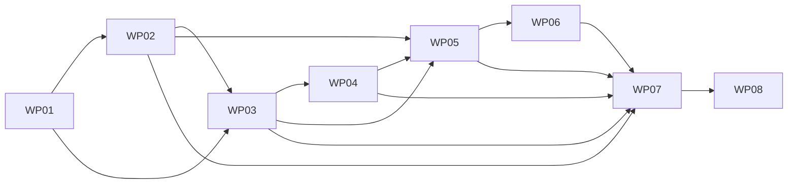

# Release 1.15 Execution Plan — WP01–WP08

## Status and controls
Planning-only execution map. The merged Release 1.15 architecture governance is controlling. This document authorizes creating and reviewing planning artifacts and issues, **not** application mutation, live provider calls, Azure deployment, image promotion or automatic acceptance of later WPs. Engineering may proceed under separately scoped implementation authority without a licensing-review milestone.

## Dependency graph

## Work packages and exit criteria
| WP | Issue | Dependencies | Exit evidence |
| --- | --- | --- | --- |
| WP01 — Baseline, architecture contract and feasibility | #367 | None | Repository baseline, contract/acceptance matrix, separately authorized UI/Docker feasibility spikes |
| WP02 — Docker dual-process runtime and isolation | #368 | WP01 | Linux image, PID1 restart, identity/secret/API isolation, bounded resources |
| WP03 — Ingestion, SQLite and recovery | #369 | WP01, WP02 runtime contracts | Completed OHLCV fixtures, quota fairness, atomicity, corrections, watermark and recovery |
| WP04 — Private indicators and regimes | #370 | WP03 | Independent numerical vectors, warmup/readiness, replay and transition events |
| WP05 — Transformed API and contract | #371 | WP02–WP04 | Cross-language full/unchanged fixtures, validation, HMAC date rollover, no raw leaks |
| WP06 — Streamlit historical chart | #372 | WP05 | Browser viewport/preset/session/reconnect/UTC gap and labeling evidence |
| WP07 — Integration and Linux/F1 qualification | #373 | WP02–WP06 | Image digest, security and browser evidence, resource measurements, deployment readiness assessment |
| WP08 — Acceptance, runbook and handoff | #374 | WP07 | Acceptance ledger, operations/recovery runbook, owner disposition; deployment remains separate |

## Sequencing rules
1. Before each WP, verify current `main`, merged governance, accepted predecessors, existing paths, tests and branch state. No assumptions from Release 1.14 file ownership.
2. Create a separate narrowly scoped implementation PR with literal file mutation paths and run-only regression paths. A directory name in the file manifest is **not** a wildcard write grant.
3. WP01 feasibility checks should first validate Plotly/Streamlit absolute-UTC viewport retention under reruns and refresh, and combined Linux process memory/startup on representative F1-like limits. Results are evidence, not a reason to silently change architecture.
4. WP03 ingestion tests use deterministic offline provider fixtures; live capability measurements require configured credentials and explicit operational authority. No live provider in CI.
5. WP04 numerical correctness precedes WP05 presentation transformations; private calculations always use real private observations.
6. WP05 freezes schema and negative fixture handling before WP06 UI acceptance; reject mixed snapshot identities and partial data.
7. WP07 records real measurements, failed cases and limitations. Local F1-like tests do not prove Azure F1 capacity. Azure activation is a separate decision.
8. Shared source files must have one active owner/PR at a time. Re-run downstream regressions whenever contracts change. Never invent acceptance evidence.
9. Every Codex prompt and change requires UTF-8 LF for all changed text, independent CRLF verification and `git diff --check`. Avoid unrelated mass normalization.

## Common stop conditions
Stop for missing predecessor evidence, unauthorized paths, schema incompatibility, secrets exposed to the public identity, external ingress to private API, invalid market candles, mixed generation/version/date, unverifiable recovery lineage, unexpected paid dependencies, or failure to satisfy resource/security limits. Escalate decisions in the owning WP rather than creating silent gates or fallback behavior.

## Milestone lifecycle
Each issue records plan → scoped implementation PR → deterministic tests → evidence → owner acceptance. GitHub PR merge, provider activation, image promotion, Azure deployment and release closure remain distinct lifecycle decisions.
