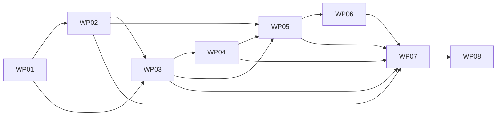

# Release 1.15 Execution Plan — WP01–WP08

## Status and controls
Planning-only execution map. The merged Release 1.15 architecture governance is controlling. This document authorizes creating and reviewing planning artifacts and issues, **not** application mutation, live provider calls, Azure deployment, image promotion or automatic acceptance of later WPs. Engineering may proceed under separately scoped implementation authority without a licensing-review milestone.

## Dependency graph

## Work packages and exit criteria
| WP | Issue | Dependencies | Exit evidence |
| --- | --- | --- | --- |
| WP01 — Baseline, architecture contract and feasibility | #367 | None | Repository baseline, contract/acceptance matrix, separately authorized UI/Docker feasibility spikes |
| WP02 — Docker dual-process runtime and isolation | #368 | WP01 | Linux image, PID1 restart, identity/secret/API isolation, bounded resources |
| WP03 — Ingestion, SQLite and recovery | #369 | WP01, WP02 runtime contracts | Completed OHLCV fixtures, quota fairness, atomicity, corrections, watermark and recovery |
| WP04 — Private indicators and regimes | #370 | WP03 | Independent numerical vectors, warmup/readiness, replay and transition events |
| WP05 — Transformed API and contract | #371 | WP02–WP04 | Cross-language full/unchanged fixtures, validation, HMAC date rollover, no raw leaks |
| WP06 — Streamlit historical chart | #372 | WP05 | Browser viewport/preset/session/reconnect/UTC gap and labeling evidence |
| WP07 — Integration and Linux/F1 qualification | #373 | WP02–WP06 | Image digest, security and browser evidence, resource measurements, deployment readiness assessment |
| WP08 — Acceptance, runbook and handoff | #374 | WP07 | Acceptance ledger, operations/recovery runbook, owner disposition; deployment remains separate |

## Sequencing rules
1. Before each WP, verify current `main`, merged governance, accepted predecessors, existing paths, tests and branch state. No assumptions from Release 1.14 file ownership.
2. Create a separate narrowly scoped implementation PR with literal file mutation paths and run-only regression paths. A directory name in the file manifest is **not** a wildcard write grant.
3. WP01 feasibility checks should first validate Plotly/Streamlit absolute-UTC viewport retention under reruns and refresh, and combined Linux process memory/startup on representative F1-like limits. Results are evidence, not a reason to silently change architecture.
4. WP03 ingestion tests use deterministic offline provider fixtures; live capability measurements require configured credentials and explicit operational authority. No live provider in CI.
5. WP04 numerical correctness precedes WP05 presentation transformations; private calculations always use real private observations.
6. WP05 freezes schema and negative fixture handling before WP06 UI acceptance; reject mixed snapshot identities and partial data.
7. WP07 records real measurements, failed cases and limitations. Local F1-like tests do not prove Azure F1 capacity. Azure activation is a separate decision.
8. Shared source files must have one active owner/PR at a time. Re-run downstream regressions whenever contracts change. Never invent acceptance evidence.
9. Every Codex prompt and change requires UTF-8 LF for all changed text, independent CRLF verification and `git diff --check`. Avoid unrelated mass normalization.

## Common stop conditions
Stop for missing predecessor evidence, unauthorized paths, schema incompatibility, secrets exposed to the public identity, external ingress to private API, invalid market candles, mixed generation/version/date, unverifiable recovery lineage, unexpected paid dependencies, or failure to satisfy resource/security limits. Escalate decisions in the owning WP rather than creating silent gates or fallback behavior.

## Milestone lifecycle
Each issue records plan → scoped implementation PR → deterministic tests → evidence → owner acceptance. GitHub PR merge, provider activation, image promotion, Azure deployment and release closure remain distinct lifecycle decisions.

## Release 1.15 dual-container execution-plan amendment — 2026-10-23

The owner selected two Linux Docker images and two Azure Linux F1 Web Apps **per environment** after the empty research shells were created (pending infrastructure evidence PR #381). This supersedes the earlier WP02 “Docker dual-process runtime” wording, single-image launch/supervisor assumption and local-only WP05 transport assumption in this plan. Dependency order WP01–WP08 remains intact; WP02 #368 now owns **two single-process images, per-container least privilege/lifecycle, environment separation and F1-compatible service-to-service security design**. No C PID1 supervisor, host Bash multiprocess supervisor, role-child restart protocol or same-container role-UID census is required.

WP03 #369 owns single-writer SQLite/recovery across any research-app replacement overlap; WP04 #370 research calculations unchanged; WP05 #371 authenticated HTTPS research snapshot client/server transport under the unchanged bounded D4 schema; WP06 #372 UI/viewport unchanged apart from transport; WP07 #373 qualifies two compatible digests, two concurrently running apps per F1 plan, per-environment actual Azure access control, denial cases, cold starts and resource pressure; WP08 #374 documents pairing/rollback of both images. Existing apps and infrastructure remain unchanged until separately authorized deployment.

**Security boundary:** A research Web App DNS name does not mean it has private ingress. External unauthorized requests to research endpoints must be rejected; no raw candles/keys/storage or admin operations in public API; HTTPS service authentication is required. Do not assume free-plan private endpoints, VNet features or dedicated compute. Fail closed on unsupported F1 security rather than invent paid resources or anonymously expose the research service.

**Qualification and gates:** The exact paired image digests, cross-app conformance and per-site browser tests replace one-image qualification. Existing source/contract/fixture approvals, G-B0–G-B7 and `PUBLIC_RUNTIME_VERIFIED=False` remain. No new licensing prerequisite, provider call, deployment, PR merge or WP02 source-path approval follows from this amendment.

## WP38 - local Docker implementation progress

Owner-authorized WP38 continues implementation and local qualification independently of Azure F1 availability. The existing two-container architecture, authenticated TLS snapshot contract, private C# research and Streamlit components remain effective. Local Docker delivery is valid milestone progress; Azure public qualification is not a prerequisite to local implementation. Azure activation and full release acceptance remain separate decisions.

Track evidence in three distinct states: **implemented**, **locally qualified**, **publicly qualified**. WP38 provides a fixture-only end-to-end chart; it does not qualify authentic observations or complete all Release 1.15 acceptance requirements. Azure F1 deployment/stop-request attribution remains **deferred and unresolved**, neither passed nor waived. See [WP38 local runbook](prompters/release-1.15-wp38-local-docker-chart.md). `liveAttemptReady=false`, `AUTHENTIC_DATA_NOT_IMPORTED=True`, `PUBLIC_RUNTIME_VERIFIED=False`.

## WP39 - offline local observation workflow

WP39 connects the existing Twelve Data minute adapter, validated private import and local dual-container chart. Implementation/offline fixture qualification are valid progress; actual provider acquisition, authentic import, local authentic snapshot/browser acceptance and public Azure qualification remain distinct. Current status: **ONE_APPROVED_ACQUISITION_ATTEMPT_FAILED_NO_BUNDLE**. The single approved attempt was consumed and failed exit 1; its HTTP status, request count and credit consumption remain unknown. Offline-only sanitized acquisition diagnostics are implemented for review; no additional provider request is authorized or performed. No authentic rows imported. No new licensing prerequisite was introduced. See [WP39 owner runbook](prompters/release-1.15-wp39-local-authentic-history.md) for the two-request proposal, private runtime channel, commands, test evidence and limitations. `AUTHENTIC_DATA_NOT_IMPORTED=True`; `PUBLIC_RUNTIME_VERIFIED=False`; `liveAttemptReady=false`. Azure deployment remains deferred/unresolved.

## WP40 - fresh offline preparation and approval checkpoint

Merged #427 baseline `c69832585a44c6253063b60d26d48b8ae487db26` was freshly published and packaged using cached inputs only. Status: **AWAITING_NEW_OWNER_PROVIDER_APPROVAL**. All 167 focused fake-only tests passed (84 C#, 22 workflow, 61 chart/client). A fresh compiled Worker negative probe through the Python diagnostic parser reported MISSING_APPROVAL with zero sends/responses. No provider request, Azure operation, authentic bundle/import, chart startup or browser verification occurred. The previous attempt remains consumed; actual credits/availability are unknown. See [WP40 evidence and bounded attempt proposal](prompters/release-1.15-wp40-controlled-acquisition.md). This documentation PR remains open for review; no new licensing gate or Azure dependency is introduced. `AUTHENTIC_DATA_NOT_IMPORTED=True`; `PUBLIC_RUNTIME_VERIFIED=False`; `liveAttemptReady=false`.

## WP41 - controlled verification Phase A

Verified merged #428 at `7c92eb98b8e9fe7d204375cf43c3e11f3f68a5e7`. Fresh offline runtime/images and valid TLS prepared, fresh assembly identity and missing-approval zero-send diagnostic confirmed. All 167 focused tests passed (84 C#, 22 workflow, 61 chart/client). Status **AWAITING_NEW_OWNER_PROVIDER_APPROVAL**; Phases B/C NOT RUN. Zero provider/Azure requests; no authentic bundle/import, session startup or browser acceptance. See [WP41 runbook and exact single-attempt approval checkpoint](prompters/release-1.15-wp41-controlled-verification.md). No new architecture/licensing gate. `AUTHENTIC_DATA_NOT_IMPORTED=True`; `PUBLIC_RUNTIME_VERIFIED=False`; `liveAttemptReady=false`.

### WP41 - separately approved attempt stopped

Following separate explicit owner approval and successful immediate prechecks, exactly one Acquire invocation failed exit 1: response_parse, BTC/USD, HTTP 200, requestsStarted=1, responsesReceived=1, outcomeUnknown=false, INVALID_PROVIDER_PAYLOAD, bundlePublished=false. ETH/USD was not requested. Bundle/receipt/private SQLite/qualification remain absent; no import/start/verify/browser or retry. Actual payload defect and consumed credits are not established. Status **ONE_APPROVED_ATTEMPT_FAILED_NO_BUNDLE**; approval consumed, stop for owner review. PR #429 evidence updated; no source change or Azure operation. `AUTHENTIC_DATA_NOT_IMPORTED=True`; `PUBLIC_RUNTIME_VERIFIED=False`; `liveAttemptReady=false`.

## WP42 - offline parser diagnostic precision

Existing open PR #429 now adds eleven fixed parser boundary codes, atomically updating C# producer/Python allowlist without changing version-1 envelope or acquisition contract. Final fake-only tests: 101 C#, 23 workflow, 61 chart/client (185 passed); actual Worker envelopes validated by Python. See [WP42 diagnosis](prompters/release-1.15-wp42-offline-parser-diagnosis.md). Historical WP41 HTTP 200 generic parser failure and unknown defect/credits are unchanged; no retroactive cause inferred. No provider request, credential/private-response inspection, Azure, image publication or merge. Return for owner review; any future live attempt needs separate approval, not requested here. `AUTHENTIC_DATA_NOT_IMPORTED=True`; `PUBLIC_RUNTIME_VERIFIED=False`; `liveAttemptReady=false`.

## WP43 - post-merge offline preparation

PR #429 squash-merged as `c4a622839c26e930140ce0b826b7269cd59d80b9` after owner Markdown reconciliation (65 candidates, 58 added, seven represented equivalently, no exclusions; per-file archive inventory tracked). Fresh merged-source cache-only runtime/images and actual unexpired TLS prepared; published hashes match fresh builds, strict Python parser confirms zero-send MISSING_APPROVAL. Regressions: 101 C# + 23 workflow + 61 chart/client = 185 passed. See [WP43 offline evidence](prompters/release-1.15-wp43-offline-preparation.md). Status **OFFLINE_PREPARATION_COMPLETE_NO_LIVE_AUTHORITY**. No provider request/retry, credential read, historical response inspection, Azure or registry publication. Historical WP41 cause/credits remain unknown, no authentic bundle/import. New WP43 PR remains OPEN/UNMERGED. `AUTHENTIC_DATA_NOT_IMPORTED=True`; `PUBLIC_RUNTIME_VERIFIED=False`; `liveAttemptReady=false`.

## WP44 - offline checkpoint before new live approval

Verified #430 merge `4a41bc49396d6a5bbd5db3c1afb373fbcd09e8d8`; fresh cached-only preparation, matching assembly/image identity, protected ACL and actual valid TLS checked. All 185 tests passed (101 C#, 23 workflow, 61 chart/client); fresh Worker/Python MISSING_APPROVAL probe confirmed zero sends. Status **AWAITING_NEW_OWNER_PROVIDER_APPROVAL**. No provider requests, credential reads, Azure or publication; bundle/receipt/SQLite/qualification absent, import/chart/browser NOT RUN. See [WP44 evidence and exact single-invocation checkpoint](prompters/release-1.15-wp44-controlled-acquisition.md). Historical WP41 cause/credits remain unknown; prospective WP42 codes unchanged. New PR remains OPEN/UNMERGED. `AUTHENTIC_DATA_NOT_IMPORTED=True`; `PUBLIC_RUNTIME_VERIFIED=False`; `liveAttemptReady=false`.

### WP44 - one approved acquisition failed, stopped

After separate explicit owner approval and successful immediate identity/ownership/TLS/destination checks, exactly one Acquire invocation exited 1: BTC/USD HTTP 200, response_parse, INVALID_PROVIDER_METADATA, sends/responses 1/1, outcomeUnknown=false, bundlePublished=false. ETH/USD not requested. No bundle/receipt/SQLite/qualification; import/start/verify/browser NOT RUN, no retry. Specific metadata defect and credit usage remain unknown; this does not explain historical WP41. Status **ONE_APPROVED_ATTEMPT_FAILED_NO_BUNDLE**, approval consumed. PR #431 stays OPEN/UNMERGED for owner review; no Azure/publication. `AUTHENTIC_DATA_NOT_IMPORTED=True`; `PUBLIC_RUNTIME_VERIFIED=False`; `liveAttemptReady=false`.
